# DirecSun Flight Firmware: Technical Design and Implementation Plan

**Status:** Design for implementation. No firmware has been written, built, flashed, or run. No hardware has been measured.
**Parent document:** *DirecSun Technical Design* (referred to below as **TD**). Section numbers such as "TD §6.5" point into that document.
**Related artifact:** the browser frontend in `direcsun/` (landing page and ground station), described in §17.
**Audience:** firmware and software engineers, software architects, agentic architects, and AI agents that will write, review, or change the firmware.

---

## 0. How to use this document

- **Humans** should read §1–§4 for orientation, then the section for the module they own. The diagrams are meant to be read on their own.
- **AI agents** should treat §2 (conventions), §15 (message schema), §13 (mode machine), §14 (interlocks), and §21 (agent rules) as binding contracts. Before changing any number, check §23 (validation log) for whether it has already been disputed.
- Every statement that a reader might act on carries a label (§2.1). An unlabelled sentence is explanation, not a fact to rely on.
- Where this document and TD disagree, §23 records the disagreement, the reasoning, and the resolution chosen here. If a later TD revision resolves it differently, TD wins and this document has a bug.

---

## 1. Purpose, scope, and non-goals

### 1.1 Purpose

Specify the firmware for the Seeed XIAO ESP32-S3 on the DirecSun box. It must:

1. read the inertial, magnetic, optical, wheel-speed, and battery sensors;
2. estimate box heading and rate;
3. run the four-loop control cascade and drive the ESC over DShot;
4. implement the seven operating modes and every safety interlock;
5. serve telemetry and accept commands over a WebSocket on the private Wi-Fi network.

It also gives an ordered implementation plan, a test strategy, and the gates that must pass before the wheel is spun.

### 1.2 Scope

In scope: everything that runs on the XIAO ESP32-S3; the wire protocol it speaks; build and test tooling for that code; the integration contract with the existing browser frontend.

### 1.3 Non-goals

- Multi-axis control, orbit dynamics, flight qualification (TD §1).
- ESC firmware changes. Flashing Bluejay for bidirectional DShot is an open option (TD §12.3), not part of this plan.
- The ground-station page itself, except where its behaviour constrains the firmware (§15, §17).
- Over-the-air firmware update. Firmware is flashed over USB-C (TD §5.5).

---

## 2. Conventions

### 2.1 Claim labels

This document reuses the TD labels and adds one.

| Label | Meaning | What a reader should do |
| --- | --- | --- |
| **[V]** | Verified in TD against an opened source (TD marks it [V]) | Trust it; re-check if the part changes |
| **[C]** | Calculated here or in TD from stated inputs; the arithmetic is shown or reproducible | Re-run if an input changes |
| **[A]** | Assumed, typical, or drawn from the author's knowledge of a library or API that was **not** checked against its documentation while writing this document | Confirm before relying on it; most become build checks |
| **[M]** | Must be measured on the hardware | Measure, record in TD §12.2 |
| **[D]** | Design decision made in this document | Change only with a reason recorded in §23 |

**Important limitation.** While this document was written, no datasheet, library header, or source page was opened. Every hardware fact labelled [V] here inherits its [V] from TD. Every ESP-IDF or Arduino API fact is labelled [A] and is checked by the build or a bench test listed in §19.

### 2.2 Units and representation

| Quantity | Internal unit (firmware) | Wire unit (JSON) |
| --- | --- | --- |
| Angle | radians, `float` | degrees |
| Angular rate | rad/s | deg/s (`*_dps`) |
| Wheel speed | rpm, `float` | rpm |
| Torque | N·m | mN·m (`*_mNm`) |
| Voltage | V | V |
| Time | microseconds since boot, `int64_t` (`esp_timer_get_time()`) [A] | milliseconds since boot (`t_ms`) |

All control arithmetic uses `float` (the ESP32-S3 has a single-precision FPU) [A]. Accumulated quantities that grow without bound (heading integral, time) use `double` or are wrapped, see §11.3.

### 2.3 Sign and frame conventions (binding)

Taken from TD §4.1 and TD §6.5. They are restated because a sign error makes the rate loop unstable (TD §12.4, R-1).

| Symbol | Definition |
| --- | --- |
| +z | Up the spin axis |
| +X | The sun-sensor face of the box |
| ψ (psi) | Box heading. **Positive counter-clockwise seen from above** |
| ω (omega_b) | Box rate about +z, positive counter-clockwise |
| τ_cmd | Torque wanted **on the box**, positive counter-clockwise |
| Ω | Wheel speed in its **forward** direction. Always positive, between the low limit and the cap. Every limit and interlock applies to Ω |
| s_w | ±1, the sign of the wheel's spin about +z when running forward. Fixed by motor wiring; found in T-5 |

> **Integration warning:** the current browser frontend treats positive heading as clockwise ("rotate right"). See §17.2 and finding V-17. The firmware convention above is authoritative; the frontend must convert.

### 2.4 Naming

- Modes on the wire: `SAFE`, `SPINUP`, `READY`, `DETUMBLE`, `HOLD`, `SLEW`, `SUN_POINT` [D]. TD's schema examples use `"HOLD"` and `"SLEW"`; the other spellings are fixed here.
- Interlock names on the wire: upper snake case, listed in §14.1 [D].
- C++ namespaces follow the module names in §18.

---

## 3. Sources and precedence

1. Measurements recorded in TD §12.2 (none exist yet).
2. TD, including `cad/stack.py` and `docs/sizing.py`, which TD says win over TD's prose.
3. This document.
4. The frontend implementation in `direcsun/` (it must follow 1–3 for anything about the device).

---

## 4. System context

### 4.1 Context diagram

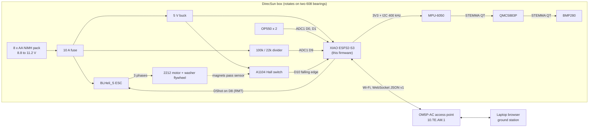

### 4.2 External interfaces of the firmware

| Interface | Peer | Direction | Defined in |
| --- | --- | --- | --- |
| I2C bus, 400 kHz | MPU-6050 0x68, QMC5883P 0x2C, BMP280 0x77 | read/write | TD §5.3 [V]; §10 |
| ADC1 ch0, ch1 (GPIO1, GPIO2) | OP550 A, B | read | TD §5.4 [V] |
| ADC1 ch7 (GPIO8) | Battery divider | read | TD §5.4 [V] |
| GPIO9 interrupt | A1104 | input | TD §5.4 [V] |
| GPIO7 RMT TX | ESC DShot input | output | TD §5.4 [V] |
| Wi-Fi STA, WebSocket server | Ground station(s) | bidirectional | TD §7 [V]; §15 |
| USB-C serial | Developer | log output, flashing | TD §5.5 |
| NVS | Flash | parameter storage | TD §6.1 [D in TD] |

GPIO numbering follows the XIAO pin table in TD §5.4: D0 = GPIO1, D1 = GPIO2, D4 = GPIO5 (SDA), D5 = GPIO6 (SCL), D8 = GPIO7, D9 = GPIO8, D10 = GPIO9 [V]. GPIO1 to GPIO10 are ADC1 channels 0 to 9 [V], so GPIO8 is ADC1 channel 7 [C].

---

## 5. Requirements traced to firmware mechanisms

| ID (TD §2) | Requirement | Firmware mechanism | Verified by |
| --- | --- | --- | --- |
| FR-1 | Reaction wheel is the only actuator | Single DShot output; no other actuator code path | Review |
| FR-2 | Seven modes, mode change within 100 ms | Mode machine (§13) runs every 2 ms tick; command queue drained every tick, so a valid command takes effect within one tick plus network latency | T-13, host test HT-7 |
| FR-3 | 50 Hz telemetry, < 100 ms latency | Snapshot every 10th control tick; comms task sends without blocking control (§7.4) | T-11 |
| FR-4 | Untethered | Battery monitor, Wi-Fi only | Review |
| FR-5 | Safe stop | E-stop command, 1 s heartbeat timeout, undervoltage, plus the full interlock table (§14) | T-13 |
| PR-1 | Detumble 1 rev/s to < 5 deg/s in 5 s | `DETUMBLE` mode, rate loop with ω_cmd = 0 | T-15 |
| PR-2 | 90 deg slew in 3 s, ±3 deg | `SLEW` trapezoid 60 deg/s, 120 deg/s² (about 2.0 s of profile) [C] | T-16 |
| PR-3 | Hold ±2 deg | `HOLD`, attitude + rate loop with integral and anti-windup | T-17 |
| PR-4 | Wheel energy < 6 J at cap, < 6.5 J worst case | Ω_ref clamped to the 4000 rpm cap; overspeed trip at 4100 rpm (5.99 J) [C] | Host test HT-5, T-13 |

The PR-1 requirement needs the gyro range to cover at least 360 deg/s, and TD §10.1 says the box can reach about 4.0 rev/s (1440 deg/s) if the wheel stops from the cap [C]. The gyro is therefore configured for ±2000 deg/s (§10.1, finding V-9).

---

## 6. Hardware interface summary for firmware authors

| Item | Value | Label |
| --- | --- | --- |
| MCU | ESP32-S3, dual core | [V] TD §6.1 |
| Framework | Arduino-ESP32 core 3.x on ESP-IDF 5.x, FreeRTOS tasks | [V] TD §6.1 for the choice; [A] for the IDF version under it |
| I2C | SDA GPIO5, SCL GPIO6, 400 kHz; fallback 100 kHz | [V] TD §5.3–5.4 |
| DShot | DShot300 if ESC MCU is 48 MHz ("H" in its name), DShot150 if 24 MHz ("L") | [V] TD §5.2; [M] read in ESC Configurator |
| DShot frame | 11-bit throttle, 1 telemetry bit, 4-bit CRC; 0 = disarm, 1–47 commands, 48–2047 throttle | [V] TD §6.3 |
| Hall | 2 magnets, both south-out → 2 falling edges per wheel turn | [V] TD §4.6 |
| Battery divider | 22/122 = 0.1803; 11.2 V → 2.02 V; 8.8 V → 1.59 V; 9.6 V → 1.73 V | [C] |
| ADC | 12 dB attenuation, usable to about 2.9 V | [V] TD §5.1 |
| Sensors' supply | 3.3 V from XIAO 3V3 | [V] TD §5.3 |

Derived wheel timing (two Hall edges per turn) [C]:

| Wheel speed | Mechanical | Hall edges/s | Edge period | Motor electrical frequency (7 pole pairs, [A] A-6) | Stored energy |
| --- | --- | --- | --- | --- | --- |
| 800 rpm (low limit, [A] A-8) | 13.3 Hz | 26.7 | 37.5 ms | 93 Hz | 0.23 J |
| 2400 rpm (bias) | 40.0 Hz | 80.0 | 12.5 ms | 280 Hz | 2.05 J |
| 4000 rpm (cap) | 66.7 Hz | 133.3 | 7.5 ms | 467 Hz | 5.70 J |
| 4100 rpm (trip) | 68.3 Hz | 136.7 | 7.3 ms | 478 Hz | 5.99 J |

---

## 7. Software architecture

### 7.1 Principles

1. **One authority per fact.** The control task owns all state. Every other context gets copies.
2. **Control never waits on the network.** Communication between cores uses lock-free or very short critical sections; nothing on the control path blocks on Wi-Fi, TCP, JSON, or flash.
3. **Pure core, thin drivers.** Estimation, control, mode logic, interlocks, DShot encoding, and message parsing are pure functions or plain classes with no hardware calls, so they compile and run on a desktop (§19.1).
4. **Fail to zero throttle.** Every fault path ends in DShot 0 (TD §6), either immediately or after the e-stop ramp (§14.3).
5. **The box is the authority on mode** (TD §7.3). The ground never assumes a command succeeded.

### 7.2 Tasks and cores

| Context | Core | Priority (FreeRTOS) | Period | Work | Label |
| --- | --- | --- | --- | --- | --- |
| `control` task | 1 | Highest application priority (e.g. `configMAX_PRIORITIES − 2`) | 2 ms (500 Hz) | Sensor reads, estimator, mode machine, controllers, interlocks, DShot frame, telemetry snapshot | [D]; rate [V] TD §6.2 |
| Tick source | n/a | ISR | 2 ms | `gptimer` alarm ISR gives a task notification to `control` | [D]; API [A] |
| Hall ISR | any (registered from core 1) | ISR, IRAM | per edge | Store `esp_timer_get_time()` in a ring buffer | [D]; API [A] |
| `comms` task | 0 | Above `loop()`, below Wi-Fi driver | event-driven + 50 Hz | WebSocket server, JSON encode/decode, ping/pong, client management | [D] |
| Wi-Fi/lwIP | 0 | System | n/a | Provided by ESP-IDF | [A] default core 0 |
| Arduino `loop()` | 1 | 1 | idle | Empty except a `vTaskDelay`; or deleted | [D] |
| Task watchdog | system | n/a | 100 ms | Resets the MCU if `control` stops feeding it | [V] TD §6.2 for the 100 ms |

Why a hardware timer instead of `vTaskDelayUntil(2)`: Arduino-ESP32 runs FreeRTOS at a 1 kHz tick [A], so `vTaskDelayUntil` could produce a 2 ms period, but its jitter is a full tick. A `gptimer` alarm gives sub-tick jitter [A]. Either works; the timer is the default and `vTaskDelayUntil` is the fallback if the timer API does not build (build check BC-3, §19.3).

### 7.3 Module and data-flow diagram

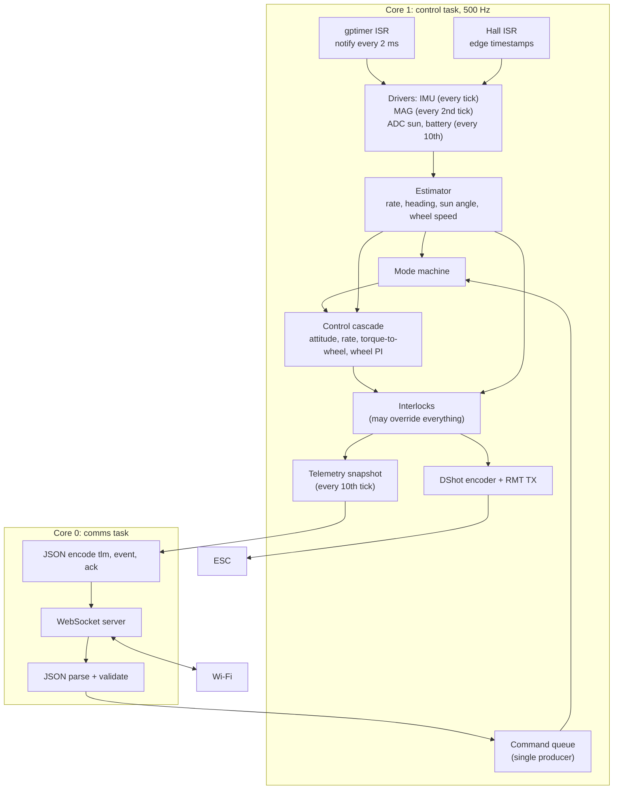

### 7.4 Shared state and concurrency

| Channel | Producer → consumer | Mechanism | Rule |
| --- | --- | --- | --- |
| Commands | comms → control | FreeRTOS queue, depth 16, items are a fixed-size `Command` struct; `xQueueSend` with timeout 0 from comms, `xQueueReceive` with timeout 0 in control | Full queue: comms answers `ack ok:false reason:"busy"`. `estop` bypasses the queue through an atomic flag (below) |
| E-stop | comms → control | `std::atomic<bool> estop_requested` | Set by comms on any `estop`; read and cleared by control on the next tick |
| Heartbeat | comms → control | `std::atomic<int64_t> last_heartbeat_us` | Written on every accepted `ping` or `cmd` from the controlling client |
| Telemetry snapshot | control → comms | Double buffer + sequence counter (seqlock) | Control writes the inactive buffer, then flips an atomic index. Comms copies the active buffer and retries if the counter changed during the copy. Control never waits |
| Events and acks | control → comms | FreeRTOS queue, depth 16 | Control posts with timeout 0; if full, the event is dropped and a `dropped_events` counter in telemetry increments |
| Hall edges | ISR → control | Ring buffer of 8 `int64_t` timestamps + atomic write index | ISR writes only; control reads only |

TD §6.2 specifies "a snapshot struct copied under a spinlock". The seqlock above gives the same consistency without control ever spinning on a lock held by core 0 [D, finding V-12]. A `portMUX` spinlock around a ~200-byte `memcpy` is an acceptable simpler alternative, since the copy takes microseconds [A].

---

## 8. Boot and initialization

### 8.1 Sequence

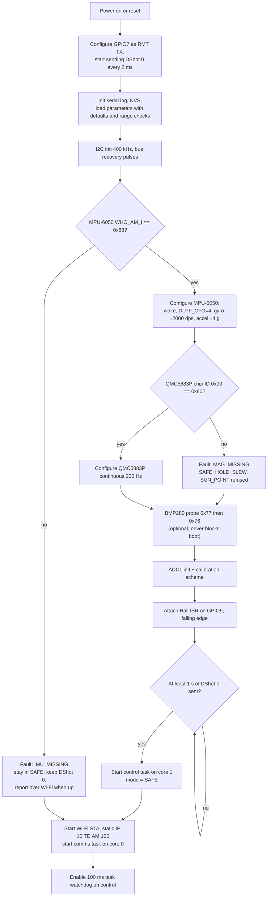

### 8.2 Notes and rationale

- **DShot 0 starts first.** The ESC arms only after seeing zero throttle [V] TD §5.2, and TD §6.3 asks for about 1 s of zeros [A] A-22. Sending zeros from the first milliseconds also means that a reset caused by the watchdog stops drive quickly. The ESC itself switches drive off about 0.3 s after pulses stop [V] TD §5.2, so the reset gap is bounded either way.
- **Boot does not wait for Wi-Fi.** The box is safe in `SAFE` without a ground connection; heartbeat rules only apply in active modes (§14.1).
- **Missing magnetometer** is not fatal: `DETUMBLE` needs only the gyro. Modes that need heading (`HOLD`, `SLEW`, `SUN_POINT`) are refused with a reason [D].
- **Gyro bias.** Bias is estimated continuously while the box is in `SAFE` **and** still (§11.1). It is not taken once at boot, because the box may be moving after a watchdog reset [D, finding V-10].

---

## 9. The control tick

### 9.1 Per-tick flow (every 2 ms)

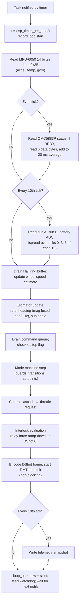

### 9.2 Timing budget (target, to be measured as `loop_us`)

| Step | Estimate | Label |
| --- | --- | --- |
| IMU burst read, 14 bytes at 400 kHz | 0.39 ms (155 bit times) | [C] |
| Magnetometer status + 6 bytes (every 2nd tick) | about 0.25 ms | [C] |
| One ADC read with calibration (at most one per tick) | tens of µs | [A] |
| Estimator + controllers + interlocks (float) | < 50 µs | [A] |
| DShot encode + RMT start | < 20 µs; the 53 µs DShot300 frame is sent by hardware | [A]; frame [V] |
| JSON is **not** on this core | 0 | [D] |
| **Worst tick** | **about 0.75 ms of 2 ms** | [C on A] |

At 100 kHz I2C the IMU read alone is 1.55 ms [C], and an IMU + magnetometer tick would exceed 2 ms, which is why TD §5.3 runs the bus at 400 kHz. Every tick reads the IMU, so there is no tick free for the magnetometer at 100 kHz. If the oscilloscope check in TD §5.3 forces 100 kHz, the control rate falls to 250 Hz (4 ms ticks: IMU 1.55 ms, plus magnetometer status and data on alternate ticks, about 0.8 ms), and the gains in §12.2 are rechecked for the longer step [D, finding V-6].

`loop_us` above 1500 for more than 10 consecutive ticks raises a `LOOP_OVERRUN` warning flag. A tick that is still running when the next notification arrives counts as a missed tick; 25 consecutive missed ticks (50 ms) trip `CONTROL_STALL` before the watchdog fires [D].

---

## 10. Drivers

### 10.1 MPU-6050 (I2C 0x68)

| Register | Address | Value | Why | Label |
| --- | --- | --- | --- | --- |
| PWR_MGMT_1 | 0x6B | 0x01 (wake, PLL with X gyro clock) | Leaves sleep; gyro clock is more stable than the internal oscillator | [A] register map; TD cites the map as [V] |
| SMPLRT_DIV | 0x19 | 0 | 1 kHz output with DLPF enabled | [A] |
| CONFIG | 0x1A | DLPF_CFG = 4 | 20 Hz gyro / 21 Hz accel bandwidth, 8.3 ms gyro delay | [V] TD §6.4 |
| GYRO_CONFIG | 0x1B | FS_SEL = 3 (±2000 deg/s, 16.4 LSB per deg/s) | Box can reach about 1440 deg/s after a stop from the cap | [C] range need; [A] scale |
| ACCEL_CONFIG | 0x1C | AFS_SEL = 1 (±4 g, 8192 LSB/g) | Headroom for imbalance vibration (T-7 target 0.05 g RMS) without clipping on taps | [D]; [A] scale |
| Data | 0x3B..0x48 | 14-byte burst: accel XYZ, temperature, gyro XYZ, big-endian | One transaction per tick | [A] |
| WHO_AM_I | 0x75 | expect 0x68 | Boot check (TD §6.6) | [A] value; TD names the check |

Error handling: an I2C error or a timeout of more than 1 ms marks the sample invalid. 25 consecutive invalid samples (50 ms) trip `IMU_SILENT` [V] TD §6.7 threshold. After three consecutive errors the driver runs bus recovery (nine SCL clock pulses, then STOP) once [A] standard I2C practice.

Axis mapping: the board sits face up, centred on the spin axis (TD §4.8), so sensor +Z is taken as box +z [A]. T-8 confirms by rotating the box counter-clockwise by hand and checking that ω reads positive [M].

### 10.2 QMC5883P (I2C 0x2C)

| Item | Value | Label |
| --- | --- | --- |
| Chip ID | register 0x00 reads 0x80 | [V] TD §5.3 |
| Data | 0x01..0x06, X/Y/Z | [V] TD §5.3; byte order [A], confirm in the QST datasheet |
| Status | 0x09, data-ready bit | [V] register; bit position [A] |
| Control | 0x0A, 0x0B: continuous mode, output data rate 200 Hz, oversampling and range | [V] registers; **bit values [A]: read them from the QST datasheet before writing the driver** |

Sampling plan (revised from TD, finding V-5): the control loop runs at 500 Hz and the magnetometer at 200 Hz, so 200 Hz is not an integer divisor of the tick rate. The driver polls the status register every 2nd tick (250 Hz). It reads data only when data-ready is set, which yields every new 200 Hz sample once, and averages all new samples in each 20 ms window into one 50 Hz heading measurement [D].

Mounting: the board hangs upside down under the flipped top deck (TD §4.8). Turning a board over is a 180° rotation about a horizontal axis, which flips **Z and one horizontal axis**, not Z alone (finding V-4). Heading uses only the horizontal components, so the horizontal flip matters and the Z flip does not. The driver applies a configurable axis map `mag_axis_map` (default: negate Y and Z, keep X), and T-9 confirms it: rotating the box counter-clockwise must make magnetic heading increase in the same direction as the integrated gyro [M].

### 10.3 BMP280 (I2C 0x77, optional)

Probed at boot at 0x77, then 0x76 [V] TD §5.3. It is read at 1 Hz on a spare tick if present, and reported in telemetry as `t_c` and `p_pa` (§15.3). It never affects control, modes, or boot [V] TD §5.3. If absent, the fields are `null`.

### 10.4 A1104 Hall sensor and wheel speed

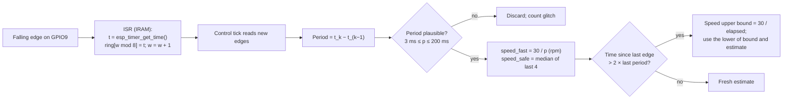

| Item | Value | Label |
| --- | --- | --- |
| Edges per turn | 2 | [V] TD §4.6 |
| Speed from period p (seconds) | Ω = 60 / (2p) = 30 / p rpm | [C] |
| Plausibility window | 3 ms (10,000 rpm) to 200 ms (150 rpm) | [D] |
| Control estimate `speed_fast` | Latest single period | [D], finding V-7 |
| Interlock estimate `speed_safe` | Median of the last 4 periods | [V] TD §6.4 |
| Staleness rule | If no edge for more than 2 × the last period, the true speed is below 30 / elapsed, so the estimate is replaced by that bound | [C] |
| Pull-up | 12 kΩ to 3.3 V, external | [V] TD §5.3; internal pull-up also enabled [D] |

**Why two estimates (finding V-7).** The median of 4 periods spans 50 ms at bias and delays the estimate by roughly 25 ms [C]. In a speed loop aimed at 5 Hz, a 25 ms delay costs about 45° of phase [C], too much for a margin-limited loop. The control loop therefore uses the latest period, and the interlocks use the median, which rejects single bad edges.

### 10.5 ADC: sun sensors and battery

| Channel | GPIO | Rate | Processing | Label |
| --- | --- | --- | --- | --- |
| Sun A | 1 (ADC1 ch0) | 50 Hz | Calibrated mV, 4-sample average | [V] pin; [D] averaging |
| Sun B | 2 (ADC1 ch1) | 50 Hz | Same | n/a |
| Battery | 8 (ADC1 ch7) | 50 Hz | mV / 0.1803, then a 1 s moving average for the undervoltage interlock | [C] ratio |

Use the ESP-IDF `adc_oneshot` driver with `ADC_ATTEN_DB_12` and the `adc_cali` curve-fitting scheme for mV conversion [A]. Arduino's `analogReadMilliVolts()` wraps the same calibration and is an acceptable shortcut [A]. ADC2 must not be used, because it is unavailable with Wi-Fi on [V] TD §5.4.

### 10.6 DShot output

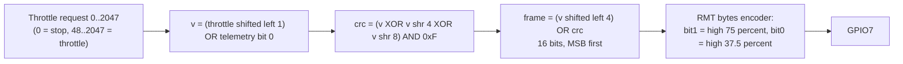

| Item | DShot300 | DShot150 | Label |
| --- | --- | --- | --- |
| Bit period | 3.333 µs | 6.667 µs | [C] |
| Frame (16 bits) | 53.3 µs | 106.7 µs | [C]; DShot300 value [V] TD §6.2 |
| '1' high time (75 %) | 2.50 µs | 5.00 µs | [A] Betaflight convention |
| '0' high time (37.5 %) | 1.25 µs | 2.50 µs | [A] |
| RMT ticks at 40 MHz resolution | bit 133, '1' 100 high + 33 low, '0' 50 high + 83 low | ×2 | [C] |

Implementation choice [D]: use the ESP-IDF 5.x RMT TX channel with the built-in **bytes encoder** (configurable `bit0`/`bit1` symbols, MSB first) on the 2-byte frame [A]. This avoids a custom encoder and avoids depending on DShotRMT building on core 3.x (TD A-18). If the bytes encoder is unavailable, write the 16-symbol encoder TD §6.1 describes.

Test vectors for the host test HT-1 [C, computed]:

| Throttle | Telemetry bit | 12-bit value | CRC | 16-bit frame |
| --- | --- | --- | --- | --- |
| 0 | 0 | 0x000 | 0x0 | `0x0000` |
| 48 | 0 | 0x060 | 0x6 | `0x0606` |
| 1046 | 0 | 0x82C | 0x6 | `0x82C6` |
| 2047 | 0 | 0xFFE | 0xE | `0xFFEE` |

Rules [D]:

- Commands 1–47 (beeps, direction, settings) are **never** sent by flight code. ESC settings, including **Brake on stop = off** (TD §5.2, §10.3), are made in ESC Configurator.
- Throttle values 1–47 from the controller are mapped to 0. The minimum running throttle is the value that holds the low-limit speed, from the T-5/T-18 map.
- One frame per 2 ms tick. That is within BLHeli_S limits [V] TD §6.2. Frames are never skipped, because a gap longer than about 0.3 s stops the motor [V] TD §5.2.

---

## 11. Estimation

### 11.1 Box rate

```
ω̂ = s_gyro · (g_z − b_z)        [rad/s]
```

- `s_gyro` = +1 by default, confirmed in T-8 [M].
- **Bias `b_z`:** updated with a slow exponential average (time constant 5 s) only when all of these hold: mode is `SAFE`, |g_z − b_z| < 2 deg/s, accel magnitude within 0.05 g of 1 g, and the wheel is below 200 rpm or the box is held [D]. The update is frozen otherwise, so a spinning box after an e-stop cannot corrupt the bias (finding V-10).
- **Vibration:** the 20 Hz DLPF passes 25 to 45 % of the 40 Hz bias-speed vibration [V] TD §6.4. A software notch filter is implemented but off by default. When enabled, its centre follows `speed_safe / 60` Hz and it is switched on only if T-7/T-8 show residual vibration in ω̂ [D].

### 11.2 Wheel speed

See §10.4. `Ω̂ = speed_fast` for control, `speed_safe` for interlocks and telemetry.

### 11.3 Heading

Complementary filter (TD §6.4):

```
every tick (Δt = 2 ms):        ψ̂ ← ψ̂ + ω̂ Δt
every 50 Hz magnetometer step:  ψ̂ ← ψ̂ + k · wrap(ψ_mag − ψ̂),   k = Δt_mag / τ = 0.02 s / 2 s = 0.01
```

| Item | Value | Label |
| --- | --- | --- |
| τ | 2 s, tunable in T-9 | [A] TD §6.4 |
| k per 20 ms step | 0.01 | [C] |
| ψ_mag | `atan2` of the calibrated horizontal field, with a sign chosen so that a counter-clockwise turn increases it (axis map, §10.2) | [M] T-9 |
| Calibration | Hard-iron offset (3 values) + soft-iron 2×2 matrix in the horizontal plane, from a 360° rotation; stored in NVS | [A] method; [M] values |
| `wrap()` | maps to (−π, π] | [D] |
| Storage | ψ̂ kept continuous (unwrapped) as `double` for control; wrapped only for display | [D] |
| Reported | `psi_deg` = wrapped ψ̂ in (−180, 180]; `mag_deg` = wrapped ψ_mag | [D] |
| `zero_heading` command | Adds an offset so that ψ̂ reads 0 at the current orientation; offset stored in RAM, not NVS | [D] |

**Aliasing (finding V-5).** TD §6.4 says the motor's magnets rotate at 13 to 67 Hz and that 200 Hz sampling avoids aliasing. The mechanical rotation is 13 to 67 Hz, but a 14-pole rotor and the phase currents produce fields at the electrical frequency, 7 × mechanical = 93 to 467 Hz [C on A-6]. That is above the 100 Hz Nyquist limit of 200 Hz sampling, so components there **can** alias. The firmware still samples at 200 Hz and averages, which attenuates some of it, but the real defences are the 14 cm distance, the QMC5883P's own oversampling filter, the gyro-dominant filter (τ = 2 s), and T-9 at three wheel speeds. If T-9 shows a speed-dependent offset, the fallback is a per-speed heading correction table indexed by Ω̂ [D].

### 11.4 Sun angle

```
d = (A − B) / (A + B)          valid only when A + B > light_threshold
sun_rad = calibration(d)       piecewise-linear table from T-10
```

`sun_valid` is false below the threshold or outside the calibrated range [V] TD §6.4. `SUN_POINT` drops to `READY` after 0.5 s of invalid sun angle [D].

### 11.5 Tilt

Tilt angle = `acos(a_z / |a|)` from the averaged accelerometer (20 ms window). Interlock above 30° [V] TD §6.7. It is evaluated on the averaged vector, so a single vibration spike does not trip it [D].

---

## 12. Control law

### 12.1 Cascade

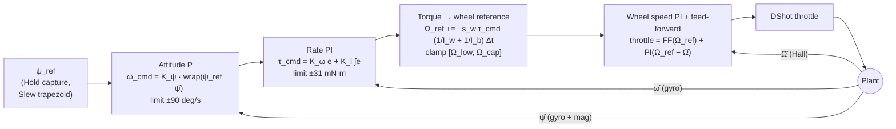

`DETUMBLE` bypasses the attitude block (ω_cmd = 0). `READY` also uses ω_cmd = 0 [V] TD §6.6. `SUN_POINT` replaces `wrap(ψ_ref − ψ̂)` with the calibrated sun angle [V] TD §6.5.

### 12.2 Starting gains and limits

All gains are starting points until G2 (plant measured) [V] TD §6.5. Values recomputed here with the current TD plant (I_b = 1.03e-3 kg·m², I_w = 6.50e-5 kg·m²):

| Parameter | Value | Derivation | Label |
| --- | --- | --- | --- |
| K_ψ | 3.1 s⁻¹ | about 0.49 Hz attitude bandwidth (3.1 / 2π) | [C] TD §6.5 |
| ω_cmd limit | ±90 deg/s | TD §6.5 | [V] TD |
| K_ω | **0.0129 N·m·s/rad** | 2π · 2 Hz · I_b with I_b = 1.03e-3. TD §6.5 states 0.011, which equals 2π · 2 · 8.9e-4, the superseded I_b (finding V-1) | [C] |
| K_i (rate) | start at K_ω · 2π · 0.2 Hz = 0.0163 N·m/rad | Integral corner a decade below the 2 Hz rate bandwidth [D] | [C on D] |
| Integral limit | ±3 mN·m equivalent | Covers the planned friction range 1 to 3 mN·m (TD §3.6) without letting the integral command large torque | [D] |
| τ_cmd limit | ±31 mN·m (3 A × 10.38 mN·m/A) | TD §6.5 | [C] |
| Wheel ref slope at the τ limit | 4842 rpm/s, 9.7 rpm per tick | 0.031 × (1/I_w + 1/I_b) × 60/2π | [C] |
| Ω_low | 800 rpm | until T-18 | [A] A-8 |
| Ω_bias | 2400 rpm | midpoint of low limit and cap | [V] TD §3.4 |
| Ω_cap | 4000 rpm | PR-4 | [V] TD |
| Wheel PI bandwidth | start at **2 Hz**, raise toward 5 Hz only after measuring delay | Hall update 80/s at bias; see V-7 | [D] |
| FF(Ω) | Lookup table, throttle versus steady speed, 8 points from T-5/T-18 | TD §6.5 | [M] |

**Bandwidth separation (finding V-8).** In a cascade, each inner loop should be several times faster than the loop around it. The plan above has attitude 0.5 Hz, rate 2 Hz, and wheel 2–5 Hz, so the rate-to-wheel ratio is only 1 to 2.5. If T-5 shows the wheel loop cannot exceed about 3 Hz, lower the rate bandwidth to about 0.7 Hz (K_ω ≈ 0.0045) and K_ψ in proportion, rather than raising wheel gains past their margin [D].

### 12.3 Saturation and anti-windup

- **Rate integral:** conditional integration. Stop integrating when τ_cmd is saturated or Ω_ref is clamped at a limit in the direction that would need more [D].
- **Ω_ref clamp:** when Ω_ref hits Ω_cap or Ω_low, set the flag `MOMENTUM_SATURATED`, freeze the rate integral, and report through telemetry. The box then cannot be driven further in that direction until desaturation (§13.4).
- **Throttle clamp:** 48..2047 while running; 0 only from the safety layer.

### 12.4 Slew profile

Trapezoid in ψ_ref, limited to 60 deg/s and 120 deg/s² [V] TD §6.5. A 90° slew takes 0.5 s accelerating (15°), 1.0 s at 60 deg/s (60°), and 0.5 s decelerating (15°), 2.0 s in all [C], within PR-2's 3 s. The slew ends (`SLEW` → `READY`, per TD §6.6 "slew complete") when |ψ_ref − ψ̂| < 3° and |ω̂| < 5 deg/s for 0.5 s [D]; a timeout of 6 s ends it with the event `SLEW_TIMEOUT` [D].

`SLEW` targets arrive as absolute `psi_ref_deg` (TD §7.3). The firmware moves ψ_ref along the **shortest** wrapped path to the target [D]. A ground station that wants a specific direction for a 180° move must send an intermediate target.

### 12.5 Sign check before closing the loop

TD R-1 notes that a wrong sign in the torque-to-wheel step makes the rate loop unstable. Before T-15:

1. With the box pinned and `bench_mode` on, step Ω_ref from bias to bias + 300 rpm with the attitude and rate loops disabled (bench command `wheel_step`, §15.3). Confirm the wheel follows. The pin stays in for this step.
2. Unpinned, at reduced K_ω (×0.2), push the box counter-clockwise by hand. Log ω̂ and Ω_ref. Correct behaviour: Ω_ref moves so that the reaction opposes the push, and ω̂ decays. Wrong sign: ω̂ grows; the operator hits e-stop.
3. Record s_w in NVS.

---

## 13. Modes

### 13.1 State machine

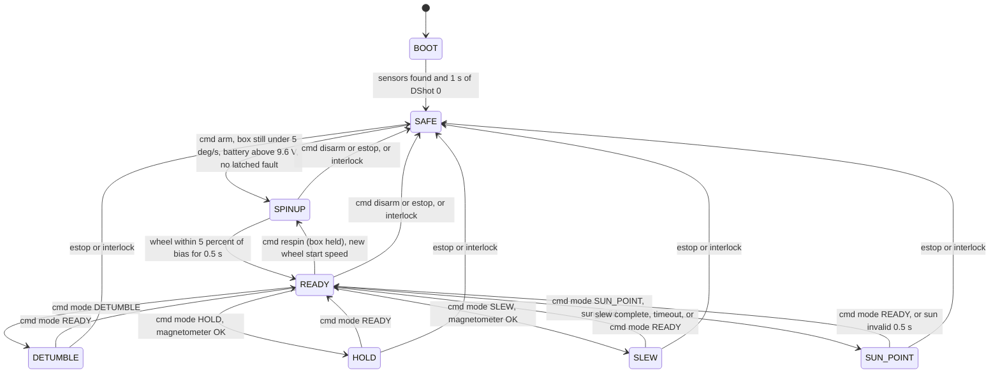

Additions to TD §6.6, each recorded in §23: the `disarm` command (TD lists it in §7.3 but not in §6.6), the 0.5 s dwell before `READY`, magnetometer and sun guards, and the `READY → SPINUP` "respin" transition used for desaturation and alternate wheel start speeds (§13.4).

### 13.2 Per-mode behaviour

| Mode | Wheel | Controller active | Setpoint | Exits |
| --- | --- | --- | --- | --- |
| `SAFE` | Ramp-down (§14.3) then DShot 0; or DShot 0 at once (hard faults) | None | n/a | `arm` |
| `SPINUP` | Ω_ref ramps toward the start speed (default bias) at 400 rpm/s; wheel PI active | Wheel loop only. Rate and attitude off: the box is pinned or held [V] TD §2 | Ω_target | At target → `READY` |
| `READY` | Wheel loop | Rate loop | ω_cmd = 0 | Mode commands |
| `DETUMBLE` | Wheel loop | Rate loop | ω_cmd = 0 | `mode READY` |
| `HOLD` | Wheel loop | Attitude + rate | ψ_ref = ψ̂ at entry | `mode READY` |
| `SLEW` | Wheel loop | Attitude + rate | Trapezoid to `psi_ref_deg` | complete, timeout, `mode READY` |
| `SUN_POINT` | Wheel loop | Sun error + rate | sun angle → 0 | `mode READY`, invalid sun |

`READY` and `DETUMBLE` run the same controller [V] TD §6.6 says `READY` holds box rate at zero. `DETUMBLE` exists as a separate mode so the ground station and the demo script can name it and so its telemetry can be logged distinctly against PR-1 [D].

The firmware cannot sense the lock pin. The `arm` guard therefore requires a still box (|ω̂| < 5 deg/s), and the ground station must ask the operator to confirm the pin is in before it sends `arm` [D, finding V-13].

### 13.3 Spin-up sequence

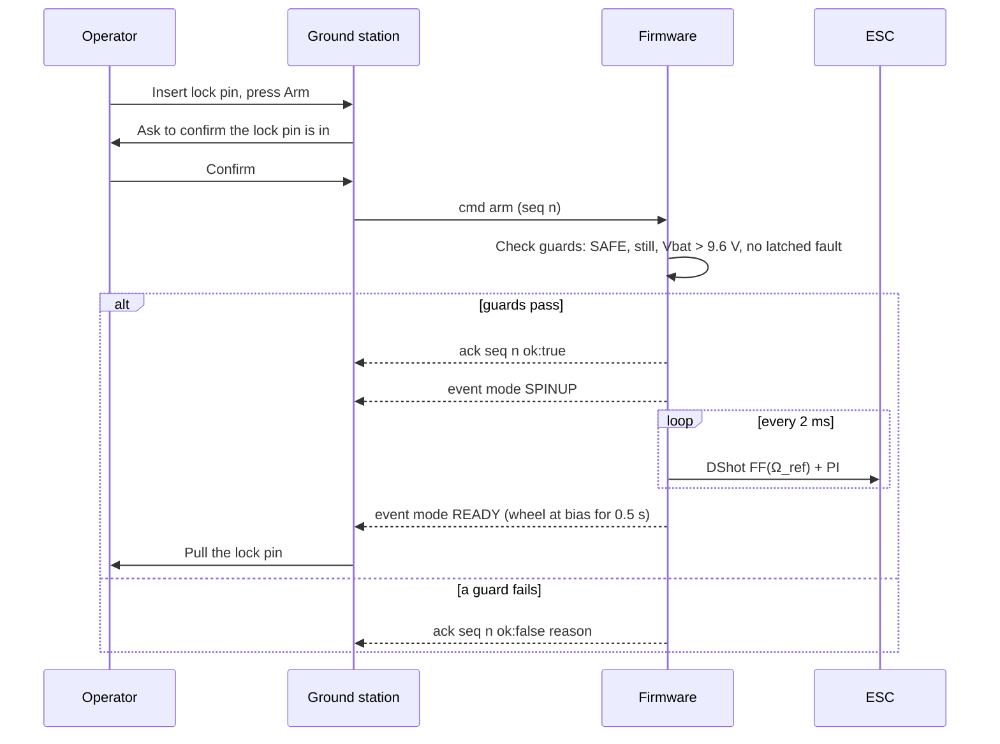

Below about 800 rpm sensorless commutation is assumed unreliable [A] A-8, so spin-up begins with throttle feed-forward only and closes the wheel PI once the Hall speed exceeds Ω_low [D].

### 13.4 Desaturation and wheel start speed

TD §3.6 (the later of the two decisions) makes the lock pin the desaturation actuator: the operator stops and pins the box, the firmware returns the wheel to its start speed, the pin comes out. TD §10.2 still describes an automatic momentum dump where the controller turns the box at about 30 deg/s while friction removes the excess. These conflict (finding V-2). This document follows the newer §3.6 decision and implements desaturation as a `respin`:

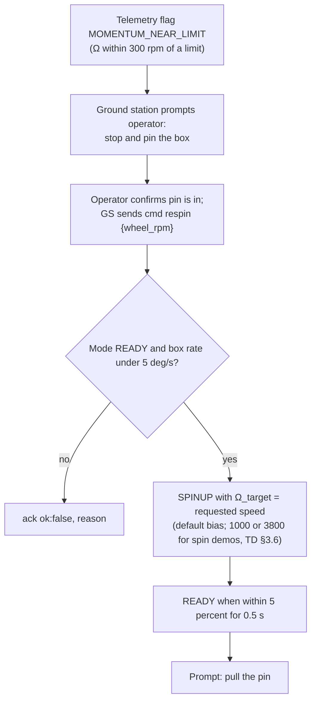

`respin` accepts start speeds within [Ω_low + 200, Ω_cap − 200] rpm [D]. That covers TD's 1000 and 3800 rpm values.

---

## 14. Safety

### 14.1 Interlocks

Every interlock is evaluated every tick, after the controller, so it can override the controller's output [D].

| Name (wire) | Condition | Action | Latch | Source |
| --- | --- | --- | --- | --- |
| `ESTOP` | `estop` command from any client | Ramp-down → SAFE | Until next `arm` | TD §6.7 |
| `HEARTBEAT_LOST` | In any mode except SAFE, no `ping` or `cmd` from the **controlling client** for 1 s | Ramp-down → SAFE | Until next `arm` | TD §6.7 |
| `OVERSPEED` | `speed_safe` > Ω_cap + 100 rpm (4100) | DShot 0 at once → SAFE | Until reset by `arm` after Ω < bias | TD §6.7 |
| `UNDERSPEED` | `speed_safe` < Ω_low for 200 ms, in any mode except SPINUP and SAFE | DShot 0 at once → SAFE | Until next `arm` | TD §6.7 |
| `BATTERY_LOW` | 1 s average below 8.8 V | DShot 0 at once → SAFE | Until arm guard passes | TD §6.7 |
| `IMU_SILENT` | 25 consecutive invalid IMU reads (50 ms) | DShot 0 at once → SAFE | Until a valid read and `arm` | TD §6.7 |
| `TILT` | Averaged accel more than 30° from vertical | DShot 0 at once → SAFE | Until upright and `arm` | TD §6.7 |
| `CONTROL_STALL` | 25 consecutive missed ticks | DShot 0 → SAFE; if the task is fully stuck, the 100 ms watchdog resets the MCU | Reboot | TD §6.7; [D] for the soft stage |
| `HALL_SILENT` | Throttle above the low-limit FF value for 500 ms with no Hall edge | DShot 0 at once → SAFE | Until next `arm` | [D] new, finding V-11 |
| `MOMENTUM_NEAR_LIMIT` | Ω within 300 rpm of a limit | Warning flag only | n/a | TD §6.7 |

**Why `HALL_SILENT` is added.** Without it, a disconnected Hall sensor makes `speed_safe` go stale. The staleness bound in §10.4 then drives the speed estimate toward zero, so `UNDERSPEED` would trip after 200 ms, which is safe. But during `SPINUP`, where `UNDERSPEED` is exempt, the wheel PI would push throttle up without bound while the real wheel accelerates past the cap with no overspeed detection. `HALL_SILENT` closes that gap (finding V-11).

### 14.2 Interlock evaluation flow

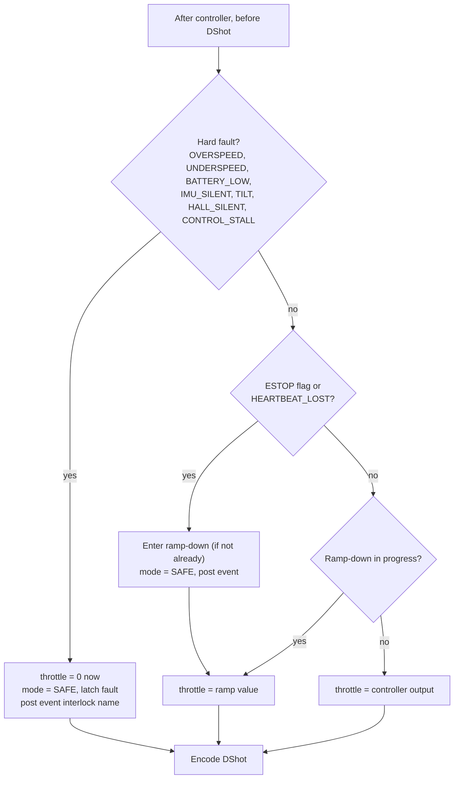

### 14.3 Ramp-down (e-stop and heartbeat loss)

TD §6.7: ramp the wheel to zero over 5 s, then DShot 0, so the box speeds up gently. Starting at the cap, the box accelerates at about 5 rad/s² during the ramp and ends near 4.0 rev/s [C]. The ramp limits the acceleration; it does not limit the final box speed, which momentum conservation fixes [C].

Implementation [D]:

1. Freeze the controllers. Record throttle_0 = current throttle.
2. Each tick, throttle = throttle_0 × (1 − t / 5 s), open loop, mapped to 0 once below 48.
3. At t = 5 s, or as soon as a hard fault occurs, send DShot 0.

The ramp is **open-loop on throttle**, not closed-loop on Ω_ref, because closed-loop control below the 800 rpm sensorless limit is not trusted [A] A-8, and because the safety path should not depend on the Hall sensor.

After DShot 0, BLHeli_S stays in its run loop for about 8 s with damped light, which likely brakes the wheel [A] TD A-17, measured in T-12. The box rate after an e-stop is therefore a T-12 measurement, not something firmware controls.

### 14.4 Controlling client and heartbeat

- The **controlling client** is the WebSocket client whose `arm` was last accepted [D].
- Only the controlling client's `ping` and `cmd` messages reset the heartbeat [D].
- `estop` is accepted from **every** client, in every state, without arming [V] TD §7.3.
- Commands other than `estop` and `ping` from a non-controlling client are refused with `reason:"not controlling client"` while the box is armed [D].
- If the controlling client disconnects, the heartbeat expires 1 s later and the ramp-down starts. No reconnect resumes motion; the operator must arm again [D], consistent with TD §7.3 and with the frontend's read-only, no-auto-reconnect link (§17).

This makes a read-only viewer, such as the current frontend's device link, harmless: it receives telemetry but can never keep an armed box alive (finding V-15).

### 14.5 Watchdog

The ESP-IDF task watchdog is configured for 100 ms on the control task [V] TD §6.2 for the value; API [A]. The control task feeds it at the end of every tick. On expiry, the panic handler resets the MCU [A]. The boot path sends DShot 0 within milliseconds (§8). Between the hang and the new zero frames, the ESC itself stops drive about 0.3 s after the last frame [V] TD §5.2.

---

## 15. Communications

### 15.1 Network

| Item | Value | Label |
| --- | --- | --- |
| Mode | Wi-Fi station on the OM5P-AC network | [V] TD §7.1 |
| Address | Static 10.TE.AM.120, gateway 10.TE.AM.1, /24 | [V] TD §7.1 |
| SSID, password, team number | NVS, set over USB serial; never in source control | [D] |
| Power save | Disabled (`WiFi.setSleep(false)` or `esp_wifi_set_ps(WIFI_PS_NONE)`) to keep latency low | [A] |
| Fallback | SoftAP selected by an NVS flag at boot (default address 192.168.4.1 [A]); never an automatic switch during a session | [D] TD §7.1 names the fallback; automatic switching is rejected because it would change the box address mid-demo |
| Endpoint | `ws://10.TE.AM.120:81/` | [V] TD §7.2 |

### 15.2 WebSocket server

| Item | Choice | Label |
| --- | --- | --- |
| Library | `arduinoWebSockets` (Links2004) `WebSocketsServer` on port 81, polled from the comms task | [A]; build check BC-4 |
| Alternative | ESP-IDF `esp_http_server` with WebSocket support, if enabled in the Arduino core's sdkconfig | [A]; BC-4 |
| Max clients | 3 | [D] |
| Outbound policy | Telemetry is broadcast to all clients. If a client's send would block (buffer full), that frame is skipped for that client and `tlm_dropped` increments. Acks and events are never skipped | [D] |
| Inbound size limit | 512 bytes per message; larger messages are dropped with `ack ok:false reason:"too large"` | [D] |
| JSON | Encode `tlm` with `snprintf` into a fixed buffer (no heap). Parse commands with ArduinoJson 7 into a stack document | [D]; library [A] |

### 15.3 Message schema, version 1

All messages are JSON objects with `v`, `type`, and `seq` [V] TD §7.3. `seq` is the sender's own counter. Times are box milliseconds since boot. Units are those in §2.2.

#### `tlm`: box → all clients, 50 Hz

| Field | Type | Meaning | Source |
| --- | --- | --- | --- |
| `v` | int | 1 | TD |
| `type` | `"tlm"` | n/a | TD |
| `seq` | int | Box telemetry counter | TD |
| `t_ms` | int | Box time since boot | TD |
| `mode` | string | Wire mode name (§2.4) | TD |
| `psi_deg` | number | Wrapped heading (−180, 180], CCW positive | TD; wrap [D] |
| `psi_ref_deg` | number or null | Current reference (null in SAFE, SPINUP, READY, DETUMBLE) | TD; null rule [D] |
| `rate_dps` | number | ω̂ | TD |
| `mag_deg` | number or null | ψ_mag (null if magnetometer missing) | TD |
| `sun_deg` | number or null | Calibrated sun angle | TD |
| `sun_valid` | bool | n/a | TD |
| `wheel_rpm` | number | `speed_safe` | TD |
| `wheel_ref_rpm` | number | Ω_ref | TD |
| `throttle` | int | DShot value sent (0..2047) | TD |
| `tau_cmd_mNm` | number | τ_cmd | TD |
| `vbat` | number | 1 s average battery voltage | TD |
| `loop_us` | int | Longest tick in the last 20 ms | TD; "longest" [D] |
| `flags` | string[] | e.g. `MOMENTUM_OK`, `MOMENTUM_NEAR_LIMIT`, `MOMENTUM_SATURATED`, `LOOP_OVERRUN`, `MAG_MISSING`, latched fault names | TD; list [D] |
| `t_c`, `p_pa` | number or null | BMP280, optional | [D] |
| `tlm_dropped`, `dropped_events` | int | Counters | [D] |

Example (values illustrative, not measurements; `vbat` chosen inside the NiMH range, finding V-3):

```json
{"v":1,"type":"tlm","seq":1042,"t_ms":83120,"mode":"HOLD",
 "psi_deg":47.2,"psi_ref_deg":47.0,"rate_dps":0.3,"mag_deg":46.8,
 "sun_deg":null,"sun_valid":false,"wheel_rpm":2504,"wheel_ref_rpm":2510,
 "throttle":412,"tau_cmd_mNm":0.8,"vbat":10.1,"loop_us":740,
 "flags":["MOMENTUM_OK"],"t_c":null,"p_pa":null,"tlm_dropped":0,"dropped_events":0}
```

At about 250 to 300 bytes per frame and 50 frames/s the stream is about 12.5 to 15 kB/s, about 0.1 Mb/s [C], far below the radio's 4 Mb/s default limit [V] TD §7.

#### `cmd`: client → box

| `cmd` | Fields | Accepted in | Effect |
| --- | --- | --- | --- |
| `arm` | none | SAFE | → SPINUP if guards pass; sender becomes the controlling client |
| `disarm` | none | SPINUP, READY, active modes | Ramp-down → SAFE (same as e-stop, without the ESTOP latch) [D] |
| `estop` | none | Any state, any client | Ramp-down → SAFE, ESTOP latch |
| `mode` | `mode`; `psi_ref_deg` for SLEW | READY (and active modes for `READY`) | Transition per §13.1 |
| `respin` | `wheel_rpm` (optional, default bias) | READY | → SPINUP to the new start speed (§13.4) |
| `zero_heading` | none | SAFE, READY | Heading offset (§11.3) |
| `set_params` | `params` object | SAFE only | Validate every key and range; store in NVS; reply with the applied set [D] |
| `wheel_step` | `delta_rpm` (±500 max) | READY, bench flag set | Ω_ref step with the attitude and rate loops suspended until `mode READY` is sent again; for §12.5, T-5 and T-18 [D]; refused unless `bench_mode` is true. Interlocks stay active |

#### `ack`: box → sender

```json
{"v":1,"type":"ack","seq":77,"ok":false,"reason":"wheel not at bias"}
```

`seq` echoes the command's `seq` [V] TD §7.3. Unknown `v`, unknown `type`, unknown `cmd`, a malformed message, or a failed guard → `ok:false` with a reason [V] TD §7.3.

> **Ambiguity resolved (finding V-14).** TD defines `seq` as "the sender's counter" for every message, but the ack example uses the command's `seq` (77). The firmware therefore puts the **echoed command seq** in `seq` for `ack` messages only. Every other box message uses the box's own counter.

#### `ping` / `pong`

Client sends `{"v":1,"type":"ping","seq":79,"t_client_ms":512330}` at 5 Hz [V] TD §7.3. Box replies `{"v":1,"type":"pong","seq":<box seq>,"ping_seq":79,"t_client_ms":512330,"t_ms":83120}` [D field names], which lets the client compute round-trip time for T-11.

#### `event`: box → all clients

```json
{"v":1,"type":"event","seq":311,"t_ms":83500,"event":"mode","mode":"SAFE","cause":"HEARTBEAT_LOST"}
```

Sent on every mode change and every interlock trip [V] TD §7.3. `cause` is an interlock name, a command name, or `"slew_complete"` [D].

### 15.4 Command handling sequence

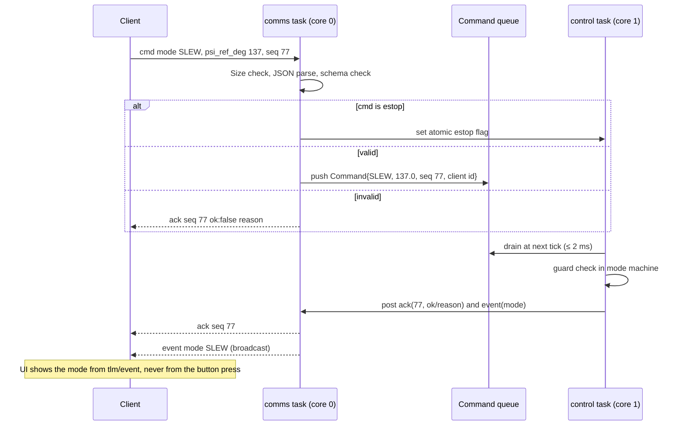

---

## 16. Parameters and persistence

Stored in NVS under namespace `direcsun` with a `param_version` key. On a version mismatch, defaults are loaded and the event `PARAMS_RESET` is posted [D].

| Key | Default | Range | Set by |
| --- | --- | --- | --- |
| `k_psi` | 3.1 | 0..10 | `set_params` |
| `k_omega` | 0.0129 | 0..0.05 | `set_params` |
| `k_i` | 0.0163 | 0..0.1 | `set_params` |
| `wheel_kp`, `wheel_ki` | from T-5 | ≥ 0 | `set_params` |
| `ff_table` | 8 points | monotonic | `set_params` |
| `omega_low_rpm` | 800 | 500..1500 | after T-18 |
| `omega_bias_rpm` | 2400 | low+400 .. cap−400 | after T-18 |
| `omega_cap_rpm` | 4000 | **≤ 4000, cannot be raised over the wire** | firmware rebuild only (TD §10.3: changing the cap requires re-running Section 3) |
| `s_w`, `s_gyro` | +1 | ±1 | after T-5, T-8 |
| `mag_axis_map`, `mag_cal` | see §10.2 | n/a | after T-9 |
| `sun_cal`, `light_threshold` | identity, 0 | n/a | after T-10 |
| `dshot_rate` | 150 | 150 or 300 | after reading the ESC MCU (TD §5.2) |
| `bench_mode` | false | bool | `set_params` in SAFE |
| Wi-Fi SSID, password, team number, SoftAP flag | n/a | n/a | USB serial only |

`dshot_rate` defaults to the slower, always-supported DShot150 until the ESC's MCU is read [D]. TD says DShot150 works on 24 MHz MCUs and DShot300 needs 48 MHz [V].

---

## 17. Integration with the existing browser frontend

Facts about `direcsun/` as currently implemented, read from its source [V: source in this workspace]:

| Frontend fact | Firmware consequence |
| --- | --- |
| The device link is read-only: it opens a WebSocket, parses `type:"tlm"` messages with `v` 1 or absent, requires a numeric `psi_deg`, and never sends | The firmware's `tlm` (§15.3) satisfies it. Because it never sends `ping`, it can never be the controlling client (§14.4) |
| It reads `psi_deg`, `psi_ref_deg`, `rate_dps`, `wheel_rpm`, `vbat`, `mode`, `t_ms`, `seq` | All present in §15.3. `psi_ref_deg` may be `null`; the frontend then treats the target as equal to the heading |
| It does not reconnect automatically | Matches §14.4 |
| Its placeholder URL is `ws://192.168.4.1/ws` | The firmware endpoint is `ws://10.TE.AM.120:81/` (station) or `ws://192.168.4.1:81/` (SoftAP). The placeholder should be changed to match (finding V-16) |
| **It treats positive heading as clockwise** ("rotate right" = +90°), and its 3D view turns the body clockwise for positive values | The firmware sends counter-clockwise-positive `psi_deg` (§2.3). Without a change, the frontend's model would turn opposite to the real box (finding V-17). Fix in the frontend: negate `psi_deg`, `psi_ref_deg`, and `rate_dps` for display when the source is the device, or adopt CCW-positive throughout |
| Its simulated judge sequence (turn 90°, hold 1 s, return) | On hardware this is a ground-orchestrated pair of `SLEW` commands with acks, not a firmware command (TD frontend spec §7.1). Not implemented in the frontend today |

---

## 18. Repository layout and build

### 18.1 Layout

```text
firmware/
  platformio.ini            # or arduino-cli sketch config (see 18.2)
  include/
    config.h                # pins, compile-time limits (cap), loop rate
  src/
    main.cpp                # boot sequence (§8), task creation
    app/
      control_task.cpp/.h   # tick orchestration (§9)
      comms_task.cpp/.h     # Wi-Fi, WebSocket, JSON (§15)
      shared.h              # queues, seqlock snapshot, atomics (§7.4)
    drivers/                # hardware access only
      i2c_bus.cpp/.h        # Wire wrapper, timeouts, bus recovery
      mpu6050.cpp/.h
      qmc5883p.cpp/.h
      bmp280.cpp/.h
      hall.cpp/.h           # ISR + ring buffer
      adc_inputs.cpp/.h
      dshot_rmt.cpp/.h      # RMT channel + bytes encoder
    core/                   # pure logic, no Arduino/IDF includes
      dshot_frame.h         # encode + CRC
      wheel_speed.h         # period → rpm, median, staleness
      estimator.h           # bias, heading filter, sun, tilt
      controllers.h         # P, PI with anti-windup, trapezoid, torque→wheel
      modes.h               # state machine, guards
      interlocks.h          # §14.1 table
      protocol.h            # message structs, parse/validate, tlm encode
      params.h              # defaults, ranges, validation
  test/
    host/                   # doctest or Unity, built with the host compiler
      test_dshot.cpp test_wheel_speed.cpp test_estimator.cpp
      test_controllers.cpp test_modes.cpp test_interlocks.cpp test_protocol.cpp
      plant_sim.h           # two-body plant from TD §3.1 for closed-loop host tests
```

The `core/` directory must not include any Arduino or ESP-IDF header. That rule is what makes host testing possible; check it in CI with a grep [D].

### 18.2 Toolchain

| Option | Notes | Label |
| --- | --- | --- |
| Arduino CLI with the `esp32` core 3.x | Directly supported by Espressif | [A] |
| PlatformIO | The upstream `espressif32` platform has lagged Arduino core 3.x; the community `pioarduino` platform provides it | [A]; BC-1 |

Pick one in the first hour (TD §11.1 frozen interfaces) and record it here.

---

## 19. Verification

### 19.1 Host tests (no hardware, run on every change)

| ID | Module | What it proves |
| --- | --- | --- |
| HT-1 | `dshot_frame` | The four vectors in §10.6; values 1–47 never emitted for controller requests |
| HT-2 | `wheel_speed` | 30/p conversion; plausibility window; median; staleness bound falls with time |
| HT-3 | `estimator` | Bias frozen while moving; complementary filter converges to ψ_mag with τ = 2 s; wrap at ±180 |
| HT-4 | `controllers` | Anti-windup stops integration at saturation; trapezoid gives 2.0 s ± 1 tick for 90° |
| HT-5 | `controllers` + `plant_sim` | Closed loop on the TD §3.1 plant: detumble 1 rev/s within 5 s; 90° slew within 3 s settling to ±3°; Ω_ref never exceeds 4000 rpm |
| HT-6 | `controllers` sign | With s_w = −1 instead of +1, HT-5's detumble diverges, so the test can see a sign error (positive control) |
| HT-7 | `modes` | Every row of §13.1, every refused transition with its reason, FR-2 timing in ticks |
| HT-8 | `interlocks` | Each interlock trips at its threshold and not 1 % below; hard faults zero throttle in the same tick; ramp-down reaches 0 at 5 s |
| HT-9 | `protocol` | Parse every `cmd`; reject oversize, wrong `v`, unknown `type`; `ack` echoes `seq`; `tlm` round-trips through a JSON parser |
| HT-10 | `interlocks` | `HALL_SILENT` trips during SPINUP with throttle high and no edges |

HT-6 follows TD §8.5's rule that an empty result counts only if a known positive is detected by the same instrument.

### 19.2 Bench and integration tests

These map firmware features onto TD §9:

| TD test | Firmware needed |
| --- | --- |
| T-5 ESC arming, DShot, s_w | §8 boot zeros, §10.6, `bench_mode` + `wheel_step` |
| T-6 Hall vs strobe | §10.4, `wheel_rpm` in telemetry |
| T-7 imbalance | Raw accel RMS field: add `accel_rms_g` to `tlm` when `bench_mode` is true [D] |
| T-8 gyro bias and noise | §11.1; raw gyro in bench telemetry |
| T-9 magnetometer | Raw mag fields in bench telemetry; calibration upload via `set_params` |
| T-10 sun sensor | Raw A, B in bench telemetry |
| T-11 telemetry | `seq`, `t_ms`, `pong` |
| T-12 ESC signal loss | Bench command to stop sending frames is **not** provided; unplug the wire as TD describes [D] |
| T-13 interlocks | Every interlock trips with an `event` naming it |
| T-15–T-17 | Modes and controllers |
| T-18 low-speed limit | `wheel_step` downward in bench mode with UNDERSPEED threshold temporarily lowered via `set_params` (bench mode only) |

### 19.3 Build checks (first day, before any feature work)

| ID | Check | Unblocks |
| --- | --- | --- |
| BC-1 | Toolchain builds an empty sketch for the XIAO ESP32-S3 on core 3.x | Everything |
| BC-2 | RMT bytes encoder produces the four §10.6 frames; verify on a logic analyser or oscilloscope at both DShot rates | DShot |
| BC-3 | `gptimer` alarm notifies a task at 500 Hz; log jitter for 10 s | Control timing |
| BC-4 | WebSocket server on port 81 accepts the frontend and a test client; 50 Hz broadcast for 10 min | Comms |
| BC-5 | Task watchdog at 100 ms resets the board when the control task is deliberately blocked | Safety |
| BC-6 | I2C at 400 kHz reads all three Adafruit boards; scope the edges (TD §5.3) | Sensors |

---

## 20. Implementation plan

### 20.1 Order of work

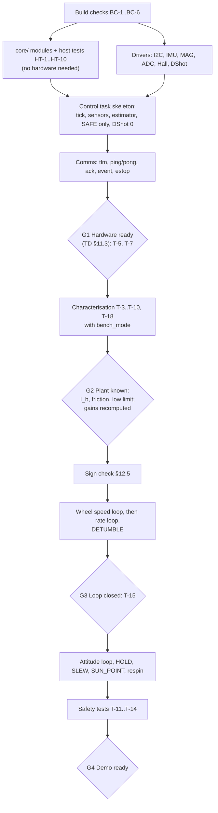

### 20.2 Work items

| ID | Item | Depends on | Done when | Owner (TD §11.5) |
| --- | --- | --- | --- | --- |
| F-1 | Toolchain, BC-1..BC-6 | n/a | All six pass | Julian |
| F-2 | `core/` + host tests | F-1 (compiler only) | HT-1..HT-10 pass | Julian; an agent can draft |
| F-3 | Drivers | F-1, assembled electronics (W-3) | Raw values on serial | Julian |
| F-4 | Control task skeleton, SAFE only | F-2, F-3 | `loop_us` < 1000 for 10 min, DShot 0 verified on scope | Julian |
| F-5 | Comms | F-4 | Frontend shows live telemetry; T-11 passes | Julian; Aaron checks the page |
| F-6 | Bench mode and characterisation support | F-5 | TD §12.2 values recorded | Both |
| F-7 | Wheel loop, rate loop, DETUMBLE | G2 | T-15 | Julian |
| F-8 | Attitude, HOLD, SLEW, SUN_POINT, respin | G3 | T-16, T-17 | Julian |
| F-9 | Interlock verification | F-7 | T-13 | Both |

---

## 21. Rules for AI agents changing this firmware

1. **Never** send DShot commands 1–47 from flight code, and never add a wire command that changes ESC settings.
2. **Never** raise `omega_cap_rpm` above 4000, add a way to raise it over the network, or weaken an interlock threshold, without a TD revision that re-runs TD §3 and PR-4.
3. Keep `core/` free of hardware headers. If logic needs hardware, add a driver interface and inject it.
4. Every new interlock gets a host test that shows it trips, and a test that shows it does not trip 1 % inside the threshold.
5. A passing test suite counts only if HT-6 (the deliberate sign error) still fails as expected. Do not delete or weaken positive controls.
6. Keep claim labels honest. When a number changes, update §23 with the old value, the new value, and why.
7. Do not change the wire schema without bumping `v` and updating §15, §17, and the frontend parser.
8. Do not add automatic reconnection, automatic re-arming, or any path that resumes wheel motion without a fresh `arm` from an operator.
9. Commit only when the owner asks (TD §8.5).

---

## 22. Firmware-specific risks

| Risk | Effect | Mitigation | Label |
| --- | --- | --- | --- |
| Rate-loop sign error | Box accelerates instead of damping | §12.5 sign check at reduced gain; HT-6 | [C] TD R-1 |
| Hall disconnect during SPINUP | Wheel overspeeds undetected | `HALL_SILENT` interlock | [D] V-11 |
| Magnetometer axis map wrong | Heading mirrored; HOLD drifts or runs away | T-9 direction check; HOLD refused until `mag_cal` is set [D] | [M] |
| Wheel loop too slow for the rate loop | Oscillation in DETUMBLE | Start at 2 Hz wheel; lower rate bandwidth if needed (§12.2) | [C] V-8 |
| Wi-Fi task starves core 0 | Telemetry gaps | Control is on core 1 and never waits; telemetry drops are counted | [A] |
| I2C forced to 100 kHz | Tick overrun | §9.2 fallback plan | [C] |
| Arduino core 3.x incompatibility (RMT, WebSocket library) | Delay | BC-2, BC-4 on day one; fallbacks named | [A] |
| NVS corruption or stale params | Wrong gains or signs after reflash | `param_version`, range checks, `PARAMS_RESET` event | [D] |

---

## 23. Adversarial validation log

Each statement below was challenged by recomputing it from TD's inputs, by checking it against another TD section, or by asking what a broken instrument would show. Findings marked **TD** are disagreements with the parent document; findings marked **This doc** are corrections made while drafting this document.

### 23.1 Findings

| # | Statement challenged | Check | Finding | Resolution here | Severity |
| --- | --- | --- | --- | --- | --- |
| V-1 | TD §6.5: K_ω = 2π · 2 Hz · I_b = 0.011 | Recomputed with TD §3.2's I_b = 1.03e-3 | 0.0129. The 0.011 value used the superseded I_b = 8.9e-4 (TD E-3) | Default 0.0129 (§12.2). TD T-3's pass band "within 30 % of 8.9e-4" is also stale; should read 1.03e-3 | Medium (TD) |
| V-2 | TD §10.2: automatic momentum dump at about 30 deg/s | Compared with the later decision in TD §3.6 | Conflicts: §3.6 makes the lock pin the desaturation actuator | `respin` sequence (§13.4); no automatic dump | Medium (TD) |
| V-3 | TD §7.3 example `"vbat":11.6` | NiMH range 8.8 to 11.2 V (TD §5.1) | 11.6 V cannot occur on the 8-cell NiMH pack | Example uses 10.1 V | Low (TD) |
| V-4 | TD §4.8: "the firmware inverts the magnetometer's Z axis" | Geometry: turning a board over is a proper rotation | Inverting Z alone is a reflection; a 180° flip about a horizontal axis negates Z and one horizontal axis. Heading uses the horizontal axes, so a Z-only inversion would leave heading mirrored | Configurable axis map, default negate Y and Z, confirmed by T-9 direction check | High (TD) |
| V-5 | TD §6.4: motor magnets at 13–67 Hz; 200 Hz sampling prevents aliasing | Pole count 14 (TD A-6) | Field components at 7× mechanical = 93–467 Hz exceed the 100 Hz Nyquist limit of 200 Hz sampling, so aliasing is possible. Also, 200 Hz is not an integer divisor of the 500 Hz tick | Poll every 2nd tick for data-ready; rely on distance, sensor oversampling, gyro-dominant filter, and T-9 at three speeds; per-speed correction table as fallback | Medium (TD) |
| V-6 | TD §5.3: at 100 kHz "the 1.5 ms IMU read still fits a 2 ms tick on its own" | 155 bit times at 100 kHz | 1.55 ms: fits only if nothing else is read in that tick, and leaves 0.45 ms for everything else | Explicit 100 kHz fallback plan (§9.2) | Low (TD) |
| V-7 | TD §6.4: wheel speed = median of last four periods, used by the 5–10 Hz wheel loop | Delay of a 4-period median at bias ≈ 25 ms | About 45° phase lag at 5 Hz and 90° at 10 Hz | Separate fast estimate for control, median for interlocks; wheel loop starts at 2 Hz | Medium (TD) |
| V-8 | TD §6.5 bandwidths 0.5 / 2 / 5–10 Hz | Cascade separation rule of thumb (inner ≥ 3–5× outer) | Rate-to-wheel ratio is 1–2.5 at the low end of the wheel target | Lower rate bandwidth if wheel loop < 3 Hz | Medium (This doc, from TD values) |
| V-9 | Gyro full-scale range unspecified in TD | Box can reach 1440 deg/s after a cap stop; PR-1 needs 360 deg/s | ±250 or ±500 deg/s ranges would clip | ±2000 deg/s (FS_SEL 3) | Medium (gap in TD) |
| V-10 | TD §6.4: bias "estimated while the box is still in Safe mode" | Safe mode is also entered after e-stop with the box spinning | Bias must be gated on actual stillness, not on mode | Stillness gate (§11.1) | Medium (TD wording) |
| V-11 | TD §6.7 interlocks with UNDERSPEED exempt during Spin-up | Failure analysis: Hall wire off during Spin-up | Wheel PI drives throttle up; OVERSPEED cannot see it | New `HALL_SILENT` interlock (§14.1) | High (gap in TD) |
| V-12 | TD §6.2: snapshot copied under a spinlock | Control on core 1 could spin while core 0 holds the lock | Bounded but unnecessary | Seqlock double buffer; spinlock acceptable alternative | Low (This doc) |
| V-13 | TD §6.6: arm guard "held by the lock pin or the operator" | Firmware has no pin sensor | Guard cannot be checked by firmware | Stillness check + ground-station confirmation prompt | Medium (TD) |
| V-14 | TD §7.3: `seq` is "sender's counter"; ack example echoes the command seq | Two rules collide for `ack` | Ambiguous | `ack.seq` echoes the command `seq`; all other box messages use the box counter | Low (TD) |
| V-15 | Heartbeat "no command or ping for 1 s" with multiple clients | A read-only viewer or a second page could keep an armed box alive if any traffic counted | Unsafe if not specified | Only the controlling client resets the heartbeat (§14.4) | High (gap in TD) |
| V-16 | Frontend placeholder `ws://192.168.4.1/ws` | TD §7.2 endpoint `ws://10.TE.AM.120:81/` | Wrong port and path for both station and SoftAP modes | Change the placeholder (§17) | Low (frontend) |
| V-17 | Frontend: positive heading = clockwise | TD §6.5: CCW positive | The frontend 3D view would turn opposite to the real box | Convert in the frontend (§17) | High (frontend) |
| V-18 | TD §3.1: "K_t … for 9202KV" | Recomputed 60/(2π·920) = 10.38 mN·m/A | Typo for 920 KV; value correct | None needed in firmware | Low (TD) |
| V-19 | TD §2 opening: "a 0.7 kg box" | TD §3.2: 844 g with wheel | Stale figure | None needed in firmware | Low (TD) |
| V-20 | TD §6.7 e-stop: "ramp the wheel to zero over 5 s, so the box speeds up gently" | Momentum conservation | The ramp limits acceleration (about 5 rad/s² from the cap), not the final box speed (about 4.0 rev/s from the cap) | Stated explicitly (§14.3); open-loop throttle ramp because control below 800 rpm is not trusted | Low (TD wording) |
| V-21 | TD §5.2: "DShot300 if … 48 MHz" | No measurement yet | Choosing DShot300 before reading the ESC risks unreliable frames on a 24 MHz MCU | Default DShot150 until read (§16) | Low (This doc) |

### 23.2 Statements re-derived and confirmed

All [C], recomputed from TD §3.2 inputs while writing this document:

| Quantity | TD value | Recomputed |
| --- | --- | --- |
| K_t | 10.38 mN·m/A | 10.380 |
| Box rate per 1000 rpm of wheel change | 357 deg/s | 356.2 |
| Box acceleration at 1 A | 578 deg/s² | 577.4 |
| 90° bang-bang slew at 1 A | 0.79 s, 228 deg/s peak, 639 rpm swing | 0.790 s, 228.0 deg/s, 640 rpm |
| Stored energy at 4000 / 4100 rpm | 5.7 / 5.99 J | 5.70 / 5.99 |
| Box spin if the wheel stops from bias / cap | about 2.4 / 4.0 rev/s | 2.37 / 3.96 |
| Board load at 35 mm, 4.0 rev/s | 2.2 g | 2.21 |
| Battery divider at 11.2 V | 2.02 V | 2.020 |
| Telemetry bandwidth | about 0.1 Mb/s | 0.100 |
| DShot300 frame | 53 µs | 53.3 |
| 14-byte read at 400 / 100 kHz | 0.4 / 1.5 ms | 0.39 / 1.55 |
| Friction margin time, 1600 rpm, 0.1–3 mN·m | 109 / 36 / 11 / 4 s | 108.9 / 36.3 / 10.9 / 3.6 |
| Attitude bandwidth from K_ψ = 3.1 | about 0.5 Hz | 0.49 |

### 23.3 Known limits of this validation

- No datasheet, library header, or source page was opened while writing this document. Register addresses and values for the MPU-6050 beyond those TD quotes, the QMC5883P control bits, and every ESP-IDF/Arduino API name are [A] and are covered by build checks BC-1..BC-6 or driver bring-up.
- Nothing has been built or measured. Every gain is a starting point.
- The closed-loop host test (HT-5) uses the idealised TD §3.1 plant. It can find sign and logic errors; it cannot predict ESC dynamics, friction, or vibration.

---

## 24. Open questions

1. Toolchain: Arduino CLI or PlatformIO (pioarduino)? (§18.2)
2. Team number for the 10.TE.AM addressing. (TD §12.3)
3. ESC MCU type (H or L) → DShot rate. (TD §5.2)
4. Should the frontend become the controlling ground station (send `ping`, `cmd`, show acks), or stay a read-only viewer next to a separate control page? (§17)
5. Frontend sign convention: convert at the link, or adopt CCW-positive in the whole UI? (V-17)
6. Owner approval for the additions recorded in §13.1 (`disarm` semantics, `respin`, guards) and §14.1 (`HALL_SILENT`).

---

## 25. Glossary

| Term | Meaning |
| --- | --- |
| Bias speed | Wheel idle speed (2400 rpm) between the low limit and the cap; the wheel never reverses (TD §3.4) |
| Controlling client | The WebSocket client whose `arm` was last accepted (§14.4) |
| DShot | Digital ESC protocol: 16-bit frames of throttle, telemetry bit, and CRC |
| Hard fault | An interlock that zeroes throttle in the same tick (§14.1) |
| Ramp-down | 5 s open-loop throttle ramp to zero after e-stop or heartbeat loss (§14.3) |
| Respin | Changing the wheel's start speed with the box pinned; used for desaturation (§13.4) |
| Seqlock | Double-buffered snapshot with a sequence counter; the reader retries if the writer changed it mid-copy |
| s_w | Sign of the wheel's spin about +z when running forward |
| ψ, ω, Ω | Box heading, box rate, wheel speed (§2.3) |
