# DirecSun Flight Firmware: Technical Design and Implementation Plan

**Status:** Design for implementation. No firmware has been written, built, flashed, or run. No hardware has been measured. Imported into the repository on 2026-10-10, when the toolchain changed to ESP-IDF v6.0 with C++17; §23.1 rows V-22 onward record every edit made then.
**Parent document:** *DirecSun Technical Design*, `docs/technical-design.md` (referred to below as **TD**). Section numbers such as "TD §6.5" point into that document.
**Related code:** the wire schema in `protocol/schema-v1.json`, the client side of the protocol in `ground/link/`, and the bench console in `ground/console/`. The main UI is `frontend/` (Aaron's), and the backend matches it (§17).
**Audience:** firmware and software engineers, software architects, agentic architects, and AI agents that will write, review, or change the firmware.

---

## 0. How to use this document

- **Humans** should read §1–§4 for orientation, then the section for the module they own. The diagrams are meant to be read on their own.
- **AI agents** should treat §2 (conventions), §15 (message schema), §13 (mode machine), §14 (interlocks), and §21 (agent rules) as binding contracts. Before changing any number, check §23 (validation log) for whether it has already been disputed.
- Every statement that a reader might act on carries a label (§2.1). An unlabelled sentence is explanation, not a fact to rely on.
- Where this document and TD disagree, §23 records the disagreement, the reasoning, and the resolution chosen here. If a later TD revision resolves it differently, TD wins and this document has a bug.

---

## 1. Purpose, scope, and non-goals

### 1.1 Purpose

Specify the firmware for the Seeed XIAO ESP32-S3 on the DirecSun box. It must:

1. read the inertial, magnetic, optical, wheel-speed, and battery sensors;
2. estimate box heading and rate;
3. run the four-loop control cascade and drive the ESC over DShot;
4. implement the eight operating modes and every safety interlock;
5. serve telemetry and accept commands over a WebSocket on the private Wi-Fi network.

It also gives an ordered implementation plan, a test strategy, and the gates that must pass before the wheel is spun.

### 1.2 Scope

In scope: everything that runs on the XIAO ESP32-S3; the wire protocol it speaks; build and test tooling for that code; the integration contract with the main UI in `frontend/`.

### 1.3 Non-goals

- Multi-axis control, orbit dynamics, flight qualification (TD §1).
- ESC firmware changes. Flashing Bluejay for bidirectional DShot is an open option (TD §12.3), not part of this plan.
- The ground-station page itself, except where its behaviour constrains the firmware (§15, §17).
- Over-the-air firmware update. Firmware is flashed over USB-C (TD §5.5).

---

## 2. Conventions

### 2.1 Claim labels

This document reuses the TD labels and adds one.

| Label | Meaning | What a reader should do |
| --- | --- | --- |
| **[V]** | Verified in TD against an opened source (TD marks it [V]) | Trust it; re-check if the part changes |
| **[C]** | Calculated here or in TD from stated inputs; the arithmetic is shown or reproducible | Re-run if an input changes |
| **[A]** | Assumed, typical, or drawn from the author's knowledge of a library or API that was **not** checked against its documentation while writing this document | Confirm before relying on it; most become build checks |
| **[M]** | Must be measured on the hardware | Measure, record in TD §12.2 |
| **[D]** | Design decision made in this document | Change only with a reason recorded in §23 |

**Important limitation.** While this document was written, no datasheet, library header, or source page was opened. Every hardware fact labelled [V] here inherits its [V] from TD. Every ESP-IDF API fact is labelled [A] and is checked by the build or a bench test listed in §19.

### 2.2 Units and representation

| Quantity | Internal unit (firmware) | Wire unit (JSON) |
| --- | --- | --- |
| Angle | radians, `float` | degrees |
| Angular rate | rad/s | deg/s (`*_dps`) |
| Wheel speed | rpm, `float` | rpm |
| Torque | N·m | mN·m (`*_mNm`) |
| Voltage | V | V |
| Time | microseconds since boot, `int64_t` (`esp_timer_get_time()`) [A] | milliseconds since boot (`t_ms`) |

All control arithmetic uses `float` (the ESP32-S3 has a single-precision FPU) [A]. Accumulated quantities that grow without bound (heading integral, time) use `double` or are wrapped, see §11.3.

### 2.3 Sign and frame conventions (binding)

Taken from TD §4.1 and TD §6.5. They are restated because a sign error makes the rate loop unstable (TD §12.4, R-1).

| Symbol | Definition |
| --- | --- |
| +z | Up the spin axis |
| +X | The sun-sensor face of the box |
| ψ (psi) | Box heading. **Positive counter-clockwise seen from above** |
| ω (omega_b) | Box rate about +z, positive counter-clockwise |
| τ_cmd | Torque wanted **on the box**, positive counter-clockwise |
| Ω | Wheel speed in its **forward** direction. Always positive, between the low limit and the cap. Every limit and interlock applies to Ω |
| s_w | ±1, the sign of the wheel's spin about +z when running forward. Fixed by motor wiring; found in T-5 |

The table above is the firmware's internal frame. The control law, the estimator, and the sign check of §12.5 are written in it.

> **Wire frame (decided 2026-10-10, finding U-1) [D]:** on the wire, every quantity about the spin axis is **clockwise positive seen from above**, matching the main UI in `frontend/`. There, "rotate right" is +90°, and the dial and 3D model turn clockwise for positive values (§17). The quantities are `psi_deg`, `psi_ref_deg`, `mag_deg`, `sun_deg`, `rate_dps`, `tau_cmd_mNm`, the SLEW `psi_ref_deg`, and the MANUAL `rate_dps`. The firmware converts only in its protocol encode and decode: a value x in the internal frame is -x on the wire, in both directions. Nothing else in the firmware knows the wire frame exists. Raw bench sensor counts (`gyro_raw`, `mag_raw`) are not converted. No client converts.

### 2.4 Naming

- Modes on the wire: `SAFE`, `SPINUP`, `READY`, `DETUMBLE`, `HOLD`, `SLEW`, `SUN_POINT`, `MANUAL` [D]. TD's schema examples use `"HOLD"` and `"SLEW"`; the other spellings are fixed here.
- Manual inputs on the wire: `throttle`, `wheel`, `rate` [D].
- Interlock names on the wire: upper snake case, listed in §14.1 [D].
- C++ namespaces follow the module names in §18.

---

## 3. Sources and precedence

1. Measurements recorded in TD §12.2 (none exist yet).
2. TD, including `cad/stack.py` and `docs/sizing.py`, which TD says win over TD's prose.
3. This document.
4. Ground code: the main UI in `frontend/`, and the bench tools `ground/link/` and `ground/console/`. They must follow 1 to 3 for anything about the device, and `protocol/schema-v1.json` must agree with §15.

For the wire interface (message fields, units, sign, endpoint), the main UI leads: the schema encodes what `frontend/` expects, and §15 and the firmware follow (owner decision 2026-10-10, finding U-3).

---

## 4. System context

### 4.1 Context diagram

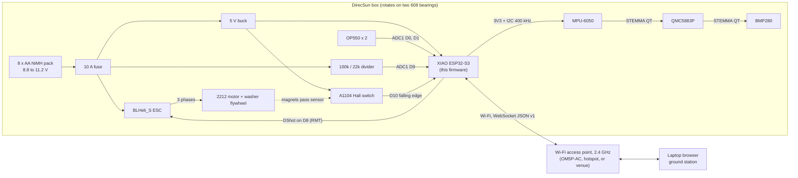

### 4.2 External interfaces of the firmware

| Interface | Peer | Direction | Defined in |
| --- | --- | --- | --- |
| I2C bus, 400 kHz | MPU-6050 0x68, QMC5883P 0x2C, BMP280 0x77 | read/write | TD §5.3 [V]; §10 |
| ADC1 ch0, ch1 (GPIO1, GPIO2) | OP550 A, B | read | TD §5.4 [V] |
| ADC1 ch7 (GPIO8) | Battery divider | read | TD §5.4 [V] |
| GPIO9 interrupt | A1104 | input | TD §5.4 [V] |
| GPIO7 RMT TX | ESC DShot input | output | TD §5.4 [V] |
| Wi-Fi STA, WebSocket server on port 80 at `/ws` | Main UI (`frontend/`), bench console | bidirectional | TD §7 [V]; §15 |
| USB-C serial | Developer | log output, flashing | TD §5.5 |
| NVS | Flash | parameter storage | TD §6.1 [D in TD] |

GPIO numbering follows the XIAO pin table in TD §5.4: D0 = GPIO1, D1 = GPIO2, D4 = GPIO5 (SDA), D5 = GPIO6 (SCL), D8 = GPIO7, D9 = GPIO8, D10 = GPIO9 [V]. GPIO1 to GPIO10 are ADC1 channels 0 to 9 [V], so GPIO8 is ADC1 channel 7 [C].

---

## 5. Requirements traced to firmware mechanisms

| ID (TD §2) | Requirement | Firmware mechanism | Verified by |
| --- | --- | --- | --- |
| FR-1 | Reaction wheel is the only actuator | Single DShot output; no other actuator code path | Review |
| FR-2 | Eight modes, mode change within 100 ms | Mode machine (§13) runs every 2 ms tick; command queue drained every tick, so a valid command takes effect within one tick plus network latency | T-13, host test HT-7 |
| FR-3 | 50 Hz telemetry, < 100 ms latency | Snapshot every 10th control tick; comms task sends without blocking control (§7.4) | T-11 |
| FR-4 | Untethered | Battery monitor, Wi-Fi only | Review |
| FR-5 | Safe stop | E-stop command, 1 s heartbeat timeout, undervoltage, plus the full interlock table (§14) | T-13 |
| PR-1 | Detumble 1 rev/s to < 5 deg/s in 5 s | `DETUMBLE` mode, rate loop with ω_cmd = 0 | T-15 |
| PR-2 | 90 deg slew in 3 s, ±3 deg | `SLEW` trapezoid 60 deg/s, 120 deg/s² (about 2.0 s of profile) [C] | T-16 |
| PR-3 | Hold ±2 deg | `HOLD`, attitude + rate loop with integral and anti-windup | T-17 |
| PR-4 | Wheel energy < 6 J at cap, < 6.5 J worst case | Ω_ref clamped to the 4000 rpm cap; overspeed trip at 4100 rpm (5.99 J) [C] | Host test HT-5, T-13 |

The PR-1 requirement needs the gyro range to cover at least 360 deg/s, and TD §10.1 says the box can reach about 4.0 rev/s (1440 deg/s) if the wheel stops from the cap [C]. The gyro is therefore configured for ±2000 deg/s (§10.1, finding V-9).

---

## 6. Hardware interface summary for firmware authors

| Item | Value | Label |
| --- | --- | --- |
| MCU | ESP32-S3, dual core | [V] TD §6.1 |
| Framework | ESP-IDF v6.0, C++17 application code, FreeRTOS tasks | [D] 2026-10-10 (TD §6.1; V-22 records the earlier choice) |
| I2C | SDA GPIO5, SCL GPIO6 on port 0, owned by esp-idf-lib `i2cdev`; every device at 400 kHz, fallback 100 kHz. The library defaults (1 MHz for the esp-idf-lib drivers, 100 kHz hard-coded in the QMC5883P driver) are overridden | [V] TD §5.3 to 5.4 for pins and rate; [V] defaults read from the driver source, 2026-10-10 |
| DShot | DShot300 if ESC MCU is 48 MHz ("H" in its name), DShot150 if 24 MHz ("L") | [V] TD §5.2; [M] read in ESC Configurator |
| DShot frame | 11-bit throttle, 1 telemetry bit, 4-bit CRC; 0 = disarm, 1–47 commands, 48–2047 throttle | [V] TD §6.3 |
| Hall | 2 magnets, both south-out → 2 falling edges per wheel turn | [V] TD §4.6 |
| Battery divider | Design 22/122 = 0.1803; the bench rig measures 21.23/104.43 = 0.2033 (V-67): 11.2 V → 2.28 V; 9.6 V → 1.95 V; 8.8 V → 1.79 V; the ADC's 2.9 V limit is 14.3 V | [C] |
| ADC | 12 dB attenuation, usable to about 2.9 V | [V] TD §5.1 |
| Sensors' supply | 3.3 V from XIAO 3V3 | [V] TD §5.3 |

Derived wheel timing (two Hall edges per turn) [C]:

| Wheel speed | Mechanical | Hall edges/s | Edge period | Motor electrical frequency (7 pole pairs, [A] A-6) | Stored energy |
| --- | --- | --- | --- | --- | --- |
| 800 rpm (low limit, [A] A-8) | 13.3 Hz | 26.7 | 37.5 ms | 93 Hz | 0.23 J |
| 2400 rpm (bias) | 40.0 Hz | 80.0 | 12.5 ms | 280 Hz | 2.05 J |
| 4000 rpm (cap) | 66.7 Hz | 133.3 | 7.5 ms | 467 Hz | 5.70 J |
| 4100 rpm (trip) | 68.3 Hz | 136.7 | 7.3 ms | 478 Hz | 5.99 J |

---

## 7. Software architecture

### 7.1 Principles

1. **One authority per fact.** The control task owns all state. Every other context gets copies.
2. **Control never waits on the network.** Communication between cores uses lock-free or very short critical sections; nothing on the control path blocks on Wi-Fi, TCP, JSON, or flash.
3. **Pure core, thin drivers.** Estimation, control, mode logic, interlocks, DShot encoding, and message parsing are pure functions or plain classes with no hardware calls, so they compile and run on a desktop (§19.1).
4. **Fail to zero throttle.** Every fault path ends in DShot 0 (TD §6), either immediately or after the e-stop ramp (§14.3).
5. **The box is the authority on mode** (TD §7.3). The ground never assumes a command succeeded.

### 7.2 Tasks and cores

| Context | Core | Priority (FreeRTOS) | Period | Work | Label |
| --- | --- | --- | --- | --- | --- |
| `control` task | 1 | Highest application priority (e.g. `configMAX_PRIORITIES − 2`) | 2 ms (500 Hz) | Sensor reads, estimator, mode machine, controllers, interlocks, DShot frame, telemetry snapshot | [D]; rate [V] TD §6.2 |
| Tick source | n/a | ISR | 2 ms | `gptimer` alarm ISR gives a task notification to `control` | [D]; API [A] |
| Hall ISR | any (registered from core 1) | ISR, IRAM | per edge | Store `esp_timer_get_time()` in a ring buffer | [D]; API [A] |
| `comms` task | 0 | Above the main task, below the Wi-Fi driver | event-driven + 50 Hz | WebSocket server, JSON encode/decode, ping/pong, client management | [D] |
| Wi-Fi/lwIP | 0 | System | n/a | Provided by ESP-IDF | [A] default core 0 |
| `app_main` | 0 | Default main-task priority | once | Runs the boot sequence (§8), creates the tasks, returns | [D] |
| Task watchdog | system | n/a | 100 ms | Resets the MCU if `control` stops feeding it | [V] TD §6.2 for the 100 ms |

Why a hardware timer instead of `vTaskDelayUntil(2)`: the project runs FreeRTOS at a 1 kHz tick (`CONFIG_FREERTOS_HZ=1000` in `firmware/sdkconfig.defaults`), so `vTaskDelayUntil` could produce a 2 ms period, but its jitter is a full tick. A `gptimer` alarm gives sub-tick jitter [A]. Either works; the timer is the default and `vTaskDelayUntil` is the fallback if the timer API does not build (build check BC-3, §19.3).

### 7.3 Module and data-flow diagram

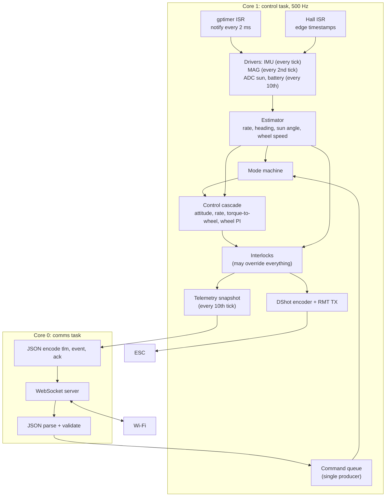

### 7.4 Shared state and concurrency

| Channel | Producer → consumer | Mechanism | Rule |
| --- | --- | --- | --- |
| Commands | comms → control | FreeRTOS queue, depth 16, items are a fixed-size `Command` struct; `xQueueSend` with timeout 0 from comms, `xQueueReceive` with timeout 0 in control | Full queue: comms answers `ack ok:false reason:"busy"`. `estop` bypasses the queue through an atomic flag (below) |
| E-stop | comms → control | `std::atomic<bool> estop_requested` | Set by comms on any `estop`; read and cleared by control on the next tick |
| Heartbeat | comms → control | Every `ping` is forwarded through the command queue as a `Ping` item (never acked); the supervisor, which alone knows the controlling client, times the heartbeat from any `ping` or `cmd` that client sends | Replaces an atomic `last_heartbeat_us` written by comms, which would need comms to track the controlling client across cores [D, V-32] |
| Telemetry snapshot | control → comms | Double buffer + sequence counter (seqlock) | Control writes the inactive buffer, then flips an atomic index. Comms copies the active buffer and retries if the counter changed during the copy. Control never waits. Written every 10th tick and on every tick that posts an ack or event (`snapshot_due`, R4.1) |
| Events and acks | control → comms | FreeRTOS queue, depth 16 | Control posts with timeout 0, after that tick's snapshot is written; if full, the event is dropped and a `dropped_events` counter in telemetry increments |
| Hall edges | ISR → control | Ring buffer of 8 `int64_t` timestamps + atomic write index | ISR writes only; control reads only |

**Ordering guarantee** [D, R4.1, finding U-5]. The first `tlm` a client receives after an `ack` or `event` reflects the control tick that produced it, or a later one. Control writes the snapshot before it posts that tick's acks and events, and writes one on every tick that posts any. Comms, each 20 ms period, pops every posted item before it reads the snapshot, and its flush sends the items before the `tlm`; so any item it sends already has a snapshot at least that new, sent after it. Comms still publishes at most one snapshot per period, so `tlm` stays at 50 Hz. An extra snapshot leaves the 20 ms `loop_us` window and `mag_fresh` to the regular one, so no window's worst tick is lost. Before R4.1 the snapshot was written only on every 10th tick and after posting, so an event posted between snapshots went out followed by a `tlm` from before the transition.

TD §6.2 specifies "a snapshot struct copied under a spinlock". The seqlock above gives the same consistency without control ever spinning on a lock held by core 0 [D, finding V-12]. A `portMUX` spinlock around a ~200-byte `memcpy` is an acceptable simpler alternative, since the copy takes microseconds [A].

---

## 8. Boot and initialization

### 8.1 Sequence

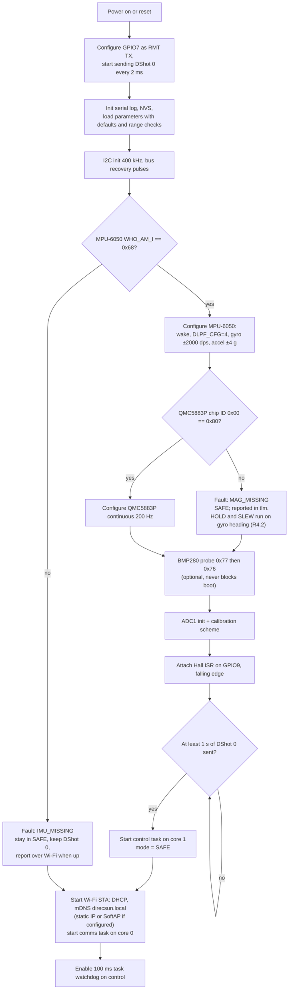

### 8.2 Notes and rationale

- **DShot 0 starts first.** The ESC arms only after seeing zero throttle [V] TD §5.2, and TD §6.3 asks for about 1 s of zeros [A] A-22. Sending zeros from the first milliseconds also means that a reset caused by the watchdog stops drive quickly. The ESC itself switches drive off about 0.3 s after pulses stop [V] TD §5.2, so the reset gap is bounded either way.
- **Boot does not wait for Wi-Fi.** The box is safe in `SAFE` without a ground connection; heartbeat rules only apply in active modes (§14.1).
- **Missing magnetometer** is not fatal: `DETUMBLE` needs only the gyro, and until Set 5 `HOLD` and `SLEW` run on the gyro-only heading for relative use (§13.1, V-48). `SUN_POINT` needs the sun sensors, not the magnetometer [D].
- **Gyro bias.** Bias is estimated continuously while the box is in `SAFE` **and** still (§11.1). The boot window seeds it only when the window itself proves the box was still, because the box may be moving after a watchdog reset [D, findings V-10 and V-61].

---

## 9. The control tick

### 9.1 Per-tick flow (every 2 ms)

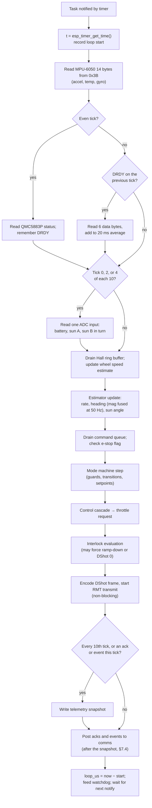

### 9.2 Timing budget (target, to be measured as `loop_us`)

| Step | Estimate | Label |
| --- | --- | --- |
| IMU burst read, 14 bytes at 400 kHz | 0.39 ms (155 bit times) | [C] |
| Magnetometer status (even ticks) or 6 data bytes (the odd tick after DRDY), never both on one tick | about 0.25 ms | [C] |
| One ADC read with calibration (at most one per tick) | tens of µs | [A] |
| Estimator + controllers + interlocks (float) | < 50 µs | [A] |
| DShot encode + RMT start | < 20 µs; the 53 µs DShot300 frame is sent by hardware | [A]; frame [V] |
| JSON is **not** on this core | 0 | [D] |
| **Worst tick** | **about 0.75 ms of 2 ms** | [C on A] |

**Measured on the XIAO (R3.4 bench, 2026-10-10) [V].** The first build ran its worst tick at 1.4 to 1.9 ms, and its first tick at 6.9 ms with 2 missed ticks. Per-stage timing (the bench Kconfig `DIRECSUN_BENCH_STAGE_TIMING`) found three causes:
- The ESP32-S3's default 16 KB instruction cache could not hold the tick's code (core, drivers, the I2C and RMT drivers, libc math), so it refilled from flash every tick: the estimator took 43 µs and the telemetry snapshot 99 µs. The firmware uses the 32 KB instruction cache (`CONFIG_ESP32S3_INSTRUCTION_CACHE_32KB`) and places `direcsun_core`, `direcsun_drivers`, and the control task in IRAM through linker fragments (`linker.lf`), so the core's sources stay free of ESP-IDF attributes (§18).
- The magnetometer status and data reads shared a tick with each other and with an ADC read. They are now on separate ticks, with the ADC reads next to the short status read (§9.1).
- The first tick logged a line on the console, which blocks for milliseconds. The line is logged before the tick timer starts.

After the fixes, per stage, mean (max) in µs: IMU 456, magnetometer 207 (282), ADC 48, estimator 6 (11), supervisor 4 (9), DShot 15, snapshot 7. Over 11.6 min the flight build's worst tick was 911 to 926 µs each second and 976 µs in the first, with no missed ticks [D, V-60].

The IMU read's maximum is not stable from build to build: 463 to 473 µs in one, 655 to 694 µs in another, once in every second. A same-binary comparison on 2026-10-10 confirmed the cause [V]. With the BMP280 silent the maximum was 459 to 462 µs, and with it answering 655 to 691 µs, while the mean did not move (`testresults/2026-10-10-s3-loop-time-barometer.md`). The core-0 barometer task (§10.3) reads once a second, and its transaction holds the shared bus when the IMU read starts. With the IRAM placement below, the worst tick including this delay is 754 µs, so moving the barometer read into the idle part of the tick would add margin; the budget no longer needs it.

**Measured with Wi-Fi (R3.5 bench, 2026-10-10) [V].** With the SoftAP up and no client, the R3.4 placement was not enough: the worst tick was 1369 to 1649 µs in every second over 10 min (median 1454). The Wi-Fi stack on core 0 shares the 32 KB instruction cache and evicts the tick's code that still ran from flash.
- A disassembly of the image, following every call out of the control task (including the `l32r`/`callx` calls that are the only way IRAM code reaches flash), listed that code: the I2C master driver and HAL, the RMT transmit path and its encoders, the ADC one-shot read with its calibration and lock, picolibc's `sqrtf`, `acosf`, `remainderf` and `remainder` with their helpers, and `main/shared.cpp`.
- `main/linker.lf` now places those objects in IRAM, together with `CONFIG_FREERTOS_IN_IRAM`, `CONFIG_I2C_ISR_IRAM_SAFE` and `CONFIG_ADC_ONESHOT_CTRL_FUNC_IN_IRAM`. What the tick still calls in flash is start-up and error paths only. Internal RAM use is 63%.
- Result over 10 min with the SoftAP up: worst tick 753 to 756 µs in every second after the first, no missed ticks, p99 deviation at most 9 µs [D, V-62]. A client streaming telemetry has not been measured yet.

**The boot second with Wi-Fi [A].** Comms start about 30 ms after the control task. In about half of boots the first second then shows one tick of about 4 ms, one or two missed ticks, and two invalid IMU reads (I2C reads that time out). None of these removed it: turning off Wi-Fi's NVS storage, turning off PHY calibration storage, or creating the I2C bus and the DShot channel on core 1. The likely cause is a flash access during Wi-Fi start-up, which stalls the other core, but it is not confirmed. It happens in SAFE, before any client can arm the box.

At 100 kHz I2C the IMU read alone is 1.55 ms [C], and an IMU + magnetometer tick would exceed 2 ms, which is why TD §5.3 runs the bus at 400 kHz. Every tick reads the IMU, so there is no tick free for the magnetometer at 100 kHz. If the oscilloscope check in TD §5.3 forces 100 kHz, the control rate falls to 250 Hz (4 ms ticks: IMU 1.55 ms, plus magnetometer status and data on alternate ticks, about 0.8 ms), and the gains in §12.2 are rechecked for the longer step [D, finding V-6].

`loop_us` above 1500 for more than 10 consecutive ticks raises a `LOOP_OVERRUN` warning flag. A tick that is still running when the next notification arrives counts as a missed tick; 25 consecutive missed ticks (50 ms) trip `CONTROL_STALL` before the watchdog fires [D].

Missed ticks do not stretch time [D, finding V-66]. The supervisor's clock (`TickClock` in `direcsun_core`) advances by every timer alarm, not by every executed tick, so the heartbeat timeout, the ramp-down, the `SPINUP` dwell, the `SLEW` profile, settle dwell, and timeout (R4.3), and the `UNDERSPEED` and `HALL_SILENT` durations are wall time. A duration counter counts the condition a late tick sees for the whole interval since the tick before, so a trip can come up to one tick early, never late. The sensor schedule and the telemetry snapshots still follow executed ticks. So do the integration steps outside the supervisor, at a fixed 2 ms per executed tick: the estimator's bias filter and heading, the wheel loop's `SPINUP` Ω_ref ramp and integrator (R3.8), and the rate loop's Ω_ref update, integral, and stick-slip bleed (R3.9). Over a missed tick they integrate less, never more; whether they should step by the alarms too is not decided.

---

## 10. Drivers

### 10.1 MPU-6050 (I2C 0x68)

| Register | Address | Value | Why | Label |
| --- | --- | --- | --- | --- |
| PWR_MGMT_1 | 0x6B | 0x01 (wake, PLL with X gyro clock) | Leaves sleep; gyro clock is more stable than the internal oscillator | [A] register map; TD cites the map as [V] |
| SMPLRT_DIV | 0x19 | 0 | 1 kHz output with DLPF enabled | [A] |
| CONFIG | 0x1A | DLPF_CFG = 4 | 20 Hz gyro / 21 Hz accel bandwidth, 8.3 ms gyro delay | [V] TD §6.4 |
| GYRO_CONFIG | 0x1B | FS_SEL = 3 (±2000 deg/s, 16.4 LSB per deg/s) | Box can reach about 1440 deg/s after a stop from the cap | [C] range need; [A] scale |
| ACCEL_CONFIG | 0x1C | AFS_SEL = 1 (±4 g, 8192 LSB/g) | Headroom for imbalance vibration (T-7 target 0.05 g RMS) without clipping on taps | [D]; [A] scale |
| Data | 0x3B..0x48 | 14-byte burst: accel XYZ, temperature, gyro XYZ, big-endian | One transaction per tick | [A] |
| WHO_AM_I | 0x75 | expect 0x68 | Boot check (TD §6.6) | [A] value; TD names the check |

Driver: esp-idf-lib `mpu6050` ^2.1.9 on `i2cdev`, validated alone on the S3 by the owner. Its device clock is set to 400 kHz before the first transaction, overriding the library's 1 MHz default [D]. Whether `mpu6050_get_motion()` issues the single 14-byte burst §9.2 assumes is [A]; if it does not, the driver wrapper reads 0x3B to 0x48 with one register read.

Error handling: an I2C error or a timeout of more than 1 ms marks the sample invalid. 25 consecutive invalid samples (50 ms) trip `IMU_SILENT` [V] TD §6.7 threshold. After three consecutive errors the driver runs bus recovery (nine SCL clock pulses, then STOP) once [A] standard I2C practice.

Axis mapping: the board sits face up, centred on the spin axis (TD §4.8), so sensor +Z is taken as box +z [A]. T-8 confirms by rotating the box counter-clockwise by hand and checking that ω reads positive [M].

### 10.2 QMC5883P (I2C 0x2C)

| Item | Value | Label |
| --- | --- | --- |
| Chip ID | register 0x00 reads 0x80 | [V] TD §5.3 |
| Data | 0x01..0x06, X/Y/Z | [V] TD §5.3; byte order [A], confirm in the QST datasheet |
| Status | 0x09, data-ready bit | [V] register; bit position [A] |
| Control | 0x0A, 0x0B: continuous mode, output data rate 200 Hz, oversampling and range | [V] registers; **bit values [A]: read them from the QST datasheet before writing the driver** |

Driver: the vendored `duruofu/qmc5883p` 0.1.0 in `firmware/components/qmc5883p`, given the i2cdev bus through `i2cdev_get_shared_handle(I2C_NUM_0, ...)` after the first i2cdev transaction has created it [D]. The driver hard-codes a 100 kHz device clock, and its own comments flag its 8 G sensitivity value as uncertain; both are corrected by documented local patches after checking the QST datasheet [A].

Sampling plan (revised from TD, finding V-5): the control loop runs at 500 Hz and the magnetometer at 200 Hz, so 200 Hz is not an integer divisor of the tick rate. The driver polls the status register every 2nd tick (250 Hz). When data-ready is set it reads the data on the next tick, so the two transactions never share a tick (§9.2, V-60); this yields every new 200 Hz sample once, and all new samples in each 20 ms window are averaged into one 50 Hz heading measurement [D].

Mounting: the board hangs upside down under the flipped top deck (TD §4.8). Turning a board over is a 180° rotation about a horizontal axis, which flips **Z and one horizontal axis**, not Z alone (finding V-4). Heading uses only the horizontal components, so the horizontal flip matters and the Z flip does not. The driver applies a configurable axis map `mag_axis_map` (default: negate Y and Z, keep X), and T-9 confirms it: rotating the box counter-clockwise must make magnetic heading increase in the same direction as the integrated gyro [M].

### 10.3 BMP280 (I2C 0x77, optional)

Probed at boot at 0x77, then 0x76 [V] TD §5.3. It is read at 1 Hz by a low-priority task on core 0 if present, never on a control tick, because the esp-idf-lib read path retries a failed transaction with backoff and can block for about 0.3 s [D, V-37]. The task publishes through a seqlock that the control task copies into the telemetry snapshot, and the readings appear in telemetry as `t_c` and `p_pa` (§15.3). It never affects control, modes, or boot [V] TD §5.3. If absent, the fields are `null`. Driver: esp-idf-lib `bmp280` ^1.0.7 at 400 kHz.

### 10.4 A1104 Hall sensor and wheel speed

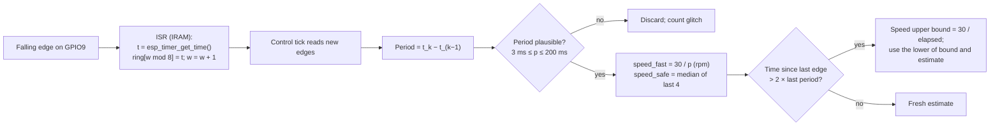

| Item | Value | Label |
| --- | --- | --- |
| Edges per turn | 2 | [V] TD §4.6 |
| Speed from period p (seconds) | Ω = 60 / (2p) = 30 / p rpm | [C] |
| Plausibility window | 3 ms (10,000 rpm) to 200 ms (150 rpm) | [D] |
| Control estimate `speed_fast` | Latest single period | [D], finding V-7 |
| Interlock estimate `speed_safe` | Median of the last 4 periods | [V] TD §6.4 |
| Staleness rule | If no edge for more than 2 × the last period, the true speed is below 30 / elapsed, so the estimate is replaced by that bound | [C] |
| Pull-up | 12 kΩ to 3.3 V, external | [V] TD §5.3; internal pull-up also enabled [D] |

**Why two estimates (finding V-7).** The median of 4 periods spans 50 ms at bias and delays the estimate by roughly 25 ms [C]. In a speed loop aimed at 5 Hz, a 25 ms delay costs about 45° of phase [C], too much for a margin-limited loop. The control loop therefore uses the latest period, and the interlocks use the median, which rejects single bad edges.

### 10.5 ADC: sun sensors and battery

| Channel | GPIO | Rate | Processing | Label |
| --- | --- | --- | --- | --- |
| Sun A | 1 (ADC1 ch0) | 50 Hz | Calibrated mV, 4-sample average | [V] pin; [D] averaging |
| Sun B | 2 (ADC1 ch1) | 50 Hz | Same | n/a |
| Battery | 8 (ADC1 ch7) | 50 Hz | mV / `kBatteryDividerRatio` (0.2033 on the bench rig, V-67), then a 1 s moving average for the undervoltage interlock | [C] ratio |

Use the ESP-IDF `adc_oneshot` driver with `ADC_ATTEN_DB_12` and the `adc_cali` curve-fitting scheme for mV conversion [A]. ADC2 must not be used, because it is unavailable with Wi-Fi on [V] TD §5.4.

### 10.6 DShot output

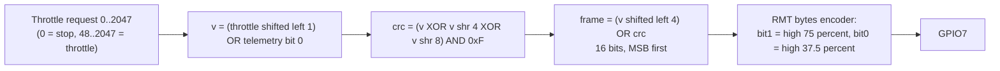

| Item | DShot300 | DShot150 | Label |
| --- | --- | --- | --- |
| Bit period | 3.333 µs | 6.667 µs | [C] |
| Frame (16 bits) | 53.3 µs | 106.7 µs | [C]; DShot300 value [V] TD §6.2 |
| '1' high time (75 %) | 2.50 µs | 5.00 µs | [A] Betaflight convention |
| '0' high time (37.5 %) | 1.25 µs | 2.50 µs | [A] |
| RMT ticks at 40 MHz resolution | bit 133, '1' 100 high + 33 low, '0' 50 high + 83 low | ×2 | [C] |

Implementation choice [D]: use the ESP-IDF 5.x RMT TX channel with the built-in **bytes encoder** (configurable `bit0`/`bit1` symbols, MSB first) on the 2-byte frame [A]. This avoids a custom encoder and any external DShot library (TD A-18). If the bytes encoder is unavailable, write the 16-symbol encoder TD §6.1 describes.

Test vectors for the host test HT-1 [C, computed]:

| Throttle | Telemetry bit | 12-bit value | CRC | 16-bit frame |
| --- | --- | --- | --- | --- |
| 0 | 0 | 0x000 | 0x0 | `0x0000` |
| 48 | 0 | 0x060 | 0x6 | `0x0606` |
| 1046 | 0 | 0x82C | 0x6 | `0x82C6` |
| 2047 | 0 | 0xFFE | 0xE | `0xFFEE` |

Rules [D]:

- Commands 1–47 (beeps, direction, settings) are **never** sent by flight code. ESC settings, including **Brake on stop = off** (TD §5.2, §10.3), are made in ESC Configurator.
- Throttle values 1–47 from the controller are mapped to 0. The minimum running throttle is the value that holds the low-limit speed, from the T-5/T-18 map.
- One frame per 2 ms tick. That is within BLHeli_S limits [V] TD §6.2. Frames are never skipped, because a gap longer than about 0.3 s stops the motor [V] TD §5.2.

---

## 11. Estimation

### 11.1 Box rate

```
ω̂ = s_gyro · (g_z − b_z)        [rad/s]
```

- `s_gyro` = +1 by default, confirmed in T-8 [M].
- **Bias `b_z`:** updated with a slow exponential average (time constant 5 s) only when all of these hold: mode is `SAFE`, |g_z − b_z| < 2 deg/s, accel magnitude within 0.05 g of the reference `a_ref`, and the wheel is below 200 rpm or the box is held [D]. The update is frozen otherwise, so a spinning box after an e-stop cannot corrupt the bias (finding V-10).
- **Stillness is relative, not 1 g** [D, V-61]. An uncalibrated MPU-6050 reads well off 1 g at rest: the bench unit reads 0.871 g, so a test against 1 g never passes and the bias never learns. `a_ref` is the boot window's own mean accel magnitude, and 1 g until a boot window qualifies.
- **Boot seed** [D, V-61]. The MPU-6050 offset can exceed the 2 deg/s gate (the register map allows ±20 deg/s; the bench unit reads about −2.1 deg/s), so from b_z = 0 the gate might never open. The 1 s boot window (§8.1) therefore averages g_z and seeds b_z, and sets `a_ref`, only when the window proves the box was still: at least 250 samples, g_z range under 0.5 deg/s, |mean g_z| under 25 deg/s, a mean accel magnitude between 0.7 and 1.3 g (a dead accelerometer reading near 0 g is not still), and every sample's magnitude within 0.05 g of that mean. Otherwise b_z starts at 0, and the boot log names the first criterion that failed.
- **Vibration:** the 20 Hz DLPF passes 25 to 45 % of the 40 Hz bias-speed vibration [V] TD §6.4. A software notch filter is implemented but off by default. When enabled, its centre follows `speed_safe / 60` Hz and it is switched on only if T-7/T-8 show residual vibration in ω̂ [D].

### 11.2 Wheel speed

See §10.4. `Ω̂ = speed_fast` for control, `speed_safe` for interlocks and telemetry.

### 11.3 Heading

Complementary filter (TD §6.4):

```
every tick (Δt = 2 ms):        ψ̂ ← ψ̂ + ω̂ Δt
every 50 Hz magnetometer step:  ψ̂ ← ψ̂ + k · wrap(ψ_mag − ψ̂),   k = Δt_mag / τ = 0.02 s / 2 s = 0.01
```

| Item | Value | Label |
| --- | --- | --- |
| τ | 2 s, tunable in T-9 | [A] TD §6.4 |
| k per 20 ms step | 0.01 | [C] |
| ψ_mag | `atan2` of the calibrated horizontal field, with a sign chosen so that a counter-clockwise turn increases it (axis map, §10.2) | [M] T-9 |
| Calibration | Hard-iron offset (3 values) + soft-iron 2×2 matrix in the horizontal plane, from a 360° rotation; stored in NVS | [A] method; [M] values |
| `wrap()` | maps to (−π, π] | [D] |
| Storage | ψ̂ kept continuous (unwrapped) as `double` for control; wrapped only for display | [D] |
| Reported | `psi_deg` = wrapped ψ̂ in (−180, 180]; `mag_deg` = wrapped ψ_mag | [D] |
| `zero_heading` command | Accepted in `SAFE` and `READY` only. The supervisor stores the estimator's continuous ψ̂ at that moment as an offset, so the reported heading reads 0 from that tick on; the estimator itself is never reset. RAM only, not NVS (R4.2) | [D] |

**Implemented in R5.1.** `Estimator` takes each new magnetometer sample (`mag_new`, raw counts), averages the samples of every 20 ms window and applies the filter above with k = 0.01. The axis map, hard-iron offset and soft-iron matrix come from the parameters (`mag_axis_map`, `mag_cal`) and take effect on the next window. ψ_mag is `atan2(-h_y, h_x)` of the corrected horizontal field, so a counter-clockwise turn raises it (T-9). The first fix sets ψ̂ to the compass heading (the one place ψ̂ is set rather than integrated); a step in the heading at that moment is expected, and `zero_heading` after it restores a relative reading. The compass counts as fused for 0.5 s after each step, and `HEADING_GYRO` is set whenever it is not. `tools/fit-mag-cal.py` computes the calibration from a 360 degree turn recorded in bench mode and checks it against the gyro heading (T-9's 3 degree pass).

**Gyro-only heading until the compass is calibrated (R4.2, finding V-48).** Until the magnetometer calibration of T-9 exists (repository Set 5), the magnetometer step above is skipped: ψ̂ is the integral of the bias-corrected ω̂ alone, reported relative to the last `zero_heading`, and every `tlm` carries the flag `HEADING_GYRO` so no UI presents it as a compass bearing. The bias is learned while still in `SAFE` (§11.1), so the residual drift over the 5 to 6 s judge sequence is expected to sit well inside PR-2's ±3° band [A]; R4.2's hardware test measures it on the turntable [M].

**Aliasing (finding V-5).** TD §6.4 says the motor's magnets rotate at 13 to 67 Hz and that 200 Hz sampling avoids aliasing. The mechanical rotation is 13 to 67 Hz, but a 14-pole rotor and the phase currents produce fields at the electrical frequency, 7 × mechanical = 93 to 467 Hz [C on A-6]. That is above the 100 Hz Nyquist limit of 200 Hz sampling, so components there **can** alias. The firmware still samples at 200 Hz and averages, which attenuates some of it, but the real defences are the 14 cm distance, the QMC5883P's own oversampling filter, the gyro-dominant filter (τ = 2 s), and T-9 at three wheel speeds. If T-9 shows a speed-dependent offset, the fallback is a per-speed heading correction table indexed by Ω̂ [D].

### 11.4 Sun angle

```
d = (A − B) / (A + B)          valid only when A + B > light_threshold
sun_rad = calibration(d)       piecewise-linear table from T-10
```

`sun_valid` is false below the threshold or outside the calibrated range [V] TD §6.4. `SUN_POINT` drops to `READY` after 0.5 s of invalid sun angle [D].

**Implemented in R5.4.** `evaluate_sun()` (`sun.hpp`) takes the 4-sample-averaged A and B in mV. The sun is valid when A + B is above both 0 and `light_threshold`, and d lies inside the table. With `sun_cal` unset (count 0) the table is the identity [D]: d of +1 reads 90 deg clockwise on the wire. A set table has 2 to 8 points, `d` strictly increasing and the angle strictly monotonic, so each d gives one angle. Outside the table the sun is invalid; it is never extrapolated. The table is stored counter-clockwise positive like every internal angle, and the protocol layer negates it on the way in; `tlm.sun_deg` is negated on the way out, so the wire sun angle is how far the box must turn clockwise to face the lamp.

### 11.5 Tilt

Tilt angle = `acos(a_z / |a|)` from the averaged accelerometer (20 ms window). Interlock above 30° [V] TD §6.7. It is evaluated on the averaged vector, so a single vibration spike does not trip it [D].

---

## 12. Control law

### 12.1 Cascade

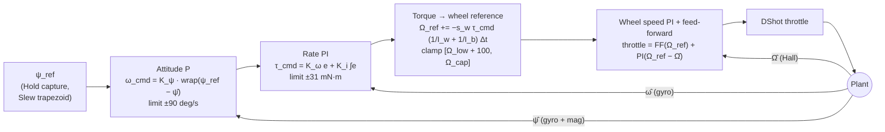

`DETUMBLE` bypasses the attitude block (ω_cmd = 0). `READY` also uses ω_cmd = 0 [V] TD §6.6. `SUN_POINT` replaces `wrap(ψ_ref − ψ̂)` with the calibrated sun angle [V] TD §6.5, through the same 1 deg deadband as HOLD (R5.4); with the sun briefly invalid ω_cmd is 0 and the 0.5 s timer ends the mode.

`HOLD` and `SLEW` run the attitude block (R4.3). ψ̂ and ψ_ref are relative to the last `zero_heading` (§11.3, V-49). While the reference stands still (`HOLD`, and `SLEW` once its profile has ended), an error under the hold deadband commands ω_cmd = 0, so the stick-slip bleed of §12.3 hands the box to bearing friction instead of the wheel creeping it the last fraction of a degree [D] (V-51).

### 12.2 Starting gains and limits

All gains are starting points until G2 (plant measured) [V] TD §6.5. Values recomputed here with the current TD plant (I_b = 1.03e-3 kg·m², I_w = 6.50e-5 kg·m²):

| Parameter | Value | Derivation | Label |
| --- | --- | --- | --- |
| K_ψ | 3.1 s⁻¹ | about 0.49 Hz attitude bandwidth (3.1 / 2π) | [C] TD §6.5 |
| ω_cmd limit | ±90 deg/s | TD §6.5 | [V] TD |
| Hold deadband | 1° on a still reference | Inside PR-3's ±2°; at 3 mN·m a creep spends about 440 rpm of wheel speed per second (R4.3 host simulation, V-51); TD §10 lists a deadband against stick-slip | [D] |
| K_ω | **0.0129 N·m·s/rad** | 2π · 2 Hz · I_b with I_b = 1.03e-3. TD §6.5 states 0.011, which equals 2π · 2 · 8.9e-4, the superseded I_b (finding V-1) | [C] |
| K_i (rate) | start at K_ω · 2π · 0.2 Hz = 0.0163 N·m/rad | Integral corner a decade below the 2 Hz rate bandwidth [D] | [C on D] |
| Integral limit | ±3 mN·m equivalent | Covers the planned friction range 1 to 3 mN·m (TD §3.6) without letting the integral command large torque | [D] |
| τ_cmd limit | ±31 mN·m (3 A × 10.38 mN·m/A) | TD §6.5 | [C] |
| Wheel ref slope at the τ limit | 4842 rpm/s, 9.7 rpm per tick | 0.031 × (1/I_w + 1/I_b) × 60/2π | [C] |
| Ω_low | 800 rpm | until T-18 | [A] A-8 |
| Ω_ref floor | Ω_low + 100 rpm (900 rpm) | Margin between the floor of the Ω_ref clamp and the `UNDERSPEED` threshold (Ω_low), as Ω_cap has 100 rpm to `OVERSPEED` (V-52) | [D] |
| Ω_bias | 2400 rpm | midpoint of low limit and cap | [V] TD §3.4 |
| Ω_cap | 4000 rpm | PR-4 | [V] TD |
| Wheel PI bandwidth | start at **2 Hz**, raise toward 5 Hz only after measuring delay | Hall update 80/s at bias; see V-7 | [D] |
| FF(Ω) | Lookup table, throttle versus steady speed, 8 points from T-5/T-18 | TD §6.5 | [M] |

**Bandwidth separation (finding V-8).** In a cascade, each inner loop should be several times faster than the loop around it. The plan above has attitude 0.5 Hz, rate 2 Hz, and wheel 2–5 Hz, so the rate-to-wheel ratio is only 1 to 2.5. If T-5 shows the wheel loop cannot exceed about 3 Hz, lower the rate bandwidth to about 0.7 Hz (K_ω ≈ 0.0045) and K_ψ in proportion, rather than raising wheel gains past their margin [D].

### 12.3 Saturation and anti-windup

- **Rate integral:** conditional integration. Stop integrating when τ_cmd is saturated or Ω_ref is clamped at a limit in the direction that would need more [D]. The integral's torque K_i ∫e is then bounded to ±3 mN·m (§12.2), so its bound in rad is 3 mN·m / K_i and widens as `rate_gain_scale` lowers K_i; with K_i = 0 the integral is held at 0 [D].
- **Stick-slip bleed (finding V-46):** while ω_cmd = 0 and |ω̂| < 1 deg/s, the rate integral decays with a 0.5 s time constant [D].
- **Ω_ref clamp:** Ω_ref stays within [Ω_low + 100, Ω_cap]; the floor is 100 rpm above the `UNDERSPEED` threshold so that a wheel held on it does not trip (V-52). When Ω_ref hits Ω_cap or the floor, set the flag `MOMENTUM_SATURATED`, freeze the rate integral, and report through telemetry. The box then cannot be driven further in that direction until desaturation (§13.4).
- **Throttle clamp:** 48..2047 while running; 0 only from the safety layer.

### 12.4 Slew profile

Trapezoid in ψ_ref, limited to 60 deg/s and 120 deg/s² [V] TD §6.5. A 90° slew takes 0.5 s accelerating (15°), 1.0 s at 60 deg/s (60°), and 0.5 s decelerating (15°), 2.0 s in all [C], within PR-2's 3 s; a half-turn takes 3.5 s [C]. A move under 30° never reaches 60 deg/s and is a triangle at 120 deg/s². The slew ends (`SLEW` → `READY`, per TD §6.6 "slew complete", event cause `slew_complete`) once the profile has ended and |ψ_ref − ψ̂| < 3° and |ω̂| < 5 deg/s have held for 0.5 s [D] (V-50); a timeout 6 s after entry ends it with the cause `SLEW_TIMEOUT` [D]. Either way the box is in `READY` holding rate, not heading. The host simulation of R4.3 settles a 90° slew within 3° by 2.36 s and completes it by 3.02 s across 0 to 3 mN·m of friction [C on A: plant model, §23.3].

`SLEW` targets arrive as `psi_ref_deg` in the same frame as `psi_deg`: clockwise positive on the wire and, until Set 5, relative to the last `zero_heading` (§13.1, V-48). The firmware moves ψ_ref along the **shortest** wrapped path to the target [D]. A half-turn is deterministic: it always goes counter-clockwise (internal +180°, wire −180°) [D]. A ground station that wants the other direction must send an intermediate target.

### 12.5 Sign check before closing the loop

TD R-1 notes that a wrong sign in the torque-to-wheel step makes the rate loop unstable. Before T-15:

1. With the box pinned and `bench_mode` on, step Ω_ref from bias to bias + 300 rpm with the attitude and rate loops disabled (bench command `wheel_step`, §15.3). Confirm the wheel follows. The pin stays in for this step.
2. Unpinned, at reduced gains (`rate_gain_scale` 0.2, the default, which scales K_ω and K_i together; finding V-47), push the box counter-clockwise by hand. Log ω̂ and Ω_ref. Correct behaviour: Ω_ref moves so that the reaction opposes the push, and ω̂ decays. Wrong sign: ω̂ grows; the operator hits e-stop.
3. Record s_w in NVS.

---

## 13. Modes

### 13.1 State machine

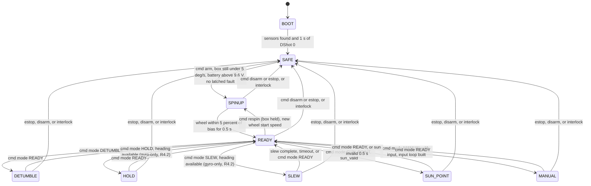

These additions were approved by the owner on 2026-10-10 and written into TD §6.6 and §6.7: the `disarm` command, the 0.5 s dwell before `READY`, the sun guard, and the `READY → SPINUP` "respin" transition used for desaturation and alternate wheel start speeds (§13.4).

**Heading guard amendment** (approved by the owner on 2026-10-10, finding V-48). `HOLD` and `SLEW` no longer require a magnetometer. Until Set 5 calibrates it, they run on the gyro-only heading of §11.3 for relative use: `SLEW` targets are interpreted relative to the last `zero_heading`, and `HOLD` holds the heading it captured at entry. A missing magnetometer (`MAG_MISSING`) is reported but blocks neither. Absolute `HOLD` against a compass reference returns with the magnetometer (Set 5).

**Hall bench bypass** (approved by the owner on 2026-10-10 [D], finding V-30). Until the Hall magnets can be mounted (repository Set 2), rung 1 of `MANUAL` is tested with the parameter `hall_installed` set false. It can be set false only by `set_params` in `SAFE` while `bench_mode` is already true, so it takes two separate commands, and every boot sets it true again; it is never persisted. While it is false:

- `arm` is refused unless `bench_mode` is true;
- only the `throttle` `MANUAL` input is available;
- `SPINUP` ramps the throttle open loop to `spinup_throttle` at 200 DShot units per second and reaches `READY` after the ramp plus 0.5 s, with no speed check;
- every throttle the controller emits is clamped to `min(manual_throttle_max, kBypassThrottleMax)`, where `kBypassThrottleMax` = 400 is a compile-time constant, not a parameter, so no command can raise it [D]; its speed, about 1600 rpm no-load at 10 V, is [A] until R3.7 measures it;
- the `tlm` flag `HALL_BYPASS` is set on every frame, and a `notice` event `HALL_BYPASS` (`detail` `on` or `off`) is posted when it changes;
- `OVERSPEED`, `UNDERSPEED`, and `HALL_SILENT` are suspended (§14.1); every other interlock stays active.

**Refusal reasons** [D, V-34]. A refused command's `ack` carries one of these exact strings: `not in SAFE` (`arm` while armed, `set_params` outside `SAFE`), `not armed` (`disarm`, or `mode READY`, in `SAFE`), `ramp-down in progress` (`arm` or `set_params` during a ramp-down, V-65), `box not still`, `battery low`, `latched fault: <INTERLOCK>` (a latch whose release condition does not hold, §14.1), `bench_mode required` (`arm` with the Hall bypassed and bench mode off), `not controlling client`, `not in READY` (`mode MANUAL`, `HOLD`, or `SLEW` from any other mode, including from each other), `wheel loop not available` (`mode HOLD`, `mode SLEW`, or `wheel_step` before the closed wheel loop exists: no Hall or no `ff_table`, V-43), `input not available`, `wheel not at bias` (`mode READY` during `SPINUP`), `not in MANUAL`, `input mismatch`, `too fast`, `invalid setpoint`, `sun not valid` (`mode SUN_POINT` without a valid sun angle), `wheel loop not available` (HOLD, SLEW, DETUMBLE, SUN_POINT, `respin`, and MANUAL `wheel` or `rate` without the T-5 table), `not implemented` (modes and commands of later repository sets), and for `set_params`: `invalid param: <key>`, `unknown param: <key>`, `not settable: <key>`, `not implemented: <key>`, `bench_mode required: hall_installed`, `no params`. The guards of `arm` are checked in the order `SAFE`, ramp, bench mode, still, battery, latches, and the first that fails names the reason; those of `set_params` in the order `SAFE`, ramp, then the parameters.

### 13.2 Per-mode behaviour

| Mode | Wheel | Controller active | Setpoint | Exits |
| --- | --- | --- | --- | --- |
| `SAFE` | Ramp-down (§14.3) then DShot 0; or DShot 0 at once (hard faults) | None | n/a | `arm` |
| `SPINUP` | Ω_ref ramps toward the start speed (default bias) at 400 rpm/s; wheel PI active | Wheel loop only. Rate and attitude off: the box is pinned or held [V] TD §2 | Ω_target | At target → `READY` |
| `READY` | Wheel loop | Rate loop | ω_cmd = 0 | Mode commands |
| `DETUMBLE` | Wheel loop | Rate loop | ω_cmd = 0 | `mode READY` |
| `HOLD` | Wheel loop | Attitude + rate, hold deadband | ψ_ref = ψ̂ at entry | `mode READY` |
| `SLEW` | Wheel loop | Attitude + rate, hold deadband after the profile | Trapezoid to `psi_ref_deg` | complete, timeout, `mode READY` |
| `SUN_POINT` | Wheel loop | Sun error + rate | sun angle → 0 | `mode READY`, invalid sun |
| `MANUAL` | Open-loop throttle (`throttle`), or the wheel loop (`wheel`, `rate`) | `throttle`: none; `wheel`: wheel loop; `rate`: rate loop over the wheel loop | From `cmd:"manual"` (§13.5) | `mode READY`, `disarm`, `estop`, interlock |

`READY` and `DETUMBLE` run the same controller [V] TD §6.6 says `READY` holds box rate at zero. `DETUMBLE` exists as a separate mode so the ground station and the demo script can name it and so its telemetry can be logged distinctly against PR-1 [D].

The firmware cannot sense the lock pin. The `arm` guard therefore requires a still box (|ω̂| < 5 deg/s), and the ground station must ask the operator to confirm the pin is in before it sends `arm` [D, finding V-13].

### 13.3 Spin-up sequence

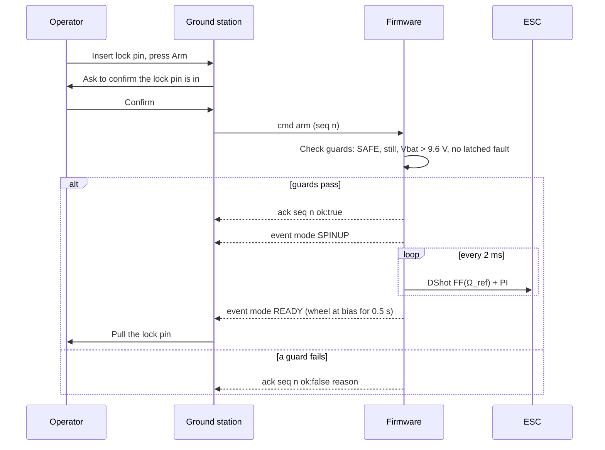

Below about 800 rpm sensorless commutation is assumed unreliable [A] A-8, so spin-up begins with throttle feed-forward only and closes the wheel PI once the Hall speed exceeds Ω_low [D].

### 13.4 Desaturation and wheel start speed

TD §3.6 (the later of the two decisions) makes the lock pin the desaturation actuator: the operator stops and pins the box, the firmware returns the wheel to its start speed, the pin comes out. TD §10.2 used to describe an automatic momentum dump where the controller turns the box at about 30 deg/s while friction removes the excess. The two conflicted (finding V-2); the owner approved the §3.6 decision on 2026-10-10 and TD §10.2 now follows it. Desaturation is a `respin`:

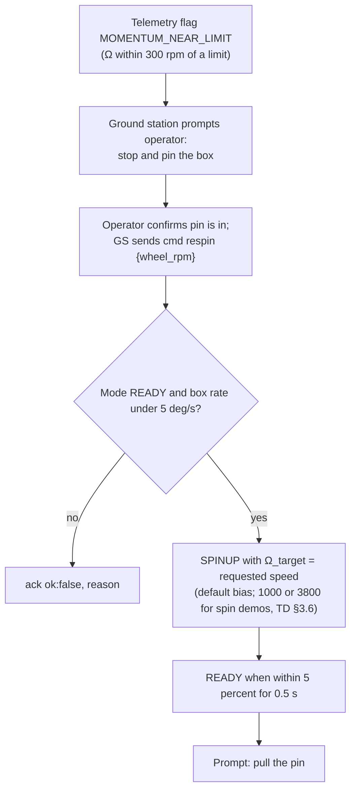

`respin` accepts start speeds within [Ω_low + 200, Ω_cap − 200] rpm [D]. That covers TD's 1000 and 3800 rpm values. Implemented in R5.3: the guards are, in order, the controlling client, `not in READY`, `box not still` (|ω̂| under 5 deg/s), `wheel loop not available`, and `invalid setpoint` for a speed outside the range. The event is `mode` SPINUP with cause `respin`. SPINUP ramps Ω_ref toward the target at 400 rpm/s in either direction (§13.2), so a respin to a lower speed does not step the wheel reference down.

### 13.5 Manual mode

Approved by the owner on 2026-10-10 [D]; TD §6.6 holds the same contract.

| Item | Rule |
| --- | --- |
| Entry | From `READY` only, with `{"cmd":"mode","mode":"MANUAL","input":"throttle"}` (or `"wheel"`, `"rate"`) from the controlling client. Refused with `reason:"input not available"` while the firmware lacks that input's loop, and with `reason:"wheel loop not available"` for `wheel` and `rate` while the T-5 table is unset (R5.2). All three inputs are built from R5.2; each is usable on its own. With the Hall bypassed only `throttle` is offered |
| `throttle` input | `{"cmd":"manual","throttle":n}`, n clamped to [`manual_throttle_min`, `manual_throttle_max`] (§16). The cascade is bypassed; the throttle goes to DShot open loop. The band comes from the T-5 throttle-to-speed map so that it keeps the wheel between Ω_low and Ω_cap [M] |
| `wheel` input | `{"cmd":"manual","wheel_rpm":n}`, n clamped to [Ω_low, Ω_cap]; sets the target of Ω_ref for the wheel PI + FF loop. Ω_ref moves toward it at 1000 rpm/s (`kManualWheelRampRpmPerS`), so the box never sees a step; entry starts from the measured wheel speed [D, R5.2] |
| `rate` input | `{"cmd":"manual","rate_dps":n}`, n clamped to ±90 deg/s; sets ω_cmd for the rate loop, which drives Ω_ref |
| Who and how often | Controlling client only; the setpoint must match the active input; at most 20 Hz (a setpoint within 50 ms of the previous accepted one is refused with `reason:"too fast"`). Each accepted setpoint counts as a heartbeat (§14.4) |
| Staleness | If no setpoint is accepted for 250 ms while the heartbeat stays alive, `rate` falls to ω_cmd = 0, so the box stops turning; `throttle` and `wheel` hold their last value, so the wheel holds its speed and the box does not move. The flag `MANUAL_STALE` is set until the next setpoint. The 1 s heartbeat rule (§14.1) still applies |
| Safety | Every interlock stays active. No input can command past Ω_cap or below Ω_low |
| Exit | `mode READY` → `READY`; `disarm` or `estop` → ramp-down → `SAFE`; any interlock → `SAFE` |
| Telemetry | `mode` is `MANUAL` and `manual_input` names the active input (§15.3) |

---

## 14. Safety

### 14.1 Interlocks

Every interlock is evaluated every tick, after the controller, so it can override the controller's output [D].

| Name (wire) | Condition | Action | Latch | Source |
| --- | --- | --- | --- | --- |
| `ESTOP` | `estop` command from any client | Ramp-down → SAFE | Until next `arm` | TD §6.7 |
| `HEARTBEAT_LOST` | In any mode except SAFE, no `ping` or `cmd` (including a `manual` setpoint) from the **controlling client** for 1 s | Ramp-down → SAFE | Until next `arm` | TD §6.7 |
| `OVERSPEED` | `speed_safe` > Ω_cap + 100 rpm (4100) | DShot 0 at once → SAFE | Until reset by `arm` after Ω < bias | TD §6.7 |
| `UNDERSPEED` | `speed_safe` < Ω_low for 200 ms, in any mode except SPINUP and SAFE | DShot 0 at once → SAFE | Until next `arm` | TD §6.7 |
| `BATTERY_LOW` | 1 s average below 8.8 V | DShot 0 at once → SAFE | Until arm guard passes | TD §6.7 |
| `IMU_SILENT` | 25 consecutive invalid IMU reads (50 ms) | DShot 0 at once → SAFE | Until a valid read and `arm` | TD §6.7 |
| `TILT` | Averaged accel more than 30° from vertical | DShot 0 at once → SAFE | Until upright and `arm` | TD §6.7 |
| `CONTROL_STALL` | 25 consecutive missed ticks | DShot 0 → SAFE; if the task is fully stuck, the 100 ms watchdog resets the MCU | Reboot | TD §6.7; [D] for the soft stage |
| `HALL_SILENT` | Throttle above `hall_expect_throttle` (§16; set to the low-limit FF value once T-5 measures it, and always below `spinup_throttle`, so it arms in every `SPINUP`, V-64) for 500 ms with no Hall edge | DShot 0 at once → SAFE | Until next `arm` | [D] new, finding V-11 |
| `MOMENTUM_NEAR_LIMIT` | Ω within 300 rpm of a limit | Warning flag only | n/a | TD §6.7 |

**Latch release** [D, V-33]. `arm` clears every latch at once, but only if each latched interlock's release condition holds now: `OVERSPEED` needs `speed_safe` below the bias, `BATTERY_LOW` needs the arm battery guard, `IMU_SILENT` a valid read (no invalid reads in the current streak), `TILT` 30 deg or less, and `CONTROL_STALL` never releases (reboot). Otherwise `arm` is refused with `latched fault: <INTERLOCK>`. Hard faults are evaluated in every mode, including `SAFE`, and post one `mode` event when they first latch.

**Hall bench bypass** (§13.1, V-30). While `hall_installed` is false, `OVERSPEED`, `UNDERSPEED`, and `HALL_SILENT` are suspended, because they need wheel speed, and the compile-time throttle ceiling `kBypassThrottleMax` is the only overspeed protection. Every other interlock, the e-stop, and the heartbeat stay active.

**Zero throttle needs no ramp** [D, V-36]. E-stop, `disarm`, and heartbeat loss start the ramp-down only when the throttle last sent was a running value (48 or more); otherwise the box drops to `SAFE` with DShot 0 at once, so a needless 5 s ramp does not block the next `arm`.

**Why `HALL_SILENT` is added.** Without it, a disconnected Hall sensor makes `speed_safe` go stale. The staleness bound in §10.4 then drives the speed estimate toward zero, so `UNDERSPEED` would trip after 200 ms, which is safe. But during `SPINUP`, where `UNDERSPEED` is exempt, the wheel PI would push throttle up without bound while the real wheel accelerates past the cap with no overspeed detection. `HALL_SILENT` closes that gap (finding V-11).

### 14.2 Interlock evaluation flow

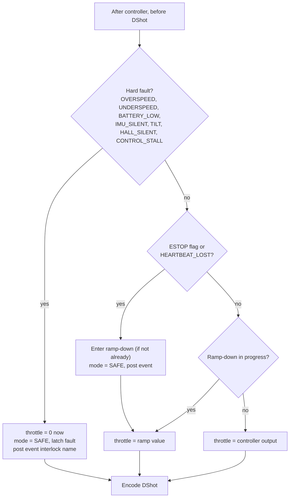

### 14.3 Ramp-down (e-stop and heartbeat loss)

TD §6.7: ramp the wheel to zero over 5 s, then DShot 0, so the box speeds up gently. Starting at the cap, the box accelerates at about 5 rad/s² during the ramp and ends near 4.0 rev/s [C]. The ramp limits the acceleration; it does not limit the final box speed, which momentum conservation fixes [C].

Implementation [D]:

1. Freeze the controllers. Record throttle_0 = current throttle.
2. Each tick, throttle = throttle_0 × (1 − t / 5 s), open loop, mapped to 0 once below 48. t is wall time from the alarm clock, so missed ticks do not lengthen the ramp (§9.2, V-66).
3. At t = 5 s, or as soon as a hard fault occurs, send DShot 0.

The ramp is **open-loop on throttle**, not closed-loop on Ω_ref, because closed-loop control below the 800 rpm sensorless limit is not trusted [A] A-8, and because the safety path should not depend on the Hall sensor.

After DShot 0, BLHeli_S stays in its run loop for about 8 s with damped light, which likely brakes the wheel [A] TD A-17, measured in T-12. The box rate after an e-stop is therefore a T-12 measurement, not something firmware controls.

### 14.4 Controlling client and heartbeat

- The **controlling client** is the WebSocket client whose `arm` was last accepted [D].
- Only the controlling client's `ping` and `cmd` messages reset the heartbeat [D].
- `estop` is accepted from **every** client, in every state, without arming [V] TD §7.3.
- Commands other than `estop` and `ping` from a non-controlling client are refused with `reason:"not controlling client"` while the box is armed [D].
- If the controlling client disconnects, the heartbeat expires 1 s later and the ramp-down starts. No reconnect resumes motion; the operator must arm again [D], consistent with TD §7.3 and with the main UI's link, which never reconnects by itself (§17).

The main UI commands the box (§17, R4.1): its operator page arms, pings every 200 ms from its first command, and runs the judge sequence. A ground-station page that only watches is still harmless: it receives telemetry but can never keep an armed box alive (finding V-15), and its e-stop works from any state.

### 14.5 Watchdog

The ESP-IDF task watchdog is configured for 100 ms on the control task [V] TD §6.2 for the value; API [A]. The control task feeds it at the end of every tick. On expiry, the panic handler resets the MCU [A]. The boot path sends DShot 0 within milliseconds (§8). Between the hang and the new zero frames, the ESC itself stops drive about 0.3 s after the last frame [V] TD §5.2.

---

## 15. Communications

### 15.1 Network

| Item | Value | Label |
| --- | --- | --- |
| Mode | Wi-Fi station with DHCP, 2.4 GHz | [D] 2026-10-10; TD §7.1 |
| Discovery | mDNS hostname `direcsun` (`espressif/mdns`), so the box answers at `direcsun.local`; the assigned address is also logged on the serial console at connect | [D] |
| Credentials, static address, SoftAP flag | menuconfig, from `firmware/sdkconfig.defaults.local` (gitignored); never in source control and never over the wire | [D] |
| Static address (option) | 10.TE.AM.120 on the OM5P-AC, gateway 10.TE.AM.1, /24 | [V] TD §7.1 |
| Power save | Disabled with `esp_wifi_set_ps(WIFI_PS_NONE)` to keep latency low, as in the DirecSun1 prototype | [A] verified by the owner on an ESP32-C3 |
| Fallback | SoftAP selected in menuconfig at build time (default address 192.168.4.1 [A]); never an automatic switch during a session | [D] TD §7.1 names the fallback; automatic switching is rejected because it would change the box address mid-demo |
| Endpoint | Port 80, path `/ws`, the main UI's default: `ws://direcsun.local/ws`, or `ws://<printed address>/ws`; `ws://192.168.4.1/ws` in SoftAP mode | [D] 2026-10-10 (finding U-2); TD §7.2 |

### 15.2 WebSocket server

| Item | Choice | Label |
| --- | --- | --- |
| Library | ESP-IDF `esp_http_server` with `CONFIG_HTTPD_WS_SUPPORT=y`, URI `/ws` registered as a WebSocket handler on port 80, the main UI's endpoint (finding U-2). Other paths are not served. Outbound frames go through `httpd_queue_work` and `httpd_ws_send_frame_async`, the pattern of the DirecSun1 prototype | [A] verified by the owner on an ESP32-C3; build check BC-4 on the S3 |
| Max clients | 3 (`max_open_sockets`), with LRU purge off, so a fourth connection is refused rather than evicting a connected (possibly controlling) client. Client ids are never reused, so a reconnect is a new client and resumes nothing | [D] |
| Threads | The httpd task (core 0) owns every socket and the client table: handshakes, inbound frames, pongs and parse refusals sent inline, and every outbound send. The comms task (core 0, 50 Hz, below httpd priority) drains acks and events from control, encodes the newest snapshot, and hands both over through a queue and a latest-tlm buffer | [D] R3.5 |
| Outbound policy | `tlm` goes to every client; a client whose socket is not writable at that moment skips the frame and `tlm_dropped` increments. An `ack` goes to the client that sent the command. An `event` goes only to clients that have sent at least one message, so a page that only watches receives only `tlm`, which carries the mode in every frame. Each comms period sends its acks and events before its `tlm`; with the ordering guarantee (§7.4), the first `tlm` after any of them reflects that tick or a later one (R4.1). Acks and events are not skipped for a slow socket; a send that fails closes that client | [D] R3.5 (finding V-38) |
| Inbound size limit | 512 bytes per message; 513 to 1024 bytes are read and refused with `ack ok:false reason:"too large"` and `seq` 0; anything larger closes the session, because skipping it would desynchronise the stream | [D] |
| JSON | Encode every message with `snprintf` into fixed buffers (no heap). Parse commands with cJSON 1.7.19, vendored in `direcsun_core/third_party/cjson` so the firmware and the host tests run the same parser (the `espressif/cjson` registry dependency is gone); `CJSON_NESTING_LIMIT` = 8 | [D] R3.5 (finding V-39) |
| Wire sign | `direcsun_core/src/protocol.cpp` is the only code that converts between the internal counter-clockwise frame and the clockwise wire frame (§2.3, U-1); host test "sign conversion" pins it, and the `no_wire_sign` mutant proves the test can fail | [D] R3.5 |
| Contract check | Every message kind is described by `protocol/schema-v1.json`. Host test HT-9 parses every client-direction schema fixture through the real parser and writes one of every encoded message kind for `tools/check-protocol.sh`, which validates them against the schema and requires a deliberately malformed `tlm` to fail | [D] |

### 15.3 Message schema, version 1

All messages are JSON objects with `v`, `type`, and `seq` [V] TD §7.3. `seq` is the sender's own counter. Times are box milliseconds since boot. Units are those in §2.2. Every quantity about the spin axis is clockwise positive on the wire, the frame the main UI uses; the firmware converts from its internal frame only in its protocol layer (§2.3, finding U-1).

#### `tlm`: box → all clients, 50 Hz

| Field | Type | Meaning | Source |
| --- | --- | --- | --- |
| `v` | int | 1 | TD |
| `type` | `"tlm"` | n/a | TD |
| `seq` | int | Box telemetry counter | TD |
| `t_ms` | int | Box time since boot | TD |
| `mode` | string | Wire mode name (§2.4) | TD |
| `manual_input` | string or null | `throttle`, `wheel`, or `rate` in `MANUAL`; null otherwise | [D] |
| `psi_deg` | number | Wrapped heading (−180, 180], clockwise positive (wire frame, §2.3) | TD; wrap [D]; sign [D] U-1 |
| `psi_ref_deg` | number or null | Current reference, clockwise positive and relative to the last `zero_heading`: a number in HOLD and SLEW (R4.3), null in SAFE, SPINUP, READY, DETUMBLE, and MANUAL | TD; null rule [D] |
| `rate_dps` | number | ω̂, clockwise positive (the internal ω̂ negated) | TD |
| `mag_deg` | number or null | ψ_mag, clockwise positive (null if the magnetometer is missing, and null until magnetometer heading exists in Set 5) | TD; [D] V-40 |
| `sun_deg` | number or null | Calibrated sun angle, clockwise positive | TD |
| `sun_valid` | bool | n/a | TD |
| `wheel_rpm` | number | `speed_safe` | TD |
| `wheel_ref_rpm` | number | Ω_ref | TD |
| `throttle` | int | DShot value sent (0..2047) | TD |
| `tau_cmd_mNm` | number | τ_cmd, clockwise positive (the internal τ_cmd negated) | TD |
| `vbat` | number | 1 s average battery voltage | TD |
| `loop_us` | int | Longest tick in the last 20 ms | TD; "longest" [D] |
| `flags` | string[] | e.g. `MOMENTUM_OK`, `MOMENTUM_NEAR_LIMIT`, `MOMENTUM_SATURATED`, `LOOP_OVERRUN`, `IMU_MISSING`, `MAG_MISSING`, `MANUAL_STALE`, `HALL_BYPASS`, `WHEEL_STEP`, `MOMENTUM_SATURATED`, `HEADING_GYRO` (every frame until Set 5: the heading is gyro-only and relative to the last `zero_heading`, R4.2), `FF_TABLE_MISSING` (Hall installed, `ff_count` 0: the wheel loop is unavailable, R5.3), `RATE_GAIN_REDUCED` (`rate_gain_scale` below 1, R5.3), then the latched fault names | TD; list [D] |
| `t_c`, `p_pa` | number or null | BMP280, optional | [D] |
| `tlm_dropped`, `dropped_events` | int | Counters | [D] |
| `gyro_raw`, `mag_raw`, `sun_a_mv`, `sun_b_mv` | int[3], int[3], int, int | Bench mode only: raw sensor counts in the sensors' own axes (not converted to the wire frame) and the sun sensor millivolts (§19.2) | [D] |

Example (values illustrative, not measurements; `vbat` chosen inside the NiMH range, finding V-3):

```json
{"v":1,"type":"tlm","seq":1042,"t_ms":83120,"mode":"HOLD",
 "psi_deg":47.2,"psi_ref_deg":47.0,"rate_dps":0.3,"mag_deg":46.8,
 "sun_deg":null,"sun_valid":false,"wheel_rpm":2504,"wheel_ref_rpm":2510,
 "throttle":412,"tau_cmd_mNm":0.8,"vbat":10.1,"loop_us":740,
 "flags":["MOMENTUM_OK"],"t_c":null,"p_pa":null,"tlm_dropped":0,"dropped_events":0}
```

At about 250 to 300 bytes per frame and 50 frames/s the stream is about 12.5 to 15 kB/s, about 0.1 Mb/s [C], far below the radio's 4 Mb/s default limit [V] TD §7.

#### `cmd`: client → box

| `cmd` | Fields | Accepted in | Effect |
| --- | --- | --- | --- |
| `arm` | none | SAFE | → SPINUP if guards pass; sender becomes the controlling client |
| `disarm` | none | SPINUP, READY, active modes | Ramp-down → SAFE (same as e-stop, without the ESTOP latch) [D] |
| `estop` | none | Any state, any client | Ramp-down → SAFE, ESTOP latch |
| `mode` | `mode`; `psi_ref_deg` (clockwise positive) for SLEW; `input` for MANUAL | READY (and active modes for `READY`) | Transition per §13.1 |
| `manual` | exactly one of `throttle` (int), `wheel_rpm`, `rate_dps` (clockwise positive), matching the active input | MANUAL, controlling client only | New setpoint, clamped and rate-limited per §13.5; counts as heartbeat |
| `respin` | `wheel_rpm` (optional, default bias) | READY | → SPINUP to the new start speed (§13.4) |
| `zero_heading` | none | SAFE, READY | Heading offset (§11.3) |
| `set_params` | `params` object | SAFE only, once any ramp-down has ended (V-65) | Validate every key and range; store in NVS; reply with the applied set [D] |
| `wheel_step` | `delta_rpm` (±500 max) | READY, bench flag set, wheel loop available | Ω_ref step, clamped to [Ω_low + 100, cap in force] (V-52), with the attitude and rate loops suspended until `mode READY` is sent again (tlm flag `WHEEL_STEP` meanwhile); for §12.5 and the wheel-loop step response [D]. Refused, in this order, with `bench_mode required`, `not in READY`, or `wheel loop not available` (no Hall, or no `ff_table` yet). Interlocks stay active |

#### `ack`: box → sender

```json
{"v":1,"type":"ack","seq":77,"ok":false,"reason":"wheel not at bias"}
```

`seq` echoes the command's `seq` [V] TD §7.3, or is 0 when the refused frame had no readable `seq` (too large, malformed JSON). Unknown `v`, unknown `type`, unknown `cmd`, a malformed message, or a failed guard → `ok:false` with a reason [V] TD §7.3. The reasons are fixed strings [D] (finding V-41):

- parse refusals, from the comms layer: `too large`, `malformed JSON`, `missing v`, `unsupported v`, `invalid seq`, `unknown type`, `unexpected type <t>` (a box-to-client type sent by a client), `unknown cmd`, `missing field: <f>`, `unexpected field: <f>`, `invalid field: <f>`, `two setpoints`, `missing setpoint`, `unknown param: <k>`, `invalid param: <k>`, `too many params`;
- `busy`, when the command queue is full (an `estop` is still applied through its flag and acked `ok:true`);
- guard refusals from the supervisor (§13.1): for example `not in SAFE`, `not controlling client`, `box not still`, `battery low`, `latched fault: <NAME>`, `input not available`, `too fast`, `not implemented`.

A `set_params` ack with `ok:true` carries `applied`, the parameter object as received: updates are all-or-nothing, so what was applied is exactly what was sent.

> **Ambiguity resolved (finding V-14).** TD defines `seq` as "the sender's counter" for every message, but the ack example uses the command's `seq` (77). The firmware therefore puts the **echoed command seq** in `seq` for `ack` messages only. Every other box message uses the box's own counter.

#### `ping` / `pong`

Client sends `{"v":1,"type":"ping","seq":79,"t_client_ms":512330}` at 5 Hz [V] TD §7.3. The main UI's pings carry a fractional `t_client_ms` (`performance.now()`, three decimals) and share one `seq` counter with its commands (§17). Box replies `{"v":1,"type":"pong","seq":<box seq>,"ping_seq":79,"t_client_ms":512330,"t_ms":83120}` [D field names], which lets the client compute round-trip time for T-11. Comms answers the pong itself and forwards every ping to the supervisor as a command, so the supervisor alone decides whose pings keep an armed box alive (V-32).

#### `event`: box → all clients

```json
{"v":1,"type":"event","seq":311,"t_ms":83500,"event":"mode","mode":"SAFE","cause":"HEARTBEAT_LOST"}
```

Sent on every mode change and every interlock trip [V] TD §7.3, to every client that has sent at least one message (§15.2). The catalogue [D] (finding V-42):

| `event` | Fields | When |
| --- | --- | --- |
| `mode` | `mode`, `cause` | Every mode change. `cause` is an interlock name (`ESTOP`, `HEARTBEAT_LOST`, `OVERSPEED`, ...), the command that caused it (`arm`, `disarm`, `mode`, `respin`), or an automatic transition: `boot`, `spinup_complete`, `slew_complete`, `SLEW_TIMEOUT`, `sun_invalid` |
| `notice` | `name`, optional `detail` | `PARAMS_RESET` (detail `missing`, `version`, or `invalid`): the stored parameters were not usable and the defaults loaded. `HALL_BYPASS` (detail `on` or `off`): the Hall bench bypass changed |

`t_ms` of an event is the time comms encoded it, at most 20 ms after the supervisor posted it, while a `tlm`'s `t_ms` is the control tick its snapshot was taken on. The two are different clocks of the same box: a client orders events against telemetry by the order frames arrive on the socket, never by `t_ms`. In socket order the box guarantees that the first `tlm` after an `ack` or `event` reflects that tick or a later one (§7.4, R4.1), so after a `mode` event the next `tlm` already shows the new mode. "Too fast" for MANUAL setpoints (§13.5) is measured when the supervisor drains the command, within one 2 ms tick of its arrival.

### 15.4 Command handling sequence

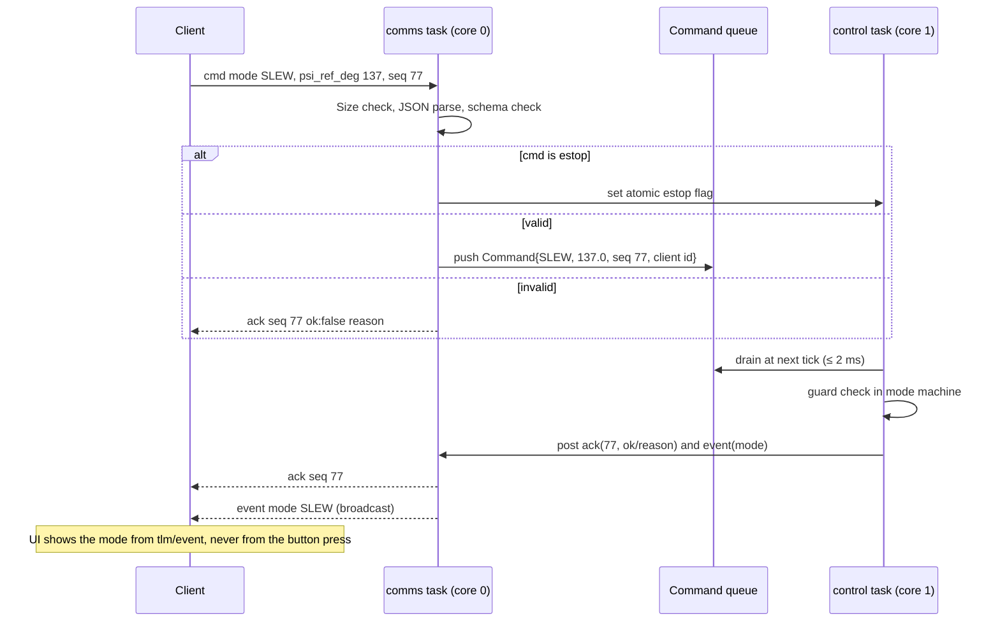

---

## 16. Parameters and persistence

Stored in NVS under namespace `direcsun` with a `param_version` key. On a version mismatch, defaults are loaded and the event `PARAMS_RESET` is posted [D].

| Key | Default | Range | Set by |
| --- | --- | --- | --- |
| `k_psi` | 3.1 | 0..10 | `set_params` |
| `k_omega` | 0.0129 | 0..0.05 | `set_params` |
| `k_i` | 0.0163 | 0..0.1 | `set_params` |
| `rate_gain_scale` | 0.2 | 0..1 | `set_params`. Multiplies `k_omega` and `k_i`: 0.2 for the first unpinned runs and the sign check (§12.5), 1 once the sign is confirmed. Added in R3.9 with `param_version` 2 [D] |
| `wheel_kp`, `wheel_ki` | 0 until T-5 [D] | 0..10 | `set_params` |
| `ff_table` | 8 points | monotonic | `set_params` |
| `omega_low_rpm` | 800 | 500..1500 | after T-18 |
| `omega_bias_rpm` | 2400 | low+400 .. cap−400 | after T-18 |
| `omega_cap_rpm` | 4000 | **≤ 4000 (`kOmegaCapMaxRpm`)** | firmware rebuild only (TD §10.3: changing the cap requires re-running Section 3). Not settable over the wire at all (`not settable`), and not persisted [D] |
| `s_w`, `s_gyro` | +1 | ±1 | after T-5, T-8 |
| `mag_axis_map`, `mag_cal` | see §10.2 | n/a | after T-9 |
| `sun_cal`, `light_threshold` | identity, 0 | n/a | after T-10 |
| `dshot_rate` | 150 | 150 or 300 | after reading the ESC MCU (TD §5.2) |
| `bench_mode` | false at every boot | bool; cannot turn off while `hall_installed` is false | `set_params` in SAFE; never persisted [D] |
| `manual_throttle_min`, `manual_throttle_max` | 150 and 400 until T-5 [D]; then from T-5 [M] | 48..2047, min < max; the band must keep the wheel between Ω_low and Ω_cap | `set_params` in SAFE |
| `spinup_throttle` | 300 until T-5 [D] | 48..2047, above `hall_expect_throttle` | `set_params` in SAFE; the open-loop throttle `SPINUP` ramps to (§13.1, R3.7) |
| `hall_expect_throttle` | 200 until T-5 [D] | 48..2047, below `spinup_throttle` | `set_params` in SAFE; set to FF(Ω_low) after T-5; arms `HALL_SILENT` (§14.1). Below `spinup_throttle` so that every `SPINUP` arms it: `SPINUP` is exempt from `UNDERSPEED`, so `HALL_SILENT` is the only stop for a silent Hall sensor there (V-11, V-64) |
| `hall_installed` | true at every boot | bool; false only with `bench_mode` already true | `set_params` in SAFE; never persisted; the Hall bench bypass (§13.1) |
| `bench_underspeed_rpm` | 0 (off) at every boot | 0, or 100..Ω_low | `set_params` in SAFE with `bench_mode` on; never persisted; cleared when `bench_mode` turns off. Replaces Ω_low as the `UNDERSPEED` threshold for T-18 only (§19.2) [D] |
| `bench_cap_rpm` | 0 (off) at every boot | 0, or `omega_bias_rpm`..`omega_cap_rpm` | `set_params` in SAFE with `bench_mode` on; never persisted; cleared when `bench_mode` turns off. Lowers the cap in force (Ω_ref clamp and `OVERSPEED` at cap + 100) for the deliberate overspeed check; it can never raise the cap [D] |
| Wi-Fi SSID, password, static address, SoftAP flag | n/a | n/a | menuconfig, from `firmware/sdkconfig.defaults.local` (gitignored); never over the wire |

`set_params` is all-or-nothing: the merged set is validated as a whole, and one bad key rejects the update and names the key. A cross-key rule names the same key whichever key the update changed: `omega_bias_rpm` for the bias between the limits, `manual_throttle_min` for the band, and `hall_expect_throttle` for the `HALL_SILENT` threshold. A stored set that breaks any rule loads the defaults, with the notice `PARAMS_RESET` `invalid`. `mag_axis_map` and `mag_cal` are live from R5.1 (`param_version` 4) and `sun_cal` and `light_threshold` from R5.4 (`param_version` 3). Both families are stored with the other persisted keys, and the wire frame of each is clockwise positive where it holds an angle. Parameters are persisted outside the control task, because a flash write stalls both cores' caches: the supervisor reports `params_changed`, and a lower-priority task writes NVS [D]. `set_params` is refused during a ramp-down with `ramp-down in progress` (V-65): the box reports `SAFE` then, but the wheel is still driven, the running ramp would ignore a lowered cap, and the flash write would stall the control tick while the motor turns.

`dshot_rate` defaults to the slower, always-supported DShot150 until the ESC's MCU is read [D]. TD says DShot150 works on 24 MHz MCUs and DShot300 needs 48 MHz [V].

---

## 17. Integration with the main UI

The main UI is `frontend/`, Aaron's landing page and ground station, built with React, Vite, and TypeScript. It became the main UI on 2026-10-10 when PR #1 merged, and the owner decided that the backend matches it (finding U-3). For the wire interface (message fields, units, sign, endpoint) the UI leads. `protocol/schema-v1.json` encodes what the UI expects, and §15 and the firmware follow.

`ground/link/` and `ground/console/` are engineering bench tools for firmware bring-up and characterisation, and are not shown to judges. The UI now commands the box, and its own TypeScript client keeps the safety rules `ground/link/` proves: a 5 Hz ping heartbeat, acks matched to commands by `seq`, an `estop` that is sent at once and never queued, and no automatic reconnect (§14.4, §21).

The bench console binds the e-stop to Space wherever focus is, its endpoint text field included, and a focused text field or button cannot take the key instead (finding V-63). A ground station that binds an e-stop key needs the same rule, or the key silently does nothing while a field has focus.

The table records facts read from the operator client in `frontend/ground-station` on `main` at c72559c: `src/hardware/deviceLink.ts`, `src/hardware/deviceOperator.ts`, `src/ground/DeviceControls.tsx` [V at that commit]. `deviceOperator.ts` and `DeviceControls.tsx` are unchanged from `frontend/draft` at c4e3b0c, where R4.1's audit ran the UI against the mock box and against a host build of the real core; `deviceLink.ts` has since gained only the sensor fields. HT-13 (§19.1) replays the UI's exact frames and sequence against the whole core. Defects found in the UI on the way are filed for Aaron as issue #32 (R4.1).

| Main UI fact | Firmware consequence |
| --- | --- |
| Every command is `{"v":1,"type":"cmd","seq",cmd,...fields}`, with one `seq` counter shared with its pings, wrapping below 2^32 (`deviceLink.ts:412-434`) | The parser accepts each frame the UI sends (HT-13 (a), and the fixtures `ping-ui`, `cmd-mode-slew-left`, `cmd-mode-slew-return`). The `ack` echoes the command's `seq` (§15.3) |
| From its first command it sends `{"v":1,"type":"ping","seq","t_client_ms"}` every 200 ms, with `t_client_ms` from `performance.now()` to three decimals, and keeps pinging while the socket is open (`:454-467`) | 5 Hz against the 1 s heartbeat (§14.4). The pong echoes the fractional `t_client_ms` and the ping's `seq` (HT-13 (a)). The timer is a page `setInterval`, which a browser may slow in a hidden tab (unverified; issue #32) |
| Every command, `estop` included, must be acked by `seq` within 1000 ms, or it fails with `TIMEOUT` (`:209`, `:421-436`) | The supervisor acks every command in the tick it drains it, and comms sends the ack within one 20 ms period (§15.2). HT-13 (b) checks each ack is posted in its command's tick |
| It reads `ack.{seq, ok, reason}`, `pong.ping_seq`, and `event` with `event` `mode` or `notice` and `mode`, `cause`, `name`, `detail`; a control frame must carry `v` 1 (`:385-410`, `:438-452`, `:470-476`). From `tlm` it reads `seq`, `t_ms`, `mode`, `psi_deg` (required, finite), `psi_ref_deg`, `rate_dps`, `wheel_rpm`, `wheel_ref_rpm`, `throttle_band`, `flags`, `vbat`, and the sensor fields (`:115-175`) | All present in §15.3; `psi_deg` is always numeric. Unknown `flags` are shown as warning chips (`:48-64`), so `HEADING_GYRO` appears as a permanent warning (issue #32) |
| Arm, disarm, and e-stop (a button, or the space bar while armed, `DeviceControls.tsx:43-59`). After the `arm` ack the page controls the box until a `tlm` shows `SAFE`. A `SAFE` event whose cause is not `disarm` shows "THE BOX WENT SAFE: <cause>" (`deviceOperator.ts:96-134`, `:239-254`) | The arm guards and their reasons are §13.1; `estop` works from any client in any state (§14.4) |
| The turn (`deviceOperator.ts:136-155`): `zero_heading`, then `mode SLEW` with `psi_ref_deg` ±90. It waits up to 10 s for an `event` READY with cause `slew_complete`, and fails on `SLEW_TIMEOUT`, any other READY cause, or a mode other than SLEW or READY (`:170-187`); a READY `tlm` without that event fails after 1 s. It then holds 1 s and fails on **any `tlm` whose mode is not READY** (`:147`), then sends `mode SLEW` with `psi_ref_deg` 0 and waits the same way | `zero_heading` is accepted in SAFE and READY (R4.2) and SLEW targets are relative to it (R4.3). A slew completes in about 3.0 s at the design gains (HT-13 (b)). The hold check is why the first `tlm` after `slew_complete` must already say READY: the ordering guarantee (§7.4, finding U-5) |
| Stop turn (`:157-168`) cancels the turn locally, and sends `mode READY` only if the newest `tlm` already says SLEW | `mode READY` in READY is a harmless `ok` with no event and no other effect (HT-13 (d)), so the UI may send it whenever a SLEW may be in flight (finding U-6, issue #32) |
| It does not reconnect automatically (`deviceLink.ts:323`) | Matches §14.4 |
| Its endpoint placeholder is `ws://192.168.4.1/ws`, and it saves whatever URL the user enters (`src/ground/DeviceLinkPanel.tsx`) | The firmware serves port 80 at `/ws` (§15.1, §15.2): SoftAP mode is exactly that default, and station mode is `ws://direcsun.local/ws` (finding U-2) |
| **Positive heading is clockwise seen from above.** "Rotate right" commands +90°, and the 3D model turns by `rotation.y = -ψ` | The wire is clockwise positive and the firmware converts in its protocol layer (§2.3, finding U-1). Wire +90 turns the box clockwise (HT-13 (b): the plant turns −90° in the internal frame) |
| Its simulation turns at 60 deg/s and 120 deg/s² (`src/simulation/constants.ts`) | The same trapezoid limits as §12.4 |
| It loads `/assets/direcsun.glb` (`frontend/shared/data/assets.ts`) when present, and otherwise draws a schematic box ("SCHEMATIC MODEL, CAD NOT LOADED") | The CAD pipeline exports that model (repository Set 2, R2.5) |
| While device telemetry is live, the simulation controls give way to the device controls and the header reads "DEVICE CONNECTED, RECEIVING TELEMETRY" | No firmware consequence |

---

## 18. Repository layout and build

### 18.1 Layout

```text
firmware/                     ESP-IDF v6.0 project; run idf.py from here (or tools/idf.sh)
  CMakeLists.txt              project, C++17, SDKCONFIG_DEFAULTS (+ sdkconfig.defaults.local if present)
  sdkconfig.defaults          tracked, annotated line by line
  sdkconfig.defaults.local    gitignored: Wi-Fi credentials, static address, SoftAP flag
  dependencies.lock           committed, for reproducible builds
  main/
    app_main.cpp              boot sequence (§8), task creation
    control_task.cpp/.hpp     tick orchestration (§9)
    shared.hpp                queues, seqlock snapshot, atomics (§7.4)
    idf_component.yml         esp-idf-lib/mpu6050, esp-idf-lib/bmp280, espressif/mdns, espressif/cjson
  components/
    direcsun_core/            pure logic: no ESP-IDF, FreeRTOS, or driver headers
      include/direcsun/core/  angles, dshot_frame, wheel_speed, estimator, controllers,
                              modes, interlocks, protocol, params (.hpp)
      src/
    direcsun_drivers/         hardware access only: i2c_bus (i2cdev, recovery), imu, mag,
                              baro, hall (ISR + ring buffer), adc_inputs, dshot_rmt
    direcsun_comms/           wifi (STA, DHCP, mDNS, SoftAP), ws_server (esp_http_server),
                              comms task, JSON (cJSON)
    qmc5883p/                 vendored duruofu/qmc5883p 0.1.0 with documented local patches
  test/host/                  CMake + doctest, host compiler, ASan and UBSan
    test_*.cpp                one file per core module (HT-1 to HT-11)
    plant_sim.hpp             two-body plant from TD §3.1 for closed-loop host tests
```

`direcsun_core` must not include any ESP-IDF, FreeRTOS, or driver header. That rule is what makes host testing possible; `tools/check-core-purity.sh` enforces it in CI [D]. C++ code uses the namespace `direcsun` with one nested namespace per module.

### 18.2 Toolchain

| Item | Choice | Label |
| --- | --- | --- |
| SDK | ESP-IDF v6.0 installed with EIM; `tools/idf.sh` activates it and runs `idf.py` in `firmware/` | [D] 2026-10-10 (§24 Q1) |
| Target | `esp32s3` | [V] TD §6.1 |
| Language | C++17 (`gnu++17`), exceptions and RTTI off; the vendored drivers are C | [D] 2026-10-10 |
| Host tests | CMake + doctest (vendored single header) with the host g++ | [D] |

---

## 19. Verification

### 19.1 Host tests (no hardware, run on every change)

| ID | Module | What it proves |
| --- | --- | --- |
| HT-1 | `dshot_frame` | The four vectors in §10.6; values 1–47 never emitted for controller requests |
| HT-2 | `wheel_speed` | 30/p conversion; plausibility window; median; staleness bound falls with time |
| HT-3 | `estimator` | Bias frozen while moving; complementary filter converges to ψ_mag with τ = 2 s; wrap at ±180 |
| HT-4 | `controllers` | Anti-windup stops integration at saturation; trapezoid gives 2.0 s ± 1 tick for 90° |
| HT-5 | `controllers` + `plant_sim` | Closed loop on the TD §3.1 plant: detumble 1 rev/s within 5 s; 90° slew within 3 s settling to ±3°; Ω_ref never exceeds 4000 rpm. R3.9 covers the detumble at 0, 1, and 3 mN·m of friction, ±30 deg/s rate tracking, and the Ω_ref bounds; the slew half arrives with the attitude loop (Set 4) |
| HT-6 | `controllers` sign | With s_w = −1 instead of +1, HT-5's detumble diverges, so the test can see a sign error (positive control) |
| HT-7 | `modes` | Every row of §13.1, every refused transition with its reason, FR-2 timing in ticks |
| HT-8 | `interlocks` | Each interlock trips at its threshold and not 1 % below; hard faults zero throttle in the same tick; ramp-down reaches 0 at 5 s; no path leaves `SAFE` after a fault without `arm`, with a mutant build that compiles out latching as its positive control; with timer alarms missed, the heartbeat, the ramp, and every interlock duration still end on wall time (V-66; mutants that count executed ticks must fail) |
| HT-9 | `protocol` | Parse every `cmd`; reject oversize, wrong `v`, unknown `type`; `ack` echoes `seq`; `tlm` round-trips through a JSON parser |
| HT-10 | `interlocks` | `HALL_SILENT` trips during SPINUP with throttle high and no edges, for every parameter set the box accepts, on the tick its 500 ms ends (V-64; a mutant build without the `hall_expect_throttle` rule must fail it) |
| HT-11 | `modes` + `protocol` | `MANUAL`: entry refused from any mode but READY and for an unbuilt input; each setpoint form clamps to its limits; a setpoint for the wrong input, from a non-controlling client, or under 50 ms after the last is refused; after 250 ms without setpoints `rate` falls to 0 and `MANUAL_STALE` is set while `throttle` and `wheel` hold; an accepted setpoint resets the heartbeat |
| HT-12 | `modes` | Hall bench bypass: property tests over 10,000 random parameter sets and command sequences show the throttle never exceeds `kBypassThrottleMax` while bypassed (a mutant build without the clamp must fail it), the bypass is refused outside `SAFE` and without `bench_mode`, and every boot starts with `hall_installed` true |
| HT-13 | `protocol` + `modes` + `control` + `estimator`, with `plant_sim` | The main UI's exact frames and judge sequence against the whole core (R4.1, §17): (a) each frame the UI sends parses to what it means, and the pong echoes the fractional `t_client_ms`; (b) arm, `zero_heading`, SLEW ±90, 1 s of READY, SLEW 0, then a second page's e-stop, at 0, 1, and 3 mN·m and both ways: every ack `ok` in its command's tick, each slew complete in under 3.5 s, and the plant turning the way the wire says; (c) step 5's order and the comms flush modelled at all ten comms phases: the first `tlm` after every mode event has its mode, and after every ack is from that tick or later; (d) `mode READY` in every state, a no-op `ok` in READY; (e) `mode READY` on the tick after SLEW stops the box within 10° of its start. Mutants: `snapshot_cadence_only` must fail (c), and `no_wire_sign` must fail (b) |

HT-6 follows TD §8.5's rule that an empty result counts only if a known positive is detected by the same instrument.

### 19.2 Bench and integration tests

These map firmware features onto TD §9:

| TD test | Firmware needed |
| --- | --- |
| T-5 ESC arming, DShot, s_w | §8 boot zeros, §10.6, `bench_mode` + `wheel_step` |
| T-6 Hall vs strobe | §10.4, `wheel_rpm` in telemetry |
| T-7 imbalance | Raw accel RMS field: add `accel_rms_g` to `tlm` when `bench_mode` is true [D] |
| T-8 gyro bias and noise | §11.1; raw gyro in bench telemetry |
| T-9 magnetometer | Raw mag fields in bench telemetry; calibration upload via `set_params` |
| T-10 sun sensor | Raw A, B in bench telemetry |
| T-11 telemetry | `seq`, `t_ms`, `pong` |
| T-12 ESC signal loss | Bench command to stop sending frames is **not** provided; unplug the wire as TD describes [D] |
| T-13 interlocks | Every interlock trips with an `event` naming it |
| T-15–T-17 | Modes and controllers |
| T-18 low-speed limit | MANUAL throttle stepped downward in bench mode, with the UNDERSPEED threshold lowered by `bench_underspeed_rpm` (bench mode only, R3.8); the T-5 map itself comes from the bench console's MANUAL throttle sweep |

### 19.3 Build checks (first day, before any feature work)

| ID | Check | Unblocks |
| --- | --- | --- |
| BC-1 | ESP-IDF v6.0 builds the skeleton (every driver library linked) for esp32s3, and it boots on the XIAO | Everything |
| BC-2 | RMT bytes encoder produces the four §10.6 frames; verify on a logic analyser or oscilloscope at both DShot rates | DShot |
| BC-3 | `gptimer` alarm notifies a task at 500 Hz; log jitter for 10 s | Control timing |
| BC-4 | `esp_http_server` WebSocket on port 80 at `/ws` accepts the main UI, the console, and a test client; 50 Hz broadcast for 10 min | Comms |
| BC-5 | Task watchdog at 100 ms resets the board when the control task is deliberately blocked | Safety |
| BC-6 | I2C at 400 kHz reads all three Adafruit boards on one i2cdev-owned bus, with the QMC5883P on the shared handle; scope the edges (TD §5.3) | Sensors |

---

## 20. Implementation plan

### 20.1 Order of work

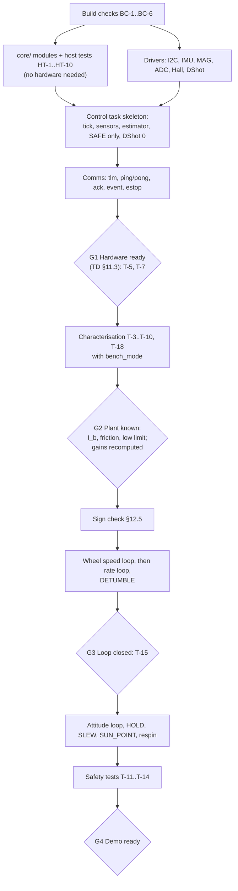

### 20.2 Work items

| ID | Item | Depends on | Done when | Owner (TD §11.5) |
| --- | --- | --- | --- | --- |
| F-1 | Toolchain, BC-1..BC-6 | n/a | All six pass | Julian |
| F-2 | `core/` + host tests | F-1 (compiler only) | HT-1..HT-10 pass | Julian; an agent can draft |
| F-3 | Drivers | F-1, assembled electronics (W-3) | Raw values on serial | Julian |
| F-4 | Control task skeleton, SAFE only | F-2, F-3 | `loop_us` < 1000 for 10 min, DShot 0 verified on scope | Julian |
| F-5 | Comms | F-4 | Frontend shows live telemetry; T-11 passes | Julian; Aaron checks the page |
| F-6 | Bench mode and characterisation support | F-5 | TD §12.2 values recorded | Both |
| F-7 | Wheel loop, rate loop, DETUMBLE | G2 | T-15 | Julian |
| F-8 | Attitude, HOLD, SLEW, SUN_POINT, respin | G3 | T-16, T-17 | Julian |
| F-9 | Interlock verification | F-7 | T-13 | Both |

In `changes/`, F-1 is Set 1 (R1.4, R1.5) and the start of Set 3; F-2 to F-6 are Set 3 (teleop); F-7 and F-9 are Set 4 (detumble); F-8 is Set 5 (pointing).

---

## 21. Rules for AI agents changing this firmware

1. **Never** send DShot commands 1–47 from flight code, and never add a wire command that changes ESC settings.
2. **Never** raise `omega_cap_rpm` above 4000, add a way to raise it over the network, or weaken an interlock threshold, without a TD revision that re-runs TD §3 and PR-4.
3. Keep `direcsun_core` free of hardware headers (`tools/check-core-purity.sh`). If logic needs hardware, add a driver interface and inject it.
4. Every new interlock gets a host test that shows it trips, and a test that shows it does not trip 1 % inside the threshold.
5. A passing test suite counts only if HT-6 (the deliberate sign error) still fails as expected. Do not delete or weaken positive controls.
6. Keep claim labels honest. When a number changes, update §23 with the old value, the new value, and why.
7. Change the wire schema only under the versioning rule in `protocol/README.md`: additive, backward-compatible changes stay `v: 1`, and breaking changes bump `v`. The schema, §15, §17, `ground/link/`, `tools/mock-box.py`, and the firmware encoder change together. For the wire interface the main UI in `frontend/` leads, and the backend matches it.
8. Do not add automatic reconnection, automatic re-arming, or any path that resumes wheel motion without a fresh `arm` from an operator.
9. Follow the git flow in `changes/CONTEXT.md` (TD §8.5).

---

## 22. Firmware-specific risks

| Risk | Effect | Mitigation | Label |
| --- | --- | --- | --- |
| Rate-loop sign error | Box accelerates instead of damping | §12.5 sign check at reduced gain; HT-6 | [C] TD R-1 |
| Hall disconnect during SPINUP | Wheel overspeeds undetected | `HALL_SILENT` interlock | [D] V-11 |
| Magnetometer axis map wrong | Heading mirrored; HOLD drifts or runs away | T-9 direction check; the magnetometer stays out of the heading until `mag_cal` is set, so until then HOLD uses the gyro heading alone (V-48) [D] | [M] |
| Wheel loop too slow for the rate loop | Oscillation in DETUMBLE | Start at 2 Hz wheel; lower rate bandwidth if needed (§12.2) | [C] V-8 |
| Wi-Fi task starves core 0 | Telemetry gaps | Control is on core 1 and never waits; telemetry drops are counted | [A] |
| I2C forced to 100 kHz | Tick overrun | §9.2 fallback plan | [C] |
| ESP-IDF v6.0 API or registry surprises (RMT bytes encoder, `i2c_master`, cJSON and mDNS now registry components) | Delay | Set 1 links every library in the skeleton build; BC-2, BC-4, BC-6 early | [A] |
| NVS corruption or stale params | Wrong gains or signs after reflash | `param_version`, range checks, `PARAMS_RESET` event | [D] |

---

## 23. Adversarial validation log

Each statement below was challenged by recomputing it from TD's inputs, by checking it against another TD section, or by asking what a broken instrument would show. Findings marked **TD** are disagreements with the parent document; findings marked **This doc** are corrections made while drafting this document.

### 23.1 Findings

Rows U-1 onward record the main UI contract (2026-10-10). They are numbered separately, because the V-numbers after V-29 are taken by work on the Set 3 branch.

| # | Statement challenged | Check | Finding | Resolution here | Severity |
| --- | --- | --- | --- | --- | --- |
| V-1 | TD §6.5: K_ω = 2π · 2 Hz · I_b = 0.011 | Recomputed with TD §3.2's I_b = 1.03e-3 | 0.0129. The 0.011 value used the superseded I_b = 8.9e-4 (TD E-3) | Default 0.0129 (§12.2). TD T-3's pass band "within 30 % of 8.9e-4" is also stale; should read 1.03e-3 | Medium (TD) |
| V-2 | TD §10.2: automatic momentum dump at about 30 deg/s | Compared with the later decision in TD §3.6 | Conflicts: §3.6 makes the lock pin the desaturation actuator | `respin` sequence (§13.4); no automatic dump | Medium (TD) |
| V-3 | TD §7.3 example `"vbat":11.6` | NiMH range 8.8 to 11.2 V (TD §5.1) | 11.6 V cannot occur on the 8-cell NiMH pack | Example uses 10.1 V | Low (TD) |
| V-4 | TD §4.8: "the firmware inverts the magnetometer's Z axis" | Geometry: turning a board over is a proper rotation | Inverting Z alone is a reflection; a 180° flip about a horizontal axis negates Z and one horizontal axis. Heading uses the horizontal axes, so a Z-only inversion would leave heading mirrored | Configurable axis map, default negate Y and Z, confirmed by T-9 direction check | High (TD) |
| V-5 | TD §6.4: motor magnets at 13–67 Hz; 200 Hz sampling prevents aliasing | Pole count 14 (TD A-6) | Field components at 7× mechanical = 93–467 Hz exceed the 100 Hz Nyquist limit of 200 Hz sampling, so aliasing is possible. Also, 200 Hz is not an integer divisor of the 500 Hz tick | Poll every 2nd tick for data-ready; rely on distance, sensor oversampling, gyro-dominant filter, and T-9 at three speeds; per-speed correction table as fallback | Medium (TD) |
| V-6 | TD §5.3: at 100 kHz "the 1.5 ms IMU read still fits a 2 ms tick on its own" | 155 bit times at 100 kHz | 1.55 ms: fits only if nothing else is read in that tick, and leaves 0.45 ms for everything else | Explicit 100 kHz fallback plan (§9.2) | Low (TD) |
| V-7 | TD §6.4: wheel speed = median of last four periods, used by the 5–10 Hz wheel loop | Delay of a 4-period median at bias ≈ 25 ms | About 45° phase lag at 5 Hz and 90° at 10 Hz | Separate fast estimate for control, median for interlocks; wheel loop starts at 2 Hz | Medium (TD) |
| V-8 | TD §6.5 bandwidths 0.5 / 2 / 5–10 Hz | Cascade separation rule of thumb (inner ≥ 3–5× outer) | Rate-to-wheel ratio is 1–2.5 at the low end of the wheel target | Lower rate bandwidth if wheel loop < 3 Hz | Medium (This doc, from TD values) |
| V-9 | Gyro full-scale range unspecified in TD | Box can reach 1440 deg/s after a cap stop; PR-1 needs 360 deg/s | ±250 or ±500 deg/s ranges would clip | ±2000 deg/s (FS_SEL 3) | Medium (gap in TD) |
| V-10 | TD §6.4: bias "estimated while the box is still in Safe mode" | Safe mode is also entered after e-stop with the box spinning | Bias must be gated on actual stillness, not on mode | Stillness gate (§11.1) | Medium (TD wording) |
| V-11 | TD §6.7 interlocks with UNDERSPEED exempt during Spin-up | Failure analysis: Hall wire off during Spin-up | Wheel PI drives throttle up; OVERSPEED cannot see it | New `HALL_SILENT` interlock (§14.1) | High (gap in TD) |
| V-12 | TD §6.2: snapshot copied under a spinlock | Control on core 1 could spin while core 0 holds the lock | Bounded but unnecessary | Seqlock double buffer; spinlock acceptable alternative | Low (This doc) |
| V-13 | TD §6.6: arm guard "held by the lock pin or the operator" | Firmware has no pin sensor | Guard cannot be checked by firmware | Stillness check + ground-station confirmation prompt | Medium (TD) |
| V-14 | TD §7.3: `seq` is "sender's counter"; ack example echoes the command seq | Two rules collide for `ack` | Ambiguous | `ack.seq` echoes the command `seq`; all other box messages use the box counter | Low (TD) |
| V-15 | Heartbeat "no command or ping for 1 s" with multiple clients | A read-only viewer or a second page could keep an armed box alive if any traffic counted | Unsafe if not specified | Only the controlling client resets the heartbeat (§14.4) | High (gap in TD) |
| V-16 | Frontend placeholder `ws://192.168.4.1/ws` | TD §7.2 endpoint `ws://10.TE.AM.120:81/` | Wrong port and path for both station and SoftAP modes | Change the placeholder (§17) | Low (frontend) |
| V-17 | Frontend: positive heading = clockwise | TD §6.5: CCW positive | The frontend 3D view would turn opposite to the real box | Convert in the frontend (§17) | High (frontend) |
| V-18 | TD §3.1: "K_t … for 9202KV" | Recomputed 60/(2π·920) = 10.38 mN·m/A | Typo for 920 KV; value correct | None needed in firmware | Low (TD) |
| V-19 | TD §2 opening: "a 0.7 kg box" | TD §3.2: 844 g with wheel | Stale figure | None needed in firmware | Low (TD) |
| V-20 | TD §6.7 e-stop: "ramp the wheel to zero over 5 s, so the box speeds up gently" | Momentum conservation | The ramp limits acceleration (about 5 rad/s² from the cap), not the final box speed (about 4.0 rev/s from the cap) | Stated explicitly (§14.3); open-loop throttle ramp because control below 800 rpm is not trusted | Low (TD wording) |
| V-21 | TD §5.2: "DShot300 if … 48 MHz" | No measurement yet | Choosing DShot300 before reading the ESC risks unreliable frames on a 24 MHz MCU | Default DShot150 until read (§16) | Low (This doc) |
| V-22 | §6, §7.2, §10, §15.2, §18, §19.3, §22 assumed Arduino-ESP32 core 3.x built with PlatformIO or Arduino CLI, arduinoWebSockets, and ArduinoJson | Owner decision 2026-10-10 | The owner chose ESP-IDF v6.0 with C++17 to match the sensor drivers validated on the ESP32-S3 | Rewritten for ESP-IDF: `esp_http_server` WebSocket (verified on an ESP32-C3 in the DirecSun1 prototype), cJSON from `espressif/cjson`, `app_main` replaces `loop()`, layout under `firmware/components`, toolchain in §18.2 | Medium (this doc) |
| V-23 | §15.1: station on the OM5P-AC at static 10.TE.AM.120; credentials in NVS set over USB serial | Owner decision 2026-10-10 | A static address works only on the FRC radio, and any 2.4 GHz access point should do for the demo | Station with DHCP and mDNS `direcsun.local`; static address and SoftAP in menuconfig; credentials from a gitignored `sdkconfig.defaults.local` | Medium (TD and this doc) |
| V-24 | §2.3 and §17 assumed the `direcsun/` frontend would integrate directly and left the sign convention open | Owner decisions 2026-10-10 | The demo UI is Aaron's and lives outside the repository; the wire stays CCW-positive | The UI uses `ground/link/` and converts signs for display; §24 Q4 and Q5 closed | Low |
| V-25 | §13.1 diagram: DETUMBLE, HOLD, SLEW, SUN_POINT left for SAFE only on "estop or interlock" | §15.3 accepts `disarm` in active modes | The diagram omitted `disarm` | Edges now read "estop, disarm, or interlock" | Low (this doc) |
| V-26 | Seven operating modes | Owner decision 2026-10-10 | Teleoperation needed a mode of its own | `MANUAL` added (§13.5) with `manual_input`, `MANUAL_STALE`, `manual_throttle_min/max`, and host test HT-11 | Medium (this doc and TD) |
| V-27 | §24 Q6 additions and the V-1, V-4, V-5, V-7, V-9, V-14 corrections awaited owner approval | Owner review 2026-10-10 | Approved | Written into TD §4.8, §5.2, §6.4 to §6.7, §7.3, §9.1, §10; §13.1 and §13.4 text updated | n/a |
| V-28 | Em dashes in headings and empty table cells | Owner style | n/a | Replaced with colons, "none", or "n/a" | Low |
| V-29 | §10 had no driver notes | Driver source read 2026-10-10 | The esp-idf-lib drivers default to 1 MHz SCL, the QMC5883P driver hard-codes 100 kHz, and the drivers were validated only one at a time | Driver notes in §10.1 to §10.3; 400 kHz override [D]; TD A-23 | Medium (this doc) |
| V-30 | §13 and §14 assumed the Hall sensor is always fitted | Owner decision 2026-10-10 | The Hall magnets cannot be mounted until repository Set 2, so rung 1 of `MANUAL` could not be tested at all | Hall bench bypass (§13.1, §14.1, §16): `hall_installed` false only from bench mode, never persisted; open-loop `SPINUP`; Hall interlocks suspended; compile-time ceiling `kBypassThrottleMax` = 400; HT-12 | Medium (this doc and TD) |
| V-31 | §14.1: `HALL_SILENT` arms on "throttle above the low-limit FF value" | The FF table does not exist until T-5 | The threshold was undefined before characterisation | New parameter `hall_expect_throttle`, default 200, set to FF(Ω_low) after T-5 [D] | Medium (this doc) |
| V-32 | §7.4: comms writes `last_heartbeat_us` for the controlling client | Only the control task knows which client armed the box | Comms would need a second copy of that fact across cores | Pings go through the command queue; the supervisor times the heartbeat [D] | Low (this doc) |
| V-33 | §14.1 latch column ("until next `arm`", "until a valid read and `arm`") did not say what `arm` does with several latches | Implementation of the supervisor | Ambiguous | `arm` clears all latches only if every latched interlock's release condition holds; else `latched fault: <NAME>` [D] | Low (this doc) |
| V-34 | §15.3: "a failed guard → ok:false with a reason" without the reason strings | Implementation | The UI and tests need exact strings | Fixed list in §13.1 [D] | Low (this doc) |
| V-35 | §16: `omega_cap_rpm` "cannot be raised over the wire"; persistence of `bench_mode` unstated | Implementation | Lowering it over the wire was also unclear | The cap is not settable over the wire at all and not persisted; `bench_mode` and `hall_installed` are volatile [D] | Low (this doc) |
| V-36 | §14.3: e-stop always ramps from throttle_0 | Implementation | A ramp from zero throttle only blocks the next `arm` for 5 s | No ramp when the last throttle was below 48 [D] | Low (this doc) |
| V-37 | §10.3: the BMP280 "is read at 1 Hz on a spare tick" | R3.2 read the esp-idf-lib i2cdev source | A bus error makes `bmp280_read_float` retry three times with 40 to 160 ms backoff, about 0.3 s, which would stall the 2 ms control loop | Read by a low-priority core-0 task and published through a seqlock; the control task never calls it (R3.4) | Medium (this doc) |
| U-1 | §2.3, §15.3, §17: the wire is counter-clockwise positive and the UI negates for display (V-17, V-24) | Main UI source at PR #1 622150a; owner decision 2026-10-10 | `frontend/` became the main UI, and the backend matches it. The UI draws positive heading clockwise ("rotate right" = +90°, dial at (sin ψ, -cos ψ), model `rotation.y = -ψ`) | The wire is clockwise positive for every quantity about the spin axis, including `tau_cmd_mNm`, which the spec list did not name but which is a torque about the same axis. The firmware converts only in its protocol encode and decode; the internal frame of §2.3 is unchanged. A v1 correction, not a v2 break: no backend had emitted v1, and the only consumer already assumed clockwise. Supersedes V-17 and the sign half of V-24 | High (wire contract) |
| U-2 | §15.1, §15.2, §17, §19.3: WebSocket on port 81 at `/` (V-16 asked the UI to change its placeholder) | Main UI placeholder `ws://192.168.4.1/ws`; owner decision 2026-10-10 | The backend matches the UI | Port 80 at `/ws`: `ws://direcsun.local/ws` in station mode, `ws://192.168.4.1/ws` in SoftAP mode. `ground/link/` default, console hints, and `tools/mock-box.py` (serves only `/ws`, 404 elsewhere) follow. Supersedes V-16 | Medium (wire contract) |
| U-3 | Header, §3, §17, §24 Q4: the demo UI is Aaron's, lives outside the repository, and talks through `ground/link/` | PR #1 merged 2026-10-10 (7136f6a) | `frontend/` is in the repository and is the main UI; it owns its operator client | §17 rewritten as the integration contract with `frontend/`, from its source. `ground/link/` and `ground/console/` are bench tools. §3 says the UI leads the wire interface | Medium |
| V-38 | §15.2: "telemetry is broadcast to all clients" and events to all clients | R1.8 found the main UI counts every non-`tlm` frame as ignored and never sends | A read-only viewer would see its ignored count climb with every event | Events go only to clients that have sent at least one message; read-only viewers receive only `tlm`, which carries the mode (R3.5) | Low (this doc) |
| V-39 | §15.2: cJSON from the `espressif/cjson` registry component | Host tests need the same parser | Two copies at different versions would let host tests pass against code the firmware does not run | cJSON 1.7.19 vendored in `direcsun_core/third_party/cjson`, compiled by both builds; the registry dependency is dropped (R3.5) | Low (this doc) |
| V-40 | §15.3: `mag_deg` null only if the magnetometer is missing | No calibrated magnetometer heading exists until Set 5 | A raw atan2 of uncalibrated counts would be a misleading heading | `mag_deg` is null until Set 5 builds the calibrated heading (R3.5) | Low (this doc) |
| V-41 | §15.3: refusals carry "a reason" without the strings | Implementation of the parser (R3.5) and supervisor (R3.6) | The UI and the tests need exact strings | Fixed list in §15.3; `seq` 0 for an unreadable frame | Low (this doc) |
| V-42 | §15.3: `cause` limited to interlocks, commands, and `slew_complete`; no notice catalogue | R1.6 schema and R3.6 supervisor | The schema already had `boot`, `spinup_complete`, `SLEW_TIMEOUT`, `sun_invalid`, and `notice` | Event catalogue in §15.3, with `HALL_BYPASS` added as an additive v1 change (CONTEXT.md, 2026-10-10) | Low (this doc) |
| V-43 | §12.1 step 4 and §16: the wheel PI runs whenever the box is armed, with gains "from T-5" | R3.8 | Before T-5 there is no feed-forward table and the gains are 0, so a closed loop would command nothing sensible | The closed wheel loop runs only when the Hall is fitted and `ff_table` is set (`wheel_loop_available`); until then the box runs rung 1, the open-loop throttle controller (R3.7). `wheel_step` is refused with `wheel loop not available` [D] | Medium (this doc) |
| V-44 | §19.2: T-18 lowers the UNDERSPEED threshold "via `set_params`"; the overspeed check had no way to lower the cap | R3.8 | No parameter existed for either, and `omega_cap_rpm` is not settable at all (V-35) | Two volatile bench-only keys, `bench_underspeed_rpm` and `bench_cap_rpm` (§16), each able only to make its own test more conservative, both cleared with bench mode and at every boot [D] | Low (this doc) |
| V-45 | §13.3: spin-up "begins with throttle feed-forward only and closes the wheel PI once the Hall speed exceeds Ω_low" | R3.8 | Ω_ref's [Ω_low, Ω_cap] clamp would jump the reference to Ω_low at once | In SPINUP Ω_ref ramps at 400 rpm/s from the measured speed with only the cap clamping it; the PI is off below Ω_low (feed-forward only) and the integrator is cleared there. READY clamps Ω_ref to [Ω_low, cap in force] [D] | Low (this doc) |
| V-46 | §12.3: the rate integral only stops while saturated | R3.9 host simulation | Coulomb friction holds a stopped box still while an integral below breakaway remains, and that integral keeps ramping Ω_ref with nothing moving: about 570 rpm in the 15 s after a 1 rev/s detumble at 1 mN·m, until Ω_ref reaches a limit | Stick-slip bleed: with ω_cmd = 0 and ω̂ within ±1 deg/s the integral decays with τ = 0.5 s. A mutant build without it fails its host test. To be re-checked by the R3.9 hold test on the turntable [D] | Low (this doc) |
| V-47 | §12.5: the sign check runs "at reduced K_ω (×0.2)" | R3.9 | Scaling K_ω alone would leave K_i at full value and move the PI corner up five times | `rate_gain_scale` scales K_ω and K_i together, default 0.2. In the host simulation scale 0.2 damps a push and never amplifies it, but does not meet PR-1; PR-1 is verified at scale 1 (HT-5) [D] | Low (this doc) |
| V-48 | §13.1 and TD §6.6: `HOLD` and `SLEW` need "magnetometer OK"; §11.3's heading fuses the calibrated magnetometer | Owner decision 2026-10-10 (repository Set 4, R4.2) | The magnetometer calibration (T-9 at three wheel speeds) belongs to Set 5, but the main UI's judge sequence (turn 90°, hold 1 s, return) needs `HOLD` and `SLEW` now, and lasts only 5 to 6 s | `HOLD` and `SLEW` run on the gyro-only heading for relative use; `SLEW` targets are relative to the last `zero_heading`; `MAG_MISSING` blocks neither; the `HEADING_GYRO` flag marks every `tlm` until Set 5. Absolute `HOLD` returns with the magnetometer | Medium (this doc and TD) |
| V-49 | §11.3: `zero_heading` "adds an offset so ψ̂ reads 0"; where the offset lives was unstated, and the command was accepted in any state | R4.2 | An offset kept in the estimator would let a zero and a `HOLD` or `SLEW` in the same control tick use different references, and a zero during `SLEW` would move the target under the box | The supervisor keeps the offset and reports the heading relative to it; the estimator integrates and is never reset. `zero_heading` is accepted in `SAFE` and `READY` only, refused elsewhere with `not in SAFE or READY` [D] | Low (this doc) |
| V-50 | §12.4: `SLEW` ends when \|ψ_ref − ψ̂\| < 3° and \|ω̂\| < 5 deg/s for 0.5 s; the target's direction for a half-turn was left to the ground station | R4.3 | Read literally, the test holds while ψ_ref is still moving, so a short slew could report `slew_complete` before ψ_ref reached the target; a 180° target had two shortest paths | The test starts only once the profile has ended, so it compares ψ̂ with the target itself; a half-turn always goes counter-clockwise. The 6 s timeout counts from entry, which is tick 0 [D] | Low (this doc) |
| V-51 | §12.1 and §12.3: ω_cmd = K_ψ · wrap(ψ_ref − ψ̂) everywhere in `HOLD`; the stick-slip bleed runs only while ω_cmd = 0 | R4.3 host simulation | At 3 mN·m, after a 10 mN·m, 100 ms poke, the box returned within 2° in 0.3 s and then crept the last 1.6° at under 1 deg/s with the rate loop holding about 2.8 mN·m against friction. The wheel absorbed that friction impulse, about 440 rpm per second, and reached Ω_low and `UNDERSPEED` 3.9 s after the poke | A 1° hold deadband on a still reference: inside it ω_cmd = 0, the bleed clears the integral, and friction holds the box. The same poke then costs about 800 rpm once and the wheel stays put (7 rpm in the next second). The positive control `DIRECSUN_MUTANT_NO_HOLD_DEADBAND` fails the HOLD simulation test [D] | Medium (this doc) |
| V-52 | §12.2: Ω_ref is clamped to [Ω_low, Ω_cap], and `UNDERSPEED` trips when the wheel is below Ω_low for 200 ms (§14.1) | R4.3 host simulation; owner decision 2026-10-10 | The clamp's floor is the trip threshold itself, so a rate loop that holds Ω_ref on Ω_low (`MOMENTUM_SATURATED`) turns into `UNDERSPEED` and `SAFE` as soon as the wheel dips a hair under it for 200 ms; the cap has margin to `OVERSPEED`, the floor has none | The floor of the clamp is Ω_low + 100 rpm, for the rate loop, the bumpless start into `READY`, and `wheel_step`; `UNDERSPEED` stays at Ω_low, and `MOMENTUM_SATURATED` is set while the rate loop holds Ω_ref on the floor. `SPINUP`'s ramp is still clamped only by the cap (V-45). In the host simulation a clockwise 3 rev/s spin pins Ω_ref on the floor: the wheel undershoots to 891 rpm and the box stays in `READY`; the positive control `DIRECSUN_MUTANT_FLOOR_AT_LOW` (floor on Ω_low) undershoots to 798 rpm and trips `UNDERSPEED` within 0.9 s. The MANUAL `wheel` input (§13, not built yet) still clamps to [Ω_low, Ω_cap] and should take the same floor when it is built [D] | Medium (this doc) |
| U-4 | §21 rule 7: any schema change bumps `v` | Owner decision 2026-10-10 (CONTEXT.md) | Additive changes need not break the UI | Additive, backward-compatible changes stay `v: 1`; breaking changes bump `v` (`protocol/README.md`) | Low |
| U-5 | §7.4, §9.1, §15.3: the telemetry snapshot is written on every 10th tick, after that tick's acks and events are posted | R4.1 audit: the main UI built from `main` (c4e3b0c) against a host build of the R4.3 core behind a WebSocket, with the comms period modelled; HT-13 (c) | Comms sends every posted item, then the newest snapshot, so an event posted after the newest snapshot went out followed by a `tlm` from before the transition. After `slew_complete` that `tlm` still said SLEW, and the UI's hold check ended the turn ("TURN STOPPED: THE BOX LEFT READY (SLEW)"), leaving the box at ±90. At comms phases 3, 6, and 9, 8 of 12 audited turns failed. Neither the mock box nor the UI's own fake box can produce it. Inferred from the code and the model; not yet observed on the real box | The ordering guarantee (§7.4): control writes a snapshot on every tick that posts an ack or event, before posting (`snapshot_due`). HT-13 (c) found 0 of 420 mode events followed by a stale `tlm` across the ten phases, against 210 of 420 with the mutant `snapshot_cadence_only` | High (demo) |
| U-6 | §17: "Stop turn" sends `mode READY` | R4.1 audit: box-to-UI frames held back 150 ms | Stop pressed after `mode SLEW` has gone out but before a `tlm` shows SLEW cancels the turn locally and sends nothing, and the box completes the 90° slew. The window is one network and comms delay, about 20 to 60 ms | The fix is the UI's (issue #32): send `mode READY` whenever a SLEW may be in flight. The firmware's part is that `mode READY` in READY is `ok` with no event and no other effect, now pinned by HT-13 (d) | Medium (UI) |
| U-7 | `tools/mock-box.py` answers as the firmware does | R4.1 audit: the same commands in the same states against the mock and the host core | The mock accepted a re-arm within 5 s of an e-stop or `disarm`; refused with `already SAFE`, `not allowed in SAFE`, `not allowed in SPINUP`, or `sun not valid` where the firmware says `not armed`, `not in SAFE`, `wheel not at bias`, or `not implemented`; accepted DETUMBLE and `respin`; had no `box not still` guard; reached READY 2 s after `arm` instead of about 6 s; and set the momentum flags in SAFE and SPINUP. A pass against the mock overstated readiness | The mock follows the firmware on every path the UI can reach, and its selftest compares the exact reasons (R4.1). Its default box stays characterised, unlike the firmware's | Medium |
| U-8 | §14.4, §15.2, §17, the schema's `event` description, `protocol/README.md`: the UI never sends, counts every non-`tlm` frame as ignored, and turns by capturing `psi_deg` and slewing back to it | Main UI at c4e3b0c (PR #10 and PR #13) and c72559c | The UI commands, pings at 5 Hz, and turns by `zero_heading`, SLEW ±90, then SLEW 0 | Those documents rewritten from the UI's source (R4.1) | Low |
| V-60 | §9.2: worst tick "about 0.75 ms of 2 ms" | R3.4 bench, per-stage timing on the XIAO | The worst tick was 1.4 to 1.9 ms: the 16 KB instruction cache thrashed every tick, the magnetometer status and data reads and an ADC read shared ticks, and the first tick logged | 32 KB instruction cache and IRAM placement by linker fragments; magnetometer data on the tick after the status read; ADC on ticks 0, 2, 4; no log inside a tick. Measured 911 to 976 µs, no missed ticks; a once-a-second IMU read delay, probably the barometer read, is open (§9.2) | High (this doc) |
| V-61 | §11.1: the bias gate needs the accel magnitude "within 0.05 g of 1 g"; §8.2: the bias "is not taken once at boot" | R3.4 bench: the MPU-6050 read 0.871 g at rest, and the boot seed refused a window with a 0.12 deg/s gyro range | The absolute test rejects an uncalibrated accelerometer at rest, so neither the boot seed nor the gate ever ran, and heading drifted with the 2.1 deg/s offset | Stillness relative to the boot window's own mean magnitude, with a 0.7 to 1.3 g plausibility band; the boot seed and its criteria written into §11.1; the boot log names the failed criterion | High (this doc) |
| V-62 | §9.2: the R3.4 IRAM placement keeps the worst tick under 1 ms | R3.5 bench on the XIAO, SoftAP up | The worst tick was 1369 to 1649 µs with Wi-Fi: the Wi-Fi stack evicts the tick's remaining flash code (I2C, RMT and ADC drivers, libc math, `shared.cpp`) from the shared instruction cache | Those objects placed in IRAM by `main/linker.lf`, plus `CONFIG_FREERTOS_IN_IRAM`, `CONFIG_I2C_ISR_IRAM_SAFE` and `CONFIG_ADC_ONESHOT_CTRL_FUNC_IN_IRAM`. Measured 753 to 756 µs over 10 min, no missed ticks after the first second. The first second's intermittent 4 ms tick is open (§9.2) | High (this doc) |
| V-63 | TD §7.4 and R3.7: the bench console's e-stop is "bound to the space bar", "from any state" | Review of R3.7 before the first spin: Playwright against `tools/mock-box.py`, frames read from the browser's own WebSocket record | With focus in the endpoint field, where connecting with Enter left it, Space typed a space into the URL and sent nothing; the box stayed in `MANUAL` | Space sends `estop` wherever focus is; a held key sends one; Space's keyup is cancelled, so it cannot press a focused button; the endpoint field loses focus once the link opens (§17) | High (bench console) |
| V-64 | §14.1 and §16: `HALL_SILENT` arms above `hall_expect_throttle`; it and `spinup_throttle` each range over 48..2047 | Review of R3.7 before the first spin: host test with the Hall fitted but silent, both parameters at 2047 as NVS could hold them | Rung 1's `SPINUP` ramp tops out at `spinup_throttle`, and `SPINUP` is exempt from `UNDERSPEED`. With the threshold at or above the target, nothing stopped a `SPINUP` at full throttle | `hall_expect_throttle` must be below `spinup_throttle`: `set_params` refuses otherwise (`invalid param: hall_expect_throttle`), and a stored set that breaks it loads the defaults. Strictly below, because the trip condition is "above". The rule matches the intended values: FF(Ω_low) is below the throttle that drives the wheel toward the bias. With the defaults it trips 1.504 s after `arm`, at throttle 300 | High (this doc) |
| V-65 | §13.1, §15.3, §16: `set_params` is accepted in `SAFE` | Review of R3.7 before the first spin: host test of a `set_params` sent during the 5 s ramp-down that follows an e-stop | The ramp-down is `SAFE` with the wheel still driven, so the update was accepted: a lowered cap did not apply to the running ramp, and `params_changed` asked for a flash write, which stalls both cores' caches and the tick alarm (§16, `control_task.cpp`), while the motor turned | `set_params` is refused until the ramp has ended, with the existing reason `ramp-down in progress`, the one `arm` already gives there; the refusal reasons stay a fixed list (§13.1), and the schema does not enumerate them, so this is no schema change | Medium (this doc) |
| V-66 | §9.2, §14.1, §14.3: missed ticks are counted for `CONTROL_STALL`; the 1 s heartbeat, the 5 s ramp, and the 200 ms and 500 ms interlock durations are counted in ticks | Review of R3.7 before the first spin: read `control_task.cpp`; host test with 6 of every 14 timer alarms missed | The supervisor's tick count advanced once per executed tick, not per alarm, so missed ticks stretched every duration. At that miss rate the heartbeat expired after 1.75 s of wall time, `UNDERSPEED` after about 350 ms, and `HALL_SILENT` after about 875 ms | `TickClock` in the pure core advances by every alarm and keeps the missed-tick streak; the control task feeds it, and the supervisor's duration counters add the alarms each tick stands for (§9.2). Host tests drive the supervisor through it; mutants that count executed ticks fail them | High (this doc) |
| V-67 | §8 and TD §5.1: the battery divider is 100 kΩ / 22 kΩ, ratio 0.1803 | Julian's meter on the bench rig's resistors, 2026-10-10 | The fitted resistors measure 83.2 kΩ and 21.23 kΩ, ratio 0.2033; with the design constant every battery reading, and so the 9.6 V arm guard and the low-battery trip, would read 12.8 % high | The ratio is computed from the two measured values in `adc_inputs.hpp`, which change with the resistors. R3.3's meter test (10.0 V and 9.0 V within 2 %) checks it | High (this doc) |
| V-69 | §13.1 and R4.4: DETUMBLE is "not implemented" | Built in R4.4 | `mode DETUMBLE` is READY's controller under its own name: from READY only, `not in READY` from every other state, `wheel loop not available` without the T-5 table, `psi_ref_deg` null, no gain of its own (host-proven tick for tick against READY) | Behaviour as §13.2; no schema change | Low |
| V-70 | §13.5: MANUAL `wheel` and `rate` "come later" | Built in R5.2 | `wheel` ramps Ω_ref at 1000 rpm/s to the setpoint on the wheel loop alone; `rate` is the rate loop at the operator's ω_cmd, falling to 0 after 250 ms without a setpoint; both need the T-5 table (`wheel loop not available`) | §13.5 rows updated | Medium |
| V-71 | R4.1 open question 2 and §16: a box with no T-5 table or a reduced rate gain looks ready but fails or slows the demo, and the `PARAMS_RESET` notice posted on the boot tick reaches no client | R5.3 | Additive status flags `FF_TABLE_MISSING` and `RATE_GAIN_REDUCED`, set in every mode; the notice is held until a client has sent a message | `protocol/README.md` Changes; schema flag enum | Low |
| V-72 | §11.4, §12.1, TD §6.6: SUN_POINT and the sun angle are unbuilt | R5.4 | Built: `evaluate_sun`, `sun_cal` and `light_threshold` parameters (persisted, `param_version` 3), SUN_POINT entry guards and the 0.5 s `sun_invalid` exit, `tlm.sun_deg` and `sun_valid`. Host-proven against a plant with a lamp; T-10 calibration is hardware | §11.4, §12.1, §13.1, §16 | Medium |
| V-73 | §11.3 and TD §6.4: heading is gyro-only until Set 5, and HOLD is relative to the last `zero_heading` | R5.1 | Built: axis map, hard- and soft-iron calibration, the 20 ms complementary filter (k = 0.01), `mag_deg`, and `HEADING_GYRO` only while unfused. HOLD and SLEW keep their `zero_heading` offset, now on an absolute heading; against a 0.3 deg/s unlearned gyro offset a 60 s HOLD stays within 2 deg only with the compass fused (T-17 in simulation) | §10.2, §11.3, §16 | Medium |

### 23.2 Statements re-derived and confirmed

All [C], recomputed from TD §3.2 inputs while writing this document. On 2026-10-10 the TD-value column was updated to the regenerated `docs/sizing_output.txt` (TD §12.4, I-17); the Recomputed column is the original derivation from the rounded inputs (I_b = 1.03e-3) and is left as it was, so small differences in the last digit are expected:

| Quantity | TD value | Recomputed |
| --- | --- | --- |
| K_t | 10.38 mN·m/A | 10.380 |
| Box rate per 1000 rpm of wheel change | 355 deg/s | 356.2 |
| Box acceleration at 1 A | 576 deg/s² | 577.4 |
| 90° bang-bang slew at 1 A | 0.79 s, 228 deg/s peak, 640 rpm swing | 0.790 s, 228.0 deg/s, 640 rpm |
| Stored energy at 4000 / 4100 rpm | 5.7 / 5.99 J | 5.70 / 5.99 |
| Box spin if the wheel stops from bias / cap | about 2.4 / 4.0 rev/s | 2.37 / 3.96 |
| Board load at 35 mm, 4.0 rev/s | 2.2 g | 2.21 |
| Battery divider at 11.2 V | 2.02 V | 2.020 |
| Telemetry bandwidth | about 0.1 Mb/s | 0.100 |
| DShot300 frame | 53 µs | 53.3 |
| 14-byte read at 400 / 100 kHz | 0.4 / 1.5 ms | 0.39 / 1.55 |
| Friction margin time, 1600 rpm, 0.1–3 mN·m | 109 / 36 / 11 / 4 s | 108.9 / 36.3 / 10.9 / 3.6 |
| Attitude bandwidth from K_ψ = 3.1 | about 0.5 Hz | 0.49 |

### 23.3 Known limits of this validation

- No datasheet, library header, or source page was opened while writing this document. Register addresses and values for the MPU-6050 beyond those TD quotes, the QMC5883P control bits, and every ESP-IDF API name are [A] and are covered by build checks BC-1..BC-6 or driver bring-up.
- Nothing has been built or measured. Every gain is a starting point.
- The closed-loop host test (HT-5) uses the idealised TD §3.1 plant. It can find sign and logic errors; it cannot predict ESC dynamics, friction, or vibration.

---

## 24. Open questions

1. ~~Toolchain~~: closed 2026-10-10, ESP-IDF v6.0 with C++17 (§18.2).
2. Team number for the 10.TE.AM addressing: needed only if the OM5P-AC static-address option is used (§15.1).
3. ESC MCU type (H or L) → DShot rate. (TD §5.2)
4. ~~Controlling ground station~~: closed 2026-10-10. The main UI in `frontend/` owns its operator client and becomes the controlling client once it sends commands; `ground/link/` is the bench client (§17, finding U-3).
5. ~~Sign convention~~: closed 2026-10-10, revised the same day (finding U-1). The wire follows the main UI and is clockwise positive; the firmware converts in its protocol layer (§2.3).
6. ~~Owner approval of the additions~~: closed 2026-10-10. `disarm`, the READY dwell, the magnetometer and sun guards, `respin`, `HALL_SILENT`, and the controlling-client heartbeat are approved and written into TD §6.6 and §6.7.

---

## 25. Glossary

| Term | Meaning |
| --- | --- |
| Bias speed | Wheel idle speed (2400 rpm) between the low limit and the cap; the wheel never reverses (TD §3.4) |
| Controlling client | The WebSocket client whose `arm` was last accepted (§14.4) |
| DShot | Digital ESC protocol: 16-bit frames of throttle, telemetry bit, and CRC |
| Hard fault | An interlock that zeroes throttle in the same tick (§14.1) |
| Manual mode | Operator control of the wheel from the ground station through one input: throttle, wheel speed, or box rate (§13.5) |
| Ramp-down | 5 s open-loop throttle ramp to zero after e-stop or heartbeat loss (§14.3) |
| Respin | Changing the wheel's start speed with the box pinned; used for desaturation (§13.4) |
| Seqlock | Double-buffered snapshot with a sequence counter; the reader retries if the writer changed it mid-copy |
| s_w | Sign of the wheel's spin about +z when running forward |
| ψ, ω, Ω | Box heading, box rate, wheel speed (§2.3) |
