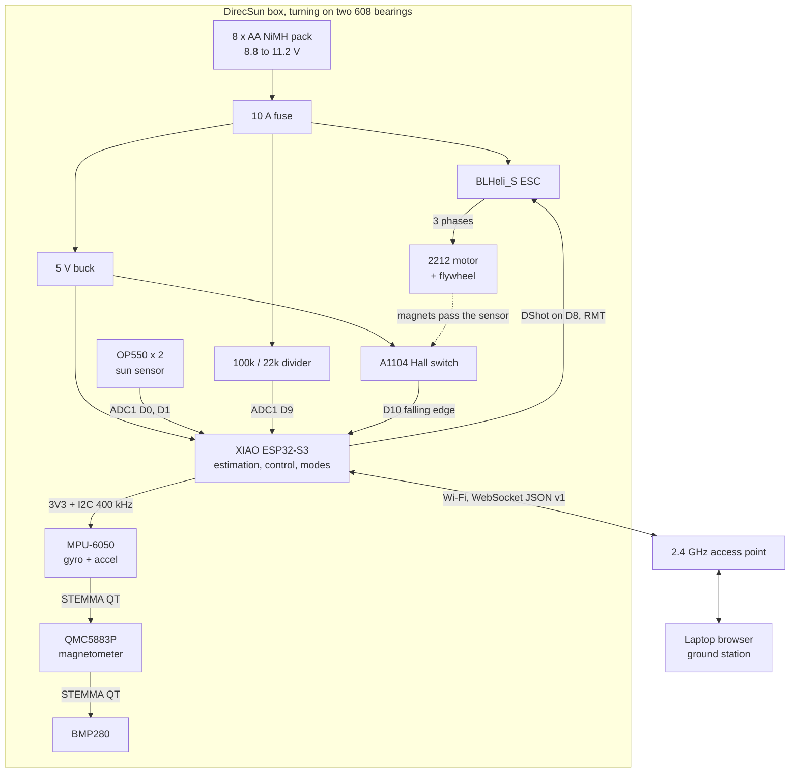
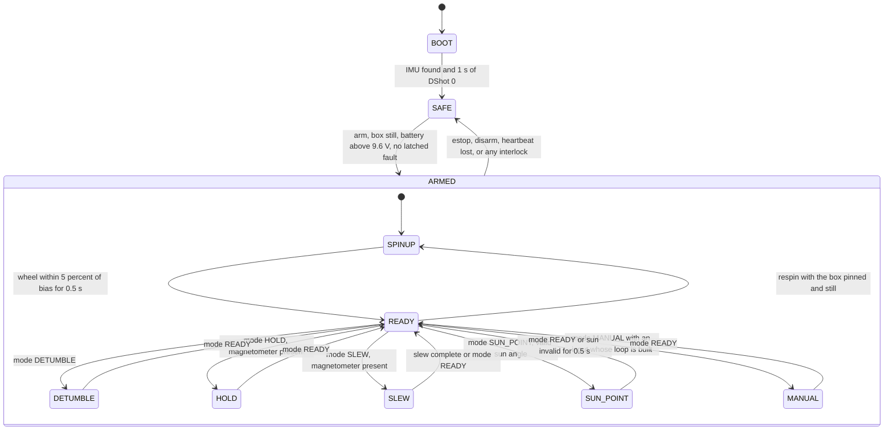
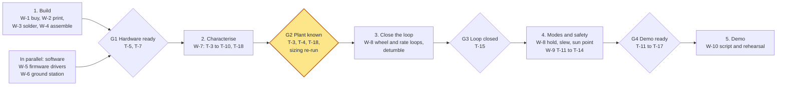

# DirecSun Technical Design

Oct 9, 2026 · Julian V. Formerly PocketADCS; imported into the repository on Oct 10, 2026 (Section 12.4, repository import).

## 1. Purpose, scope, and conventions

This document specifies DirecSun, a single-axis reaction wheel attitude trainer built in a 3D-printed 2U CubeSat frame, and the plan to build it during a weekend hackathon. Nothing described here has been built or measured yet. Every number is either sourced, calculated from stated inputs, or an assumption to be measured.

**Audience.** Software and firmware engineers who will write the flight and ground code, architects deciding module boundaries, and AI agents that will modify the CAD, firmware, or this document. Sections 6, 7, 8, and 12 are written so an agent can act on them without the conversation that produced them.

**Scope.** In scope: physics sizing, mechanical design (CAD exists), electrical design, firmware and ground station architecture, test plan, risks, and schedule. Out of scope: multi-axis control, orbital dynamics, flight qualification, and anything not needed for a tabletop demonstration.

**Claim labels.** Statements that a reader might act on carry one of four labels.

| Label | Meaning | What a reader should do |
| --- | --- | --- |
| \[V\] | Verified against a source page that was opened, a datasheet, or a script that was run | Trust it, but re-check if the part number changes |
| \[C\] | Calculated from stated inputs, by arithmetic shown beside the value or by `docs/sizing.py` | Re-run the script if an input changes |
| \[A\] | Assumed or typical; not yet confirmed for the parts on hand | Treat as provisional |
| \[M\] | Must be measured on the real hardware before it is relied on | Measure it, record the value in Section 12 |

**Precedence.** Where this document disagrees with earlier chat messages or the two design web pages, this document wins. Section 12 logs every earlier statement that adversarial review found to be wrong, and what replaced it.

**Source of truth.** Geometry lives in `cad/stack.py` and the part scripts. Sizing numbers live in `docs/sizing.py`. Paths in this document are relative to the repository root. If this document and those files disagree, the files win and this document has a bug.

## 2. System overview and requirements

DirecSun is a 0.85 kg box that turns about one vertical axis on two 608 bearings, pointed by a reaction wheel inside it. A brushless motor spins a steel washer flywheel; changing the wheel's speed turns the box the opposite way, as a satellite's reaction wheel does. An ESP32-S3 on the box closes the loop from a gyro, a magnetometer, and a two-element sun sensor. A browser ground station on a private Wi-Fi network commands it and plots telemetry.



Power flows from the pack through the fuse to the ESC and the 5 V buck; sensing flows into the XIAO over I2C, the ADC, and the Hall input; the Wi-Fi link to the bench is the only connection that leaves the box, so nothing tethers it.

**Demonstration modes.** Each mode exercises a different part of the loop.

| Mode | What happens | What it shows |
| --- | --- | --- |
| Safe | Wheel ramped down (e-stop, heartbeat loss) or cut at once (hard faults); its momentum moves into the box, which turns | Default after boot, e-stop, or fault |
| Spin-up | Wheel ramps to the bias speed while the lock pin (Section 4.11) or an operator holds the box, because spinning the wheel up necessarily spins a free box the other way | Momentum bias; why the wheel never stops |
| Ready | Box rate held at zero; the operator pulls the lock pin or lets go | Entry point to every demonstration mode |
| Detumble | Box rate driven to zero after a hand spin | Rate damping; momentum moves into the wheel |
| Hold | Heading held against pokes | Disturbance rejection |
| Slew | Box turns to a commanded heading | Commanded manoeuvre |
| Sun point | +X face tracks a lamp | Change of attitude reference |
| Manual | The operator drives the wheel from the ground station: throttle nudges, a wheel-speed target, or a box-rate joystick | Momentum exchange under direct human control; also the fallback demonstration (Section 11.4) |

**Requirements.** Targets are chosen for a tabletop demo. Section 3 shows the hardware can exceed them; none has been measured.

| ID | Requirement | Target | Basis |
| --- | --- | --- | --- |
| FR-1 | Control box yaw with a reaction wheel only | No other actuator | Scope |
| FR-2 | Provide the eight modes above, switchable from the ground station | Mode change applied within 100 ms | Usability |
| FR-3 | Stream telemetry to a browser | 50 Hz, under 100 ms latency on the private network | Plots stay smooth |
| FR-4 | Run untethered | Battery on the box, Wi-Fi the only link | A tether adds friction torque |
| FR-5 | Stop safely | Ground e-stop; Safe mode on 1 s without a ground heartbeat; undervoltage cutoff | Section 10 |
| PR-1 | Detumble a 1 rev/s hand spin | Under 5 deg/s within 5 s | Section 3: torque allows under 1 s |
| PR-2 | Slew 90 deg | Within 3 s, settled to plus or minus 3 deg | Section 3: torque allows 0.7 s |
| PR-3 | Hold heading | Plus or minus 2 deg against bearing friction | \[M\] friction and magnetometer noise |
| PR-4 | Limit wheel energy | Under 6 J at the 4000 rpm cap; under 6.5 J at the worst-case overspeed including sensing lag | Guard ring and finger safety |

**Constraints.** The build must finish in one weekend, mostly from parts already owned. Printed parts must fit a 220 mm print bed. Nothing printed may spin with the wheel. The design must survive a judge pushing or spinning the box by hand.

**Hardware on hand** (owner's statement, not inspected) \[A\]: Seeed XIAO ESP32-S3 and ESP32-C3 boards (6 each), Adafruit STEMMA QT sensor boards (MPU-6050 #3886, BMP280 #2651, QMC5883P #6388, confirmed by the owner), four 2212 920KV motors, LANRC 35A/45A BLHeli\_S ESCs, an Open Mesh OM5P-AC radio, and the component bins listed in `docs/reference/Electronics_Component_Inventory_with_Robotics.pdf` (OP550 phototransistors, A1104 Hall switches, 1N5817 Schottky diodes, solder breadboards).

**To buy:** an M8 × 60 hex bolt (bought, with an M8 × 70 as a spare), four #8-32 threaded rods cut to about 245 mm with eight #8-32 nylon-insert lock nuts (Home Depot had no M3 rod), three 2.5 in fender washers, about 40 cm of 18 to 22 AWG stranded wire for the printed battery holder (Section 4.12), a 5 V buck module, a 10 A fuse with holder, two 200 mm STEMMA QT cables, and one STEMMA QT to header cable for the XIAO. Already on hand: eight Energizer Recharge NiMH AA cells, two Bones Reds 608 bearings, and a screw kit (M2 to M5 button-head screws, nuts, and washers) that covers every small fastener in the design.

**From the EE parts closet:** the pick list with bin labels and photo numbers was a separate tab of the original document and was not imported into the repository.

## 3. Physics and sizing

The baseline wheel (three 2.5 in steel fender washers) gives the box about 355 deg/s of rate per 1000 rpm of wheel speed change and can absorb a 1.58 rev/s hand spin in either direction before reaching a speed limit \[C\]. Neither torque nor momentum limits the demonstration: 1 A of motor current accelerates the box at about 576 deg/s² \[C\]. The binding constraints are imbalance vibration and stored energy, which set the bias and cap speeds. All values come from `docs/sizing.py`; its output is saved in `docs/sizing_output.txt`.

### 3.1 Model

The box and wheel form a two-body system about one fixed vertical axis. Let I\_b be the box inertia without the wheel, I\_w the inertia of the spinning parts (washers plus motor bell), ω\_b the box rate, and Ω the wheel speed relative to the box. The motor applies torque τ to the wheel and −τ to the box. External torque τ\_ext is bearing friction plus gravity if the axle is tilted.

```latex
I_b\,\dot{\omega}_b = -\tau + \tau_{ext}, \qquad I_w\,(\dot{\omega}_b + \dot{\Omega}) = \tau
```

With τ\_ext = 0, total momentum is conserved, which gives the box rate change for a wheel speed change:

```latex
(I_b + I_w)\,\omega_b + I_w\,\Omega = H \;\Rightarrow\; \Delta\omega_b = -\frac{I_w}{I_b + I_w}\,\Delta\Omega
```

Motor torque follows from the KV rating for an ideal brushless motor: K\_t = 60 / (2π KV) = 10.38 mN·m/A for 920 KV \[C\]. This is per amp of phase current, not ESC input current, and real motors fall a few percent short \[A\].

### 3.2 Inputs

| Input | Value | Label | Source |
| --- | --- | --- | --- |
| Printed rotating parts | 254 g, I\_z 4.54e-4 kg·m² | \[C\] from CAD, \[A\] fill 0.55 | CAD solids × PLA 1240 kg/m³ × fill factor |
| Threaded rods | 4 × 21.8 g at 64.7 mm radius, I\_z 3.65e-4 | \[C\] | Steel #8-32, modelled as a 3.8 mm solid rod, 245 mm |
| Other hardware | 361 g, I\_z 2.14e-4 | \[A\] | Battery 243 g (8 × AA NiMH and 16 contact screw sets; the printed holder is counted with the printed parts), boards 45 g, wiring 35 g, stator 30 g, ESC 8 g |
| Box inertia I\_b | 1.03e-3 kg·m² | \[C\] on \[A\] inputs | Sum of the three rows |
| Box mass with wheel | 845 g | \[C\] | Weight 8.29 N |
| Baseline wheel | 3 × 63.5 mm OD, 8 mm ID, 1.6 mm steel; 117 g | \[A\] | Typical 2.5 in fender washer |
| Motor bell | 25 g at 14 mm radius | \[A\] | Not measured |
| Sensorless low-speed limit | 800 rpm | \[A\] \[M\] | Below this BLHeli\_S commutation is assumed unreliable |

The threaded rods contribute about a third of I\_b because they sit at the corners. Replacing them with nylon rods would cut I\_b by about 30 % and is not recommended: the rods carry the stack clamp.

### 3.3 Results

| Quantity | Baseline: 3 × 2.5 in washers | Fallback: 3 × 50 mm washers |
| --- | --- | --- |
| Wheel inertia I\_w (kg·m²) | 6.50e-5 | 2.66e-5 |
| I\_w / I\_b | 0.063 | 0.026 |
| Bias / cap / overspeed trip (rpm) | 2400 / 4000 / 4100 | 3000 / 6000 / 6100 |
| Wheel momentum at cap (N·m·s) | 0.0272 | 0.0167 |
| Box rate per 1000 rpm of wheel change | 355 deg/s | 150 deg/s |
| Hand spin absorbable, toward cap / toward low limit | 1.58 / 1.58 rev/s | 1.25 / 0.92 rev/s |
| Box acceleration at 1 A | 576 deg/s² | 576 deg/s² |
| 90 deg rest-to-rest slew, bang-bang at 1 A | 0.79 s, peak 228 deg/s, wheel swing 640 rpm | 0.79 s, wheel swing 1513 rpm |
| Stored energy at cap / at overspeed trip | 5.7 / 5.99 J | 5.2 / 5.42 J |
| Rim speed at cap | 13.3 m/s | 15.7 m/s |
| Imbalance force at bias, 0.1 mm stack offset | 0.74 N | 0.67 N |
| Imbalance force at cap, 0.2 mm stack offset | 4.12 N | 5.39 N |
| Imbalance force at cap, uncentred stack on an M5 thread | 30.9 N (1.5 mm offset) | 18.9 N (0.7 mm offset) |
| Vibration frequency at bias | 40 Hz | 50 Hz |

Washers on hand: the 1.5 in washers found locally measure 37.88 mm across \[M\]; their hole and thickness are taken as 8.0 and 1.5 mm \[A\]. Run at a 3400 rpm bias and a 6000 rpm cap:

| Quantity | 6 × 37.9 mm | 9 × 37.9 mm | Baseline 3 × 2.5 in |
| --- | --- | --- | --- |
| Wheel inertia I\_w (kg·m²) | 1.92e-5 | 2.63e-5 | 6.50e-5 |
| Hand spin absorbable each way | 0.79 rev/s | 1.08 rev/s | 1.58 rev/s |
| Stored energy at cap | 3.8 J | 5.2 J | 5.7 J |
| Vibration at cap | 100 Hz | 100 Hz | 67 Hz |
| Imbalance force at cap, 0.2 mm offset | 6.0 N | 9.0 N | 4.1 N |

At 6000 rpm the imbalance force reaches the 8.3 N box weight with a 0.2 mm offset, and the motor needs 90 % duty at 3 A near the 8.8 V cutoff \[C\]. The small washers suit bring-up and a reduced demo; 2 to 2.5 in washers remain the baseline. Nine washers stack 13.5 mm, and whether that fits the prop adapter thread with the nut and jam nut is unmeasured \[M\].

### 3.4 Why the wheel idles at a bias speed

The ESC is sensorless: it finds rotor position from back-EMF, which vanishes near zero speed. A wheel that must reverse direction would pass through zero every time the box changes direction, and sensorless commutation stutters there \[V: the BLHeli\_S manual limits power at low speed to detect weak back-EMF; A: that commutation stutters\]. Idling at a bias speed and steering by speeding up or slowing down keeps the wheel in one direction. The 2400 rpm bias sits midway between the assumed 800 rpm low limit and the 4000 rpm cap, so a hand spin in either direction has the same 1600 rpm of margin. If T-18 measures a different low limit, the bias moves to the new midpoint.

### 3.5 Imbalance, energy, and the speed cap

A washer stack offset e from the spin axis produces a rotating force F = m e Ω² at the wheel speed. A 2.5 in fender washer's hole is about 8 mm on a 5 to 6 mm prop thread \[A\], so an uncentred stack can sit up to 1.5 mm off axis on an M5 thread. At the cap that gives 30.9 N, 4.4 times the box's weight, so centring is mandatory. A centred stack still 0.2 mm off gives 4.1 N at the cap, 59 % of the weight. The wider wheel stores more momentum at 4000 rpm (0.0272 N·m·s) than the 50 mm set at 6000 rpm (0.0167 N·m·s), which is why its cap can be lower. Section 4.6 specifies centring and balancing.

Stored energy is 5.7 J at the cap and 5.99 J at the 4100 rpm overspeed trip (baseline). A 30 ms speed-sensing lag at full torque could let the wheel reach about 4250 rpm, 6.43 J, before the trip acts \[C\]. Both are within PR-4, with little margin until the bell is weighed (A-3). The guard ring (Section 4.7) exists because the box sides are open and the rim moves at 13 m/s.

### 3.6 External torques

| Source | Magnitude | Label |
| --- | --- | --- |
| Bearing friction, two shielded 608s, light load | Not known; plan for 1 to 3 mN·m | \[A\] \[M\] coin test, Section 9 |
| Gravity, CG 5 mm off axis, axle tilted 1 deg | 0.72 mN·m | \[C\] |
| Motor torque available at 1 A | 10.4 mN·m | \[C\] |

The coin test converts a hanging mass to torque: a string wound at 50 mm radius gives 0.49 mN·m per gram \[C\]. Friction matters only near standstill, where breakaway torque produces stick-slip; it limits pointing precision, not slew capability.

Whether the motor can turn the box: the SKF constant-coefficient model, M = 0.5 μ P d with μ = 0.0015 for deep groove ball bearings \[V\], gives 0.05 mN·m for the 845 g box on one 608 \[C\]. Grease, shields, and the printed fit can raise that many times, so the planning range in the table stays 1 to 3 mN·m \[A\]. At 1 A the motor gives 3.5 to 10 times that range, and at 3 A 10 to 31 times \[C\]. Overcoming friction takes 0.1 to 0.3 A of motor current \[C\]. The heavier box (NiMH pack, printed holder, and steel #8-32 rods) raises the bearing load by 19 % and I\_b by 16 %; neither changes this conclusion \[C\].

Friction draws on the wheel's momentum margin only while the box is turning. During one-way rotation it moves the wheel from bias to a speed limit in 3.6 to 11 s \[C\], so continuous spinning in one direction is limited to a few turns. Back-and-forth slews cancel, because friction reverses with the direction of motion, and one 90 deg slew of 0.79 s uses at most 22 % of the margin \[C\]. Gravity torque from a tilted axle is a steady load at any heading other than the low point: at 1 deg tilt with the CG 5 mm off axis it uses the margin in 15 s \[C\]. Level the base to well under 1 deg.

How long the box can keep turning in one direction: friction drains the wheel margin only while the box turns, so the time is wheel inertia × usable speed range ÷ friction torque \[C\]. The wheel turns one way only, so which limit friction drives it toward depends on the direction the box turns. When the box turns against the wheel's spin, friction pushes the wheel faster, toward the cap. When the box turns with the wheel's spin, friction slows the wheel, toward the low limit \[C\]. A spin mode therefore starts the wheel at the far end of its range from the limit it will drift toward, giving nearly the whole range to one direction at the cost of the other \[C\]. More washers help little under the 6 J limit of PR-4, because the cap has to come down as the inertia goes up \[C\]. The three wheel start speeds:

| Wheel start speed | Range for the box turning against the wheel | Range for the box turning with the wheel | Use |
| --- | --- | --- | --- |
| 2400 rpm (normal bias) | 1600 rpm | 1600 rpm | Pointing, slews, and disturbances from either side |
| 1000 rpm (start low) | 3000 rpm | 200 rpm | Long one-way spin against the wheel's direction |
| 3800 rpm (start high) | 200 rpm | 2800 rpm | Long one-way spin in the wheel's direction |

The start speed changes only with the box held by the lock pin, because changing the wheel speed with the box free spins the box: going from 2400 to 1000 rpm unpinned would turn it at about 1.4 rev/s \[C\]. Each mode change uses the same hold-and-set-wheel-speed sequence as spin-up and manual desaturation, with a different target speed. The box's own spin rate also uses part of the range: with three washers, each 0.5 rev/s of box rate takes about 505 rpm of wheel speed, so the times below are upper bounds for a slow spin \[C\].

| Wheel and mode | 0.1 mN·m | 0.3 mN·m | 1 mN·m | 3 mN·m |
| --- | --- | --- | --- | --- |
| 3 washers, bias 2400 rpm, either direction (1600 rpm range) | 109 s | 36 s | 11 s | 4 s |
| 3 washers, start low at 1000 rpm, box against the wheel (3000 rpm range) | 204 s | 68 s | 20 s | 7 s |
| 3 washers, start high at 3800 rpm, box with the wheel (2800 rpm range) | 191 s | 64 s | 19 s | 6 s |
| 4 washers, cap 3486 rpm, start low (2486 rpm range) | 222 s | 74 s | 22 s | 7 s |
| 5 washers, cap 3126 rpm, start low (2126 rpm range) | 234 s | 78 s | 23 s | 8 s |

Friction torque is the largest unknown: the SKF estimate (0.05 mN·m) and the planning range (1 to 3 mN·m) differ by a factor of 20 to 60 \[C\]. T-4 measures it and decides which column applies. Rotation in one direction without a time limit needs an external torque, as on a spacecraft. A servo brake against the base hub was considered and not adopted (Oct 10): it would add a servo mount and plunger hole to the bottom cap, a brake ring on the base hub, a servo on the 5 V rail, and a firmware mode, and the one-way spin would still pause at each unload. Instead, the existing lock pin is the desaturation actuator: when the wheel nears a limit, the ground station prompts the operator to stop the box and drop in the pin, the firmware returns the wheel to its start speed with the reaction going into the bench, and the pin comes out. This reuses the hold-and-spin sequence that spin-up already needs. The decision is revisited only if T-4 measures high friction and long one-way rotation is still required.

### 3.7 Structural margins

A 20 N push at the top of the box produces a 4.62 N·m moment at the bearings \[C\]. That loads each bearing radially to about 185 N, against a static rating C0 of 1.4 kN for an SKF 608-2Z \[V\]. It stresses the printed bearing boss to 2.5 MPa and the M8 bolt to 92 MPa \[C\]. Both are far below the strength of PETG and of a property class 8.8 bolt \[A\]. Layer adhesion of printed parts varies by printer and is the weakest link \[A\].

### 3.8 Sensitivity

I\_b depends on the 0.55 fill factor and on hardware masses that were not weighed. If I\_b is 30 % higher, the absorbable spin and rate per rpm fall by about 22 %; the requirements in Section 2 still hold. Measure I\_b with the method in Section 9 and re-run the script.

## 4. Mechanical design

The box is a stack of six printed decks clamped by four #8-32 threaded rods and nylon-insert lock nuts through 8.5 mm corner columns, matching the CubeSat 2U envelope of 100 × 100 × 227 mm. It turns on two 608 bearings riding on a fixed M8 bolt held by a printed base hub. Thirteen printed parts and two test prints exist as parametric CadQuery scripts; all are watertight \[V: skill runner, `--strict`\], and review of each six-view preview found none that needs supports. The assembly check finds no overlaps among 47 solids, including the lock pin inserted, the three Adafruit boards with a screw through every hole, and the battery holder with all eight cells and every contact screw, and the six deliberate collisions built into the script as positive controls are all detected \[V: `cad/assembly.py`\].

The rendered stack is the viewing model `cad/out/assembly_view.stl`; GitHub and most CAD viewers display it directly. The earlier embedded image did not survive the import into the repository.

The viewing model contains printed parts, the inserted lock pin, the three Adafruit boards on their standoffs, and the printed battery holder with its cells and contact hardware, and stand-ins for the motor, 63.5 mm washer wheel, bearings, bolt, ESC, and perfboards. The 258 mm bounding box runs from the base hub's underside to the top deck; the QMC5883P and BMP280 hang inside the 227 mm box. The "not watertight" note applies only to this multi-body viewing model, not to the printable parts.

### 4.1 Stack layout

Heights are in the assembly frame: z = 0 is the underside of the bottom cap, +z is up the spin axis, +X is the sun sensor face, and boards slide in from −Y.

| Part | Plate bottom z (mm) | Carries | Material |
| --- | --- | --- | --- |
| base\_hub | −31 to 0 (fixed) | M8 bolt head in a hex trap; 11 mm pad under the lower bearing's inner ring | PETG |
| bottom\_cap | 0 | Two 608 bearings in a boss rising to z = 32 | PETG |
| motor\_deck | 38 | 2212 motor, Hall bracket, guard groove | PETG |
| flywheel\_guard | 42 to 94.5 | Slotted ring around the wheel | PETG |
| power\_deck | 95 | Perfboard (buck, fuse, connectors) offset to −X; ESC on +X | PLA or PETG |
| battery\_deck | 126 | Printed 8 × AA NiMH holder, 32.7 mm tall, between side rails; cap A screwed down (Section 4.12) | PLA |
| avionics\_deck | 165 | Adafruit MPU-6050 on standoffs centred on the spin axis; XIAO ESP32-S3 on a 50 × 35 mm carrier; sun sensor block | Black PLA |
| top\_deck | 223 to 227, installed flipped | Adafruit QMC5883P and BMP280 on standoffs, hanging below the plate | PLA |

The magnetometer sits at the top, about 14 cm above the top of the motor bell, because motor fields fall off steeply with distance \[A\]. The top deck prints with its card guides up and is installed flipped, so the board hangs inside the 227 mm envelope \[V: measured box top z = 227.0 in cad/assembly.py\]. The battery, the heaviest item, sits mid-stack on the axis.

### 4.2 Bearing post

The lower 608 sits in a pocket opening on the bottom cap's underside; the upper one sits in a pocket at the boss top, 25 mm higher. Two bearings resist tilt; one bearing would let the 227 mm box rock on its internal clearance. Load path: box weight → boss ledge → lower bearing outer ring → balls → inner ring → 11 mm pad on the base hub → bolt and hub → bench.

The ledges and pad are sized to SKF's abutment data for the 608-2Z \[V; A: generic 608ZZ bearings are assumed to share these lands, so check the bearings bought\]: the inner-ring land is 12.15 mm and the shaft abutment range is 10 to 12 mm, so the 11 mm pad touches only the inner ring. The outer-ring land starts at 19.2 mm and the housing abutment maximum is 20 mm, so the ledge bore is 19.6 mm. An earlier version used 17 mm, which could rub the shields; Section 12 logs the change.

Printed holes vary by printer, so `bearing_fit_test.stl` has pockets at 22.0, 22.2 and 22.4 mm. The chosen value goes in `BRG_POCKET_D` in `stack.py` before the bottom cap is printed. The owner's 608 held only in the 22.4 mm pocket, so BRG\_POCKET\_D = 22.4 \[M\]. This printer therefore makes vertical holes about 0.4 mm small, and every hole, slot, and nut trap that a part must fit now adds HOLE\_COMP = 0.4 mm in stack.py. Without it the 4.6 mm rod holes would print about 4.2 mm around a 4.17 mm rod, and the 9.0 mm lock-nut traps would print smaller than the 8.73 mm nut \[C\]. The hole gauge (Oct 10) confirmed the correction for the M8 hole, the AA bore, and the #8-32 lock-nut trap, found the M3 clearance hole slightly loose (acceptable), the rod hole loose, and the 2.2 mm M2 pilot too small \[M\]: small holes shrink more than large ones. The rod hole is now drawn 4.8 mm and the M2 pilot 2.5 mm, and cad/hole\_ladder.py prints 2.3 to 2.7 mm pilots and 4.6 to 5.0 mm rod holes to set the final values \[M\]. The ladder set the rod hole at 4.8 mm drawn (4.6 mm slid but scraped over 6 mm, and the deck columns are 35 to 55 mm long) and the M2 pilot at 2.4 mm drawn (2.3 mm did not take the screw, 2.5 mm took it with play) \[M\]. Nut traps and counterbores that open on the bed face also get two 0.2 mm sacrificial bridge layers, because the gauge's trap ceiling strung \[M\]. The #8-32 lock nut (8.73 mm across flats) is wider than the 8.5 mm corner column, so the corner traps reach up to 0.8 mm past the box edge; this is cosmetic \[C\].

The fit-test pockets open upward, but the cap's lower pocket opens on the bed face, where first-layer squish (elephant foot) narrows the mouth. A 0.5 mm 45 deg chamfer there, and on the lock-pin hole, removes that difference \[V: a probe of the CAD finds 0.36 mm³ of material at the pocket mouth's bed-face edge, against 5.54 mm³ without the chamfer\]. The #8-32 lock-nut traps on the same face are not chamfered; a nut pushes past a small lip.

The base hub is 31 mm tall so that the M8 × 60 bolt tip ends 3.4 mm below the motor deck and passes fully through the upper bearing \[V: `cad/assembly.py`\].

### 4.3 Motor mount

The 2212 mounts on the common 22xx pattern of M3 holes 16 mm and 19 mm apart, screwed from below through 6.2 mm counterbores \[A: widely reported by forum and vendor pages that blocked retrieval; M: measure the motor\]. Some 22xx motors use 16 × 16 mm instead \[A\]. Screws must be M3 × 6: the counterbore leaves 2 mm of plastic, and longer screws can reach the windings \[A: forum reports\]. A 10 mm centre hole clears the shaft end and circlip below the stator.

### 4.4 Hall sensor bracket

The A1104 drops into a pocket in a printed post, branded face toward the bell, behind a 1 mm plastic wall. The sensor face sits at 18.5 mm radius: bell radius 14 mm, plus a 2 mm magnet, plus 2.5 mm from magnet face to sensor face made of 1.5 mm air and the 1 mm wall \[A: bell diameter 28 mm\]. A slotted foot allows ±4 mm of radial adjustment, locked by an M3 × 12 button-head screw from the kit into a nut trapped under the motor deck. The post top is 9 mm below the washers.

### 4.5 Flywheel

The flywheel is three 2.5 in steel fender washers clamped to the bell by the prop nut and a jam nut, with thread-locker. Nothing printed spins, because a printed part's layer adhesion is unpredictable at 13 m/s rim speed \[A\]. The 50 mm washer set is a fallback with lower inertia (Section 3.3).

Open problem (Oct 10): the motor's threaded shaft is 6.76 mm long and 5.81 mm across the threads, consistent with M6 \[M\]. That leaves room for one nut and about 3.5 mm of washers, not the 4.8 mm stack plus prop nut and jam nut assumed above. The washers on hand (37.88 mm across; three with a 9.5 mm hole and 1.27 mm thick, four with an 11 mm hole and 1.44 mm thick \[M\]) also sit 1.85 to 2.6 mm loose on the thread, which at 4000 rpm is 3 to 5 N of rotating force per washer if one slides fully off centre \[C\]. The flywheel attachment is being redesigned around a measurement of the motor top: any raised collar around the shaft, any screw holes in the bell, the thread handedness, and whether the motor came with nuts or self-tightening props \[M\].

**Decision (Oct 10, owner).** The flywheel becomes a printed PETG wheel with the washers sealed inside at a print pause, as rehearsed by `washer_stack_test` (see `cad/README.md`). This overrides the rule above that nothing printed spins. Repository Set 2 owns the design and the revision of invariant 8.3, the hazard table (Section 10.1), and PR-4; until then, the text above describes the superseded washer-stack design.

### 4.6 Centring and balancing

Imbalance is the main dynamic risk (Section 3.5). The procedure, in order:

1. Centre the washers on the prop thread. Wrap the thread with tape until the washers slide on without radial play, or use washers whose hole fits the thread.
2. Glue the two bell magnets diametrically opposite each other, both south pole out: the A1104 is a unipolar switch that responds to a south pole \[V\].
3. Spin to the bias speed with the box clamped still and log the MPU6050 accelerometer.
4. Rotate the top washer in 45 deg steps, logging at each step, and keep the quietest position.
5. Optional: use the Hall pulse as a once-per-turn phase reference and do single-plane influence-coefficient balancing in the ground station.

Acceptance: vibration amplitude at the bias frequency below the level that disturbs the gyro after filtering \[M\]; Section 9 sets the test.

### 4.7 Guard ring

A 76 mm ID, 2.4 mm wall PETG ring sits in a 1 mm groove in the motor deck and stops 0.5 mm short of the power deck, so the corner columns carry the rod clamp. Fifteen 5 mm slots let judges see the wheel while keeping fingers out. A notch at −38 deg passes the motor leads toward the ESC lead slot. The 63.5 mm wheel clears the ring by 6.25 mm radially \[C\]; `cad/assembly.py` finds no overlap with the ring, and its built-in positive control flags a 78 mm wheel \[V\].

### 4.8 Board mounting

The three sensors are Adafruit STEMMA QT boards that share one footprint: 25.40 × 17.78 mm, four 2.5 mm holes 2.54 mm in from the corners, and the sensor chip at the board centre \[V: Adafruit Eagle board files\]. Each sits on four 4 mm printed standoffs, held by M2 × 8 button-head screws from the owner's kit, threaded straight into blind pilot holes drawn at 2.4 mm \[M: hole gauge and hole ladder\], so each board comes off from above. The screws are steel; because they move with the magnetometer, hard- and soft-iron calibration (T-9) absorbs them \[A\]. The MPU-6050 is centred on the spin axis, so the gyro is on the axis. The QMC5883P and BMP280 hang under the flipped top deck, chips facing down. Turning a board over is a 180 deg rotation about a horizontal axis, which negates Z and one horizontal axis, not Z alone; inverting Z alone would leave the heading mirrored. The firmware therefore applies a configurable magnetometer axis map that by default negates Y and Z and keeps X, and T-9 confirms it by checking that a counter-clockwise turn raises the magnetic heading in step with the integrated gyro (V-4). The BMP280 product page lists 19.2 × 17.9 mm, which matches Adafruit's older non-STEMMA revision; the current STEMMA QT board file is 25.40 × 17.78 mm \[V\]. The XIAO has no mounting holes \[V: Seeed wiki, 21 × 17.8 mm\], so it rides on a 50 × 35 mm carrier cut from a 5 × 7 cm perfboard, in short card guides that stop 2 mm short of the MPU-6050 board; the power deck keeps full-length guides for a 50 × 70 × 1.6 mm perfboard \[A: vendor listings\]. The guides allow 0.4 mm total play, hold 2 mm of each board edge, and put the board underside 6 mm above the plate for solder joints. Boards enter from −Y and stop at the closed end of their guides.

If the wheel stops from the cap, for example after an e-stop, the box can reach 4.0 rev/s, which puts about 2.2 g on a board 35 mm from the axis \[C\]. Friction will not hold a board against that. Each board is fixed with hot glue at the open end. Other mounts: the ESC by two zip ties (fits 28 × 13 to 36 × 18 mm units \[V: one opened listing at 28 × 13 mm; A: 36 × 18 mm from a search result; the LANRC unit is unmeasured\]); the printed battery holder between side rails, with cap A screwed to the deck by two M3 screws into nut traps (Section 4.12); the OP550s in pockets sized to the TT Electronics drawing, 5.72 × 4.44 × 1.57 mm \[V\].

### 4.9 Measured clearances

| Clearance | Value | Label |
| --- | --- | --- |
| Bolt tip to motor deck underside | 3.4 mm | \[V\] assembly check |
| Bolt engagement in upper bearing | 7.0 of 7.0 mm | \[V\] |
| Flywheel nut stack to power deck | 8.2 mm, assuming a 31 mm motor body | \[V\] geometry, \[A\] motor height |
| Hall post top to washer underside | 9.0 mm | \[V\] |
| Component height above power board | 19.4 mm | \[V\] |
| Stack height / overall with hub | 227 / 258 mm | \[V\] |

### 4.10 Measure before printing

| Item | Assumed | Affects | Where to change it |
| --- | --- | --- | --- |
| Motor bell diameter | 28 mm | Hall sensor radius | `BELL_D` in `stack.py` |
| Motor body height to washer seat | 31 mm | Nut-stack clearance | `MOTOR_BODY_H` in `assembly.py` (check only) |
| Prop thread and washer hole | M5–M6 thread, 8 mm hole | Centring, imbalance | Hardware choice |
| AA cell length, longest cell | 50.17 mm, measured | Contact preload, 0.45 mm per end | `CELL_L` in `stack.py` |
| Bearing press fit | 22.4 mm, measured | Bottom cap pocket | `BRG_POCKET_D` after the fit test |
| Perfboard size | 50 × 70 × 1.6 mm | Card guides | `BOARD_W`, `BOARD_L`, `BOARD_T` |

### 4.11 Spin-up lock pin

A printed pin locks the box to the fixed base hub while the wheel spins up, so nobody has to hold the box. The reaction torque goes through the pin into the bench instead of turning the box.

| Item | Value | Label |
| --- | --- | --- |
| Position | 30 mm from the axis on +X, through the bottom cap plate into a blind hole in the hub flange | \[V\] `cad/assembly.py` |
| Pin | 6 mm PETG shaft, 33 mm long, chamfered tip, 22 × 16 mm pull tab with a finger hole | \[V\] CAD |
| Holes | 6.5 mm in the cap and the hub; 7 mm deep in the hub with a 1 mm lead-in chamfer | \[V\] CAD |
| Engagement | Tip 6 mm into the flange, 1 mm short of the hole bottom; tab top 12 mm below the motor deck | \[V\] `cad/assembly.py` |
| Load | About 1 N of shear at the full 3 A motor torque (31 mN·m at 30 mm) | \[C\] |

The pin prints lying flat on a 0.5 mm flat along its shaft, so its layers run lengthwise and bending cannot split them. Use: turn the box until the two holes line up, drop the pin in through the open bottom bay, arm and spin up, then pull the pin once Ready shows. The assembly check confirms the inserted pin clears both holes, and a pin 1 mm oversize is reported colliding with both, so the clean result is meaningful \[V\]. Pulling the pin while the wheel is still accelerating would let the box turn; Ready is reached only after the wheel is at bias, so the pin comes out under no load.

### 4.12 Printed battery holder

The EE parts closet is not available, so the eight AA cells sit in a printed holder whose contacts use only screw-kit hardware \[V: the owner's kit list\].

| Part | Size | Role |
| --- | --- | --- |
| battery\_holder\_body | 62.7 × 32.7 × 52.4 mm | Two rows of four 14.9 mm bores (printed size) at 15 mm pitch; printed standing on end A so the bores are vertical; polarity marks engraved on the top and bottom faces |
| battery\_cap\_a | 62.7 × 32.7 mm, 17.2 mm deep | Eight spring contacts; two feet screwed to the battery deck; pack leads leave through side notches |
| battery\_cap\_b | 62.7 × 32.7 mm, 10.2 mm deep | Eight spring contacts; removed with three M2 screws to change cells |

Each cell end presses on the dome of an M3 × 8 button-head screw. The screw sits in a 7.2 mm disc joined to the cap by a 1.2 mm ring between two C-shaped slots, with the two joints 180 deg apart. The ring is 1.6 mm thick: a 1.4 mm sample on the hole gauge sprang back but felt weak \[M\]. A cell of length CELL\_L pushes each disc out 0.45 mm, which gives about 3 N of contact force and about 22 MPa of bending stress in the ring \[C: guided-beam estimate; A: PETG modulus 2 GPa\]. The body length sets that preload. The cells measure 50.17 mm tip to tip \[M\], so CELL\_L = 50.17 mm and the body is 52.57 mm long \[V: stack.py\]. Outside each cap, a washer, a wire loop, a washer, and a nut on each screw carry the current; the skirt keeps that hardware recessed.

The cells alternate direction. Cap B joins the two cells in each column, and cap A joins top row columns 1-2, bottom row columns 2-3, and top row columns 3-4. The pack + is column 1 bottom and the pack − is column 4 bottom, both at cap A \[V: series order in stack.py cell\_centres()\]. A reversed cell lowers the pack by about 2.5 V, which the 9.6 V arm check refuses \[C\].

The holder sits between two side rails on the battery deck, and two M3 × 8 screws through cap A's feet thread into nuts pressed into traps under the deck. Its top is 2.3 mm below the avionics deck \[V: cad/assembly.py\]. The collision check includes all eight cells and every contact screw with its hardware, and a positive control with cells 1 mm too long is detected \[V\]. Unverified: the contact force, PETG creep over days of preload, and the contact resistance of the steel screw heads \[A, M: hole gauge spring sample, then a pack voltage check under load\].

## 5. Electrical design

One 8 × AA NiMH pack (Energizer Recharge cells in the printed holder of Section 4.12, wired in series, 9.6 V nominal) feeds two branches: the ESC directly, and a 5 V buck that powers the XIAO and the 5 V sensors. No op-amp is needed: the OP550 emitter-follower circuit drives the ADC directly. The TL074 in the inventory would be unsuitable anyway, because its inputs must stay well above the negative rail \[V\]; the TLC272, also in the inventory, accepts inputs down to −0.2 V on a 5 V supply and is the choice if gain is ever needed \[V\]. One part dictates a supply choice: the A1104 Hall switch needs at least 3.8 V \[V\]. The Adafruit sensor boards each carry a 3.3 V regulator and accept 3 to 5 V \[V: Adafruit guides\], so they run from the XIAO's 3V3 pin over STEMMA QT.

### 5.1 Power tree

```
8 × AA NiMH pack (8.8 to 11.2 V)
  └─ 10 A fuse at the pack
       ├─ 470 µF 35 V bulk capacitor ─ ESC (LANRC 35A/45A BLHeli_S) ─ 2212 motor
       ├─ 100 kΩ / 22 kΩ divider ─ ADC (battery voltage)
       └─ 5 V buck
            ├─ 1N5817 Schottky ─ XIAO 5V pin ─ XIAO 3V3 output (700 mA max)
            │                                     ├─ Adafruit MPU-6050, QMC5883P, BMP280 (STEMMA QT chain)
            │                                     └─ pull-ups: A1104 output, OP550 circuit
            └─ A1104 supply
```

The diode follows Seeed's guidance for powering the XIAO through its 5V pin \[V\]; the 1N5817 and the 470 µF 35 V capacitor are in the inventory bins \[V: inventory PDF\]. The divider maps 11.2 V, a pack fresh off the charger, to 2.02 V, inside the 0 to 2.9 V range of the ESP32-S3 ADC at 12 dB attenuation \[C, V\]. Motor current at the torques in Section 3 is 1 to 3 A of phase current; the 10 A fuse is sized for wiring protection, not for the motor's limit \[A\].

Battery current, baseline wheel, from `docs/sizing.py` \[C on A\]:

| Operating point | Pack current | Pack sag |
| --- | --- | --- |
| Avionics only (XIAO with Wi-Fi, sensors) | 0.09 A | 0.03 V |
| Wheel held at the 2400 rpm bias | 0.24 A | 0.08 V |
| Wheel held at the 4000 rpm cap | 0.34 A | 0.12 V |
| 1 A manoeuvre at the cap | 0.87 A | 0.29 V |
| 3 A peak at the cap | 2.00 A | 0.68 V |
| 3 A peak and a Wi-Fi peak at the 8.8 V cutoff | 2.35 A | pack at 8.0 V; the cap then needs 59 % duty |

The motor model is input power = (I + I0)(I R + ω Kt), with no-load current I0 = 0.5 A at every speed (a listing value at 10 V, conservative at lower speeds), phase resistance R = 0.12 Ω, and ESC efficiency 90 % \[A\]. The 5 V rail draws 0.15 A on average and 0.4 A at Wi-Fi peaks through an 85 % buck \[A\]. The pack resistance is taken as 0.34 Ω: 30 mΩ per cell plus 0.1 Ω of holder contacts and wiring \[A\]. NiMH AA cells deliver several amps \[A\], so the 2 A peak is not a limit. For a demo that idles at bias and spends a quarter of the time in 1 A manoeuvres, the average is 0.40 A, which gives about 4 h per charge from 2000 mAh cells at 80 % usable capacity \[C; A: read the capacity on the cell label\]. The fallback wheel draws more (0.52 A average, 3.1 h) and needs 90 % duty for its 6000 rpm cap at 3 A near the cutoff, so with that wheel the cap or the current limit comes down as the pack empties \[C\].

### 5.2 ESC

| Item | Value | Label |
| --- | --- | --- |
| Firmware | BLHeli\_S; all BLHeli\_S codes use damped light, which brakes regeneratively | \[V\] manual |
| Input protocol | DShot300 if the ESC MCU runs at 48 MHz (firmware name contains H); DShot150 if 24 MHz (contains L). The firmware defaults to DShot150, which both MCUs accept, until the name has been read (V-21) | \[V\] manual; \[M\] read the name in ESC Configurator |
| Arming | Arms after seeing zero throttle; DShot needs no calibration | \[V\] manual |
| Direction | Forward only (bias-speed operation, Section 3.4). Brake on stop must be disabled, its default: if enabled, DShot 0 and the signal-loss timeout both short the windings and dump the wheel's momentum into the box at once \[V: source\]. Even when disabled, the ESC stays in its run loop for about 8 s at zero throttle, where damped light likely brakes the wheel \[A, M: T-12\] | Design choice |
| RPM telemetry | Not in stock BLHeli\_S; available by flashing Bluejay and enabling bidirectional DShot | \[V\] Bluejay, ArduPilot docs; optional |
| Behaviour on signal loss | Not in the manual. The firmware source resets a counter to 10 on each input pulse and counts it down every 32 ms; at zero it switches motor power off, so drive stops about 0.3 s after the signal stops and the wheel coasts | \[V\] BLHeli\_S.asm; \[M\] T-12 confirms on the LANRC |

### 5.3 Sensors and buses

| Device | Bus / address | Supply | Notes | Label |
| --- | --- | --- | --- | --- |
| Adafruit MPU-6050 (#3886) | I2C 0x68; 0x69 with the AD0 jumper | 3.3 V from the XIAO; board accepts 3 to 5 V | 3.3 V regulator, 10 kΩ I2C pull-ups, two STEMMA QT connectors | \[V\] register map; \[V\] Adafruit guide |
| Adafruit QMC5883P (#6388) | I2C 0x2C; chip ID register 0x00 reads 0x80 | 3.3 V from the XIAO; Adafruit board accepts 3 to 5 V, chip range 2.5 to 3.6 V | Data 0x01 to 0x06, status 0x09, control 0x0A and 0x0B. One CircuitPython docstring says 0x3C; the code and datasheet say 0x2C | \[V\] QST datasheet |
| Adafruit BMP280 (#2651) | I2C 0x77 on the Adafruit board (library default); 0x76 with SDO tied low | 3.3 V | Not used by the control loop | \[V\] Bosch data sheet and Adafruit library; \[A\] that the board default matches the library |
| A1104 Hall switch | Digital input | 5 V | NMOS open drain: 12 kΩ pull-up to 3.3 V (the closet has no 10 kΩ bin). Output goes low with a south pole above BOP, 70 to 350 G at 25 °C; sinks up to 25 mA | \[V\] Allegro datasheet; \[M\] field at 2.5 mm |
| OP550 × 2 | Two ADC inputs | 3.3 V | Collector to 3.3 V, emitter to ADC with a load resistor to ground; start at 12 kΩ and adjust in T-10 | \[A\] |
| ESC signal | One RMT output | 3.3 V logic | Shared ground with the ESC. A pull-up of about 2 kΩ is needed only for bidirectional DShot | \[V\] DShotRMT README |

The I2C bus chains XIAO → MPU-6050 → QMC5883P → BMP280 over STEMMA QT cables and runs at 400 kHz, which all three sensors support \[V\]. The three boards' 10 kΩ pull-ups in parallel make 3.3 kΩ, which meets the 300 ns Fast-mode rise time while total bus capacitance stays under about 100 pF \[C; A: the I2C specification limit\]. The bus is checked with an oscilloscope before closing the stack \[M\]; if edges are slow it drops to 100 kHz, where the 1.5 ms IMU read still fits a 2 ms tick on its own (Section 6.2). The A1104 must switch reliably: a 2 mm magnet 2.5 mm from the sensor face (1.5 mm air, 1 mm plastic) may not reach 350 G \[M: T-6\]. A larger magnet or a smaller gap is the fix.

### 5.4 Pin allocation (XIAO ESP32-S3)

| XIAO pin | GPIO | Function | Why this pin |
| --- | --- | --- | --- |
| D0 | 1 | Sun sensor A (ADC1) | ADC1 works with Wi-Fi on |
| D1 | 2 | Sun sensor B (ADC1) | Same |
| D2 | 3 | Unused | GPIO3 is a strapping pin (JTAG source select) |
| D3 | 4 | Spare (ADC1) |  |
| D4 | 5 | I2C SDA | XIAO default |
| D5 | 6 | I2C SCL | XIAO default |
| D6 | 43 | Spare | UART0 TX |
| D7 | 44 | Spare | UART0 RX |
| D8 | 7 | ESC signal, DShot via RMT | Any GPIO can drive the RMT |
| D9 | 8 | Battery voltage (ADC1) | ADC1 |
| D10 | 9 | A1104 Hall input, interrupt on falling edge | Any GPIO |

All analog inputs are on ADC1 because ADC2 cannot be used while Wi-Fi is active on the ESP32-S3 \[V\]. GPIO1 to GPIO10 are ADC1 channels 0 to 9 \[V\].

### 5.5 Wiring practice

- Twist each motor phase bundle and the battery leads; route them away from the top deck to keep their fields off the magnetometer.
- Run one ground from the pack to a star point on the power deck; the ESC signal ground returns to that point.
- Put the bulk capacitor at the ESC's power input, with short leads.
- Steel that moves with the QMC5883P, such as its M2 screws and the corner rods, is absorbed by calibration (T-9); steel that does not move with it, such as tools on the bench, is not, so keep it away during calibration and demos \[A\]. Nylon or brass M2 screws on the QMC5883P are an optional improvement.
- Leave a USB-C service loop: the XIAO sits at the board's −Y end so it can be flashed in place.

## 6. Firmware architecture

The firmware is a 500 Hz cascade of four loops on one core, attitude → rate → wheel-speed reference → wheel speed → DShot throttle, with Wi-Fi on the other core. The ESC accepts a throttle, not a torque, so torque is commanded indirectly by moving the wheel speed reference. Every fault path ends in the same action: DShot zero throttle.

### 6.1 Platform

| Item | Choice | Label |
| --- | --- | --- |
| MCU | ESP32-S3 on the XIAO, dual core, 8 MB flash | \[V\]; flash size \[A\], read with esptool during repository Set 1 |
| Framework | ESP-IDF v6.0 with FreeRTOS tasks, application code in C++17, built with `idf.py` from an EIM install (`tools/idf.sh`). Chosen Oct 10 to match the sensor drivers the owner validated on this MCU (Section 12.4, I-2, records the earlier choice) | Design choice |
| Sensor drivers | esp-idf-lib `mpu6050` and `bmp280` on the esp-idf-lib `i2cdev` bus manager, plus a vendored `duruofu/qmc5883p` driver that is handed the same bus through `i2cdev_get_shared_handle()`. Every device runs at 400 kHz; the library defaults (1 MHz for the esp-idf-lib drivers, 100 kHz hard-coded in the QMC5883P driver) are overridden | \[V\] defaults read from the driver source; \[A\] the owner validated each driver alone on an ESP32-S3 at SDA GPIO5 and SCL GPIO6, never all three on one bus (A-23) |
| DShot | RMT peripheral (4 TX channels) \[V\], driven by the ESP-IDF RMT TX channel and its built-in bytes encoder (firmware design §10.6). A 16-symbol custom encoder is the fallback. No external DShot library | \[M\] build check |
| Control tick | A `gptimer` alarm interrupt notifies the control task every 2 ms (firmware design §7.2) | Design choice |
| WebSocket and JSON | `esp_http_server` WebSocket on port 80, path `/ws`, the main UI's endpoint (U-2); cJSON from the `espressif/cjson` registry component, because ESP-IDF v6.0 no longer bundles it | \[A\]: the owner verified the WebSocket server on an ESP32-C3 (the DirecSun1 prototype), not yet on the S3 (A-24) |
| Persistent parameters | NVS key-value store | Design choice |

The firmware design, `docs/firmware-design.md`, specifies the firmware in detail and takes precedence on firmware internals only where this document is silent.

### 6.2 Tasks and timing

| Task | Core | Rate | Work |
| --- | --- | --- | --- |
| control | 1 | 500 Hz, highest priority | Read MPU6050 accel and gyro (14 bytes); estimator; controllers; safety checks; send one DShot frame |
| control, decimated | 1 | 200 Hz and 50 Hz | Read QMC5883P at its 200 Hz output rate and average to 50 Hz; sun ADCs and battery ADC at 50 Hz; each slow read on its own tick |
| Hall ISR | any | per edge, up to 133 per second at the cap | Timestamp the edge; the control task computes speed from the last N periods |
| comms | 0 | 50 Hz out, commands on arrival | WebSocket server, telemetry snapshot, command queue |
| watchdog | system | 100 ms timeout on the control task | Reset into Safe |

Budget: a 14-byte burst read takes about 1.5 ms at 100 kHz I2C and 0.4 ms at 400 kHz \[C: 9 bits per byte plus addressing\]. At 100 kHz an IMU read plus a magnetometer read would overrun the 2 ms period, so the bus runs at 400 kHz and the slower reads are spread over separate ticks. A DShot300 frame lasts 53 µs \[V\], and BLHeli\_S accepts DShot300 at up to 16 kHz \[V\], so one frame per 500 Hz tick is well within limits. The control task shares state with comms through a snapshot struct copied under a spinlock and a single-producer command queue; comms never blocks control.

### 6.3 DShot output

- Frame: 11-bit throttle, 1 telemetry-request bit, 4-bit CRC = (v ^ (v >> 4) ^ (v >> 8)) & 0x0F over the 12-bit value \[V: Betaflight\].
- Values: 0 is disarm, 1 to 47 are commands, 48 to 2047 are throttle \[V\]. The telemetry bit stays 0.
- Boot: send 0 so the ESC completes arming, which the manual describes as a low beep then a high beep \[V\]; 1 s of zeros is an assumed safe duration \[A\]. Spin-up starts only after that.
- Rate: DShot300 or DShot150 per the ESC's MCU (Section 5.2).

### 6.4 Estimation

- **Box rate.** Gyro Z minus a bias estimated while the box is still in Safe mode. The gyro runs at its ±2000 deg/s full scale (FS\_SEL = 3): the box can reach about 1440 deg/s if the wheel stops from the cap (Section 10.1), which the ±250 and ±500 deg/s ranges would clip (V-9). MPU6050 digital low-pass filter DLPF\_CFG = 4 gives 20 Hz gyro and 21 Hz accel bandwidth at 1 kHz output \[V: register map\], with 8.3 ms of gyro delay \[V\], which only partly reduces the 40 Hz wheel vibration at bias. The register map gives cutoff and delay but not the filter order; a first- or second-order filter would pass 25 to 45 % of the amplitude at 40 Hz \[C\], so balancing remains the main defence. A software notch filter centred on the wheel frequency, which the Hall sensor measures, removes the residual; T-7 and T-8 show whether it is needed.
- **Heading.** Complementary filter. Integrate the gyro, and pull toward the magnetometer heading with a 2 s time constant \[A, tune in T-9\]. The axle is vertical, so heading is atan2 of the calibrated horizontal field and no tilt compensation is needed when the base is level \[A\]. The motor's magnets rotate at 13 to 67 Hz over the 800 to 4000 rpm range, but a 14-pole rotor and the phase currents produce fields at the electrical frequency, seven times the mechanical one: 93 to 467 Hz \[C on A-6\]. That is above the 100 Hz Nyquist limit of the QMC5883P's 200 Hz maximum output rate \[V\], so these components can alias to a steady heading offset that no low-pass filter removes (V-5). The sensor is still read at 200 Hz and averaged to 50 Hz, which attenuates some of it; the real defences are the 14 cm distance, the sensor's own oversampling filter, the gyro-dominant filter, and T-9 at three wheel speeds. If T-9 shows a speed-dependent offset, the fallback is a heading correction table indexed by wheel speed. Motor current also changes the field with torque, so the filter trusts the gyro over seconds and the magnetometer only over its 2 s time constant.
- **Sun angle.** Normalised difference (A − B)/(A + B), mapped to angle with the T-10 calibration. Valid only when A + B exceeds a light threshold.
- **Wheel speed Ω.** Hall period, two pulses per turn (two magnets), kept as two estimates (V-7). The control loop uses the latest single period, because a four-period median spans 50 ms at bias and delays the estimate by about 25 ms, roughly 45 deg of phase at a 5 Hz loop bandwidth \[C\]. The interlocks and telemetry use the median of the last four periods, which rejects single bad edges. Bluejay eRPM divided by the pole-pair count is an optional cross-check; the pole-pair count is 7 (14 magnet poles) for a 12N14P motor but must be counted on the actual motor \[M\].

### 6.5 Control law

Sign convention: +z points up; heading ψ, box rate ω, and torque on the box τ\_cmd are positive counter-clockwise seen from above. Ω is the wheel's speed in its forward direction, always positive between the low limit and the cap, and every limit and interlock applies to Ω. The wheel's spin about +z is s\_w Ω, where s\_w = ±1 is fixed by the motor wiring and found in T-5. The cascade, outer to inner, with starting gains from the Section 3 plant that are placeholders until G2 \[C on A\]:

1. **Attitude.** ω\_cmd = K\_ψ · wrap(ψ\_ref − ψ̂), limited to ±90 deg/s. K\_ψ = 3.1 s⁻¹ gives about 0.5 Hz attitude bandwidth.
2. **Rate.** τ\_cmd, the torque wanted on the box, = K\_ω (ω\_cmd − ω̂) + K\_i ∫(…), limited to ±31 mN·m (3 A). K\_ω = 2π · 2 Hz · I\_b = 0.0129 N·m·s/rad with I\_b = 1.03e-3 kg·m² (V-1; the earlier 0.011 used the superseded I\_b of 8.9e-4). The integral term, with anti-windup, handles bearing stick-slip.
3. **Torque to wheel reference.** The motor must apply −τ\_cmd to the wheel to put +τ\_cmd on the box. From Section 3.1 the wheel's spin about +z, relative to the box, then changes at −τ\_cmd (1/I\_w + 1/I\_b), so each tick Ω\_ref changes by −s\_w τ\_cmd (1/I\_w + 1/I\_b) Δt, clamped to \[low limit, cap\]. Getting this sign wrong makes the rate loop unstable; T-15 starts with a small gain to catch it.
4. **Wheel speed.** throttle = FF(Ω\_ref) + PI(Ω\_ref − Ω). FF is the steady-state throttle-versus-speed map measured in T-5 and T-18. Target bandwidth 5 to 10 Hz, limited by the Hall update rate (80 per second at bias) \[C\] and the motor's response \[M\].

Mode setpoints: Detumble sets ω\_cmd = 0 and bypasses step 1. Hold captures ψ\_ref at entry. Slew ramps ψ\_ref along a trapezoid limited to 60 deg/s and 120 deg/s². Sun point replaces the heading error with the sun angle. Manual feeds the cascade at the level its input names: `throttle` replaces the whole cascade with an open-loop throttle, `wheel` sets Ω\_ref for step 4 directly, and `rate` sets ω\_cmd for step 2 (Section 6.6).

### 6.6 Modes and transitions



Nine states and one fault path: every state inside ARMED drops to Safe the same way. E-stop, `disarm`, and heartbeat loss go through the 5 s ramp-down; every other interlock cuts the throttle at once (Section 6.7).

The box only reaches the five demonstration modes through Ready, after the wheel is at bias speed; any interlock or e-stop, from any state, drops it to Safe.

| From | To | Guard |
| --- | --- | --- |
| Boot | Safe | IMU found (WHO\_AM\_I) and DShot 0 sent for 1 s. A missing magnetometer (QMC5883P chip ID 0x80 not read) is reported and blocks only Hold and Slew |
| Safe | Spin-up | Ground `arm` command, box still (rate under 5 deg/s) and held by the lock pin or the operator, battery above 9.6 V, no latched fault. The sender becomes the controlling client (Section 6.7) |
| Spin-up | Ready | Ω within 5 % of the bias speed for 0.5 s; Ready holds box rate at zero |
| Ready | Detumble | Ground command |
| Ready | Hold, Slew | Ground command; magnetometer present |
| Ready | Sun point | Ground command; valid sun angle |
| Ready | Manual | Ground command with an `input` of `throttle`, `wheel`, or `rate`; refused with a reason while the firmware lacks that input's loop |
| Ready | Spin-up | Ground `respin` with the box pinned and still (rate under 5 deg/s). The new wheel start speed must lie between the low limit + 200 rpm and the cap − 200 rpm |
| Any active mode | Ready | Ground command, or slew complete; Sun point also returns after 0.5 s without a valid sun angle |
| Spin-up, Ready, any active mode | Safe | Ground `disarm`: the same 5 s ramp-down as an e-stop, without the e-stop latch |
| Any | Safe | Any interlock in 6.7, or ground e-stop |

**Manual mode** (approved Oct 10). Manual is entered from Ready only, with `{"cmd":"mode","mode":"MANUAL","input":"throttle"|"wheel"|"rate"}`. The firmware refuses an input whose loop it has not built yet, with a reason, so the three inputs can arrive one at a time. Setpoints arrive as exactly one of:

- `{"cmd":"manual","throttle":n}`, clamped to the parameters `manual_throttle_min` to `manual_throttle_max`, a band taken from the T-5 throttle-to-speed map that keeps the wheel between the low limit and the cap; the cascade is bypassed and the throttle is sent open loop;
- `{"cmd":"manual","wheel_rpm":n}`, clamped to the low limit and the cap, which sets Ω\_ref for step 4 of the cascade;
- `{"cmd":"manual","rate_dps":n}`, clamped to ±90 deg/s, which sets ω\_cmd for step 2.

Setpoints are accepted only from the controlling client, only for the active input, and at up to 20 Hz, and each one counts as a heartbeat. If they stop for 250 ms while pings continue, the `rate` input falls to a zero rate command, so the box stops turning, while `throttle` and `wheel` hold their last value, so the wheel holds its speed and the box does not move. The 1 s heartbeat rule still ramps everything down. Every interlock stays active, and no input can command past the cap or below the low limit. Manual returns to Ready on a ground command, and drops to Safe on `disarm`, e-stop, or any interlock.

**Desaturation.** `respin` is the lock-pin desaturation of Section 3.6, and it replaces the automatic momentum dump once described in Section 10.2 (V-2). When the wheel nears a limit, the ground station prompts the operator to stop and pin the box, then sends `respin`. The firmware returns the wheel to its start speed (the bias by default; 1000 or 3800 rpm for the long one-way spins of Section 3.6) with the reaction going into the bench, and Ready is reached again before the pin comes out.

### 6.7 Interlocks

Ground e-stop, `disarm`, and heartbeat loss ramp the wheel throttle to zero over 5 s, open loop, then send DShot 0. The ramp limits how fast the box speeds up (about 5 rad/s² from the cap), not how fast it ends up turning: momentum conservation fixes that at about 4.0 rev/s from the cap (V-20). Every other interlock sends DShot 0 within one control tick. The name in parentheses is the one sent on the wire in `event` messages (firmware design §14.1).

| Interlock | Threshold | Label |
| --- | --- | --- |
| Ground heartbeat lost (`HEARTBEAT_LOST`) | No ping or command from the controlling client for 1 s, in any mode except Safe. The controlling client is the one whose `arm` was last accepted; traffic from other clients does not count, so a read-only viewer cannot keep an armed box alive, and no reconnection resumes motion without a fresh `arm` (V-15) | FR-5 |
| Wheel overspeed (`OVERSPEED`) | Ω above cap + 100 rpm (4100 rpm, 5.99 J) | Keeps PR-4 |
| Wheel underspeed in any mode except Spin-up (`UNDERSPEED`) | Ω below the low limit for 200 ms | \[M\] T-18 sets the limit |
| Battery low (`BATTERY_LOW`) | Below 8.8 V (1.1 V per NiMH cell) for 1 s | \[A\] |
| IMU silent (`IMU_SILENT`) | No valid read for 50 ms | Design choice |
| Hall silent (`HALL_SILENT`) | Throttle above the low-limit feed-forward value for 500 ms with no Hall edge. Without it, a disconnected Hall sensor during Spin-up, where the underspeed check is exempt, would let the wheel pass the cap with no overspeed detection (V-11) | Design choice |
| Tilt (`TILT`) | Accelerometer shows more than 30 deg from vertical | Box lifted or falling |
| Control task stalled (`CONTROL_STALL`) | 100 ms watchdog | Resets the MCU; boot path sends DShot 0 |
| Momentum near limits (`MOMENTUM_NEAR_LIMIT`) | Ω within 300 rpm of cap or low limit | Warning only; ground shows it |

## 7. Ground station and networking

The box and a laptop join one 2.4 GHz Wi-Fi network as stations, and the laptop's browser talks to the box over one WebSocket carrying JSON. Any access point works: the OM5P-AC in its home access-point mode, a phone hotspot, or the venue network. Telemetry at 50 Hz needs about 0.1 Mb/s, far under the OM5P-AC's default 4 Mb/s limit \[C, V\]. The plant simulator first planned here was dropped on Oct 10 (Section 7.5); a protocol stub stands in for the box while the UI is built.

### 7.1 Network

| Item | Value | Label |
| --- | --- | --- |
| Band | 2.4 GHz only. The ESP32-S3 has no 5 GHz radio, so a 5 GHz-only access point cannot carry the box | \[A\] |
| Mode | Wi-Fi station with DHCP | Design choice |
| Discovery | mDNS hostname `direcsun`, so the box answers at `direcsun.local`. The assigned address is also printed on the serial console when the box connects, as in the DirecSun1 prototype | Design choice |
| Credentials | SSID and password in `firmware/sdkconfig.defaults.local`, which is gitignored, read through menuconfig at build time | Design choice |
| Static address (option) | A menuconfig setting. On the OM5P-AC use 10.TE.AM.120, outside both DHCP pools (wired .11 to .111, wireless .138 to .237), where TE.AM is the team number entered in the radio utility | \[V\] pools; design choice |
| OM5P-AC (option) | FRC Radio Configuration Utility, home configuration (access point) at 10.TE.AM.1, DHCP on; bandwidth limited to 4 Mb/s by default, which can be disabled for home use. Configure its 2.4 GHz band | \[V\] WPILib 2024 radio docs |
| Fallback | XIAO SoftAP with the same WebSocket service, selected in menuconfig at build time. The firmware never switches modes by itself during a session, because that would move the box's address mid-demo | Design choice |

On the OM5P-AC the network has no internet. The ground station page is served from the laptop, not from the XIAO's flash, to keep firmware updates small.

### 7.2 Transport

A WebSocket on the box on port 80 at path `/ws`, the endpoint the main UI in `frontend/` expects: `ws://direcsun.local/ws`, or the printed address (`ws://192.168.4.1/ws` in SoftAP mode \[A\]), served by `esp_http_server` with WebSocket support enabled. Other paths are not served (U-2). Browsers cannot open raw UDP, and WebSocket is the simplest bidirectional browser transport. TCP retransmission can delay single frames; the plots tolerate that and safety does not depend on it, because the box enforces its own heartbeat timeout. JSON at about 250 bytes per frame and 50 frames per second is about 12.5 kB/s \[C\].

### 7.3 Message schema (version 1)

Every message has `v` (schema version), `type`, and `seq` (sender's counter). Times are box milliseconds since boot. Angles are degrees, rates deg/s, wheel speed rpm, torque mN·m, voltage V. On the wire, every angle, rate, and torque about the spin axis is clockwise positive seen from above, matching the main UI ("rotate right" is +90°). The firmware computes in the counter-clockwise frame of Section 6.5 and converts only when it encodes or decodes a message (U-1).

```json
{"v":1,"type":"tlm","seq":1042,"t_ms":83120,"mode":"HOLD",
 "psi_deg":47.2,"psi_ref_deg":47.0,"rate_dps":0.3,"mag_deg":46.8,
 "sun_deg":null,"sun_valid":false,"wheel_rpm":2504,"wheel_ref_rpm":2510,
 "throttle":412,"tau_cmd_mNm":0.8,"vbat":10.1,"loop_us":740,
 "flags":["MOMENTUM_OK"]}
```

```json
{"v":1,"type":"cmd","seq":77,"cmd":"mode","mode":"SLEW","psi_ref_deg":137.0}
{"v":1,"type":"cmd","seq":78,"cmd":"estop"}
{"v":1,"type":"cmd","seq":80,"cmd":"mode","mode":"MANUAL","input":"rate"}
{"v":1,"type":"cmd","seq":81,"cmd":"manual","rate_dps":-20.0}
{"v":1,"type":"ping","seq":79,"t_client_ms":512330}
```

| Type | Direction | Rate | Purpose |
| --- | --- | --- | --- |
| `tlm` | box → ground | 50 Hz | State for plots and the 3D view |
| `cmd` | ground → box | On user action | `arm`, `disarm`, `estop`, `mode`, `manual`, `respin`, `set_params`, `zero_heading`, and `wheel_step` (bench mode only) |
| `ack` | box → ground | Per command | `{"v":1,"type":"ack","seq":77,"ok":false,"reason":"wheel not at bias"}`; a refused guard says why. Its `seq` echoes the command's `seq`; every other box message carries the box's own counter (V-14) |
| `ping` / `pong` | both | 5 Hz | Heartbeat for FR-5 (only the controlling client's traffic counts) and round-trip latency for T-11 |
| `event` | box → ground | On change | Mode changes and interlock trips, with the interlock name |

Rules: the box is the authority on mode. The UI shows the mode from `tlm`, never optimistically from a button press. `estop` is accepted in every state, from every client, and needs no arm. While the box is armed, commands other than `estop` and `ping` from a client that is not the controlling client are refused. Unknown `v` or `type` is answered with an `ack` carrying `ok:false`. The full field list is in firmware design §15.3 and `protocol/schema-v1.json`.

### 7.4 User interface

The main UI is `frontend/`, Aaron's landing page and ground station (PR #1, merged 2026-10-10). The backend matches it: for the wire interface the UI leads, and the firmware and `protocol/schema-v1.json` follow (U-3; firmware design §17). Today its device link is read-only. When it starts sending commands, its client must keep the safety rules that `ground/link/` proves: heartbeat, acknowledgement matching, an e-stop that is never queued, and no automatic reconnection. `ground/link/` and `ground/console/` are engineering bench tools for firmware bring-up, not the demo UI. The wire is clockwise positive, the UI's own frame, so no client converts (U-1). The list below is the UI scope this design originally asked for. Which items the main UI provides is Aaron's call.

- 3D view of the box turning with ψ̂; the CubeSat 2U model file already on hand can be reused.
- Plots: heading with its reference, box rate, wheel speed with the cap and low-limit band shaded, battery voltage.
- Mode buttons, enabled only when the box reports the mode's guard can pass; a large e-stop button also bound to the space bar.
- Manual controls: throttle nudges on the arrow keys, a wheel-speed target, and a rate joystick (Section 6.6).
- Parameters panel for gains and limits, sent with `set_params` and stored by the box in NVS.
- Balancing tool: accelerometer amplitude at the wheel frequency per washer position (Section 4.6).
- CSV logging of every `tlm` frame for the tests in Section 9.

### 7.5 Simulator

Dropped on Oct 10 (Section 11.5). Two narrower tools replace it. `tools/mock-box.py` is a protocol stub with no plant model: it streams schema-conformant telemetry and answers commands, so the UI can be built before the firmware speaks the protocol. The closed-loop host simulation in `firmware/test/host` (firmware design, test HT-5) runs the control code against the two equations of Section 3.1. Neither is evidence about the hardware.

## 8. CAD repository and build pipeline

All geometry is generated from Python; STL and STEP files are build outputs and are never edited by hand. A change is complete only when every part rebuilds watertight, the assembly check reports no overlaps, and its positive control still fires.

### 8.1 Layout

```
DirecSun/                      repository root; paths below are relative to it
  .agents/skills/cad-skill/    CadQuery skill (git submodule): run_cadquery_model.py, preview.py, design-review.md
  .venv/                       Python 3.12, pinned by tools/requirements.txt, created by tools/bootstrap-venv.sh
  cad/
    stack.py                   ALL shared dimensions and helper geometry
    bottom_cap.py ... top_deck.py, base_hub.py, hall_bracket.py,
    flywheel_guard.py, lock_pin.py, battery_holder_body.py, battery_holder_cap.py,
    hole_gauge.py, hole_ladder.py, bearing_fit_test.py, washer_stack_test.py   one script per printed part
    assembly.py                places parts + stand-in hardware, collision check, assembly.step
    README.md                  print list, hardware, assembly order
    out/                       generated: *.stl and *_preview.png committed, *.step gitignored, manifest.json
  docs/
    sizing.py                  every number in Section 3
    sizing_output.txt          last run of sizing.py
  tools/
    build-cad.sh               the only producer of cad/out/
    check-cad-stale.py         fails when cad/out/ is older than its sources
```

Work follows the git flow in `changes/CONTEXT.md`: set and feature branches, each feature merged only after its tests pass, and `main` reached only through a pull request the owner merges.

### 8.2 Commands

```bash
# once: Python 3.12 venv with the pinned CadQuery toolchain
tools/bootstrap-venv.sh
# every part: build, render a 6-view preview, fail if any mesh is not watertight,
# move STL and previews into cad/out/, run the assembly check, write the manifest
tools/build-cad.sh
# one or more parts
tools/build-cad.sh bottom_cap motor_deck
# fail if a script or stack.py changed since cad/out/ was built (needs no CadQuery)
tools/check-cad-stale.py
# sizing numbers
.venv/bin/python docs/sizing.py > docs/sizing_output.txt
```

`tools/build-cad.sh` runs `.agents/skills/cad-skill/run_cadquery_model.py <part> --preview --strict` for each part. The runner prints JSON; `success` and `watertight` must both be true. `assembly.py` prints one line per overlapping pair above 0.5 mm³, then the clearance list.

### 8.3 Invariants

| Invariant | Checked by |
| --- | --- |
| Every dimension shared between parts lives in `stack.py` | Review |
| Each part is modelled in print orientation with z = 0 on the bed | Preview: flat bottom |
| Every part is watertight | Runner with `--strict` |
| No two solids overlap by more than 0.5 mm³ | `assembly.py` |
| The collision check can see a collision | Six positive controls run on every assembly.py invocation (listed in cad/README.md); the script exits with code 2 if any is missed |
| Column height of each deck = next deck's z minus this deck's top | Derived in each script, never typed |
| Stack height is 227 mm | `STACK_H` in `stack.py` |
| Nothing printed rotates with the wheel | Design rule; review |
| Committed outputs in `cad/out/` match their sources | `tools/check-cad-stale.py`, also run in CI |
| No supports needed | Preview review against `design-review.md` |

### 8.4 Changing a dimension

1. Edit the parameter in `stack.py` or in the part script's PARAMETERS block.
2. Rebuild every part that imports it with `tools/build-cad.sh <part>...`. When unsure, run `tools/build-cad.sh` with no arguments, which rebuilds every part.
3. Read the `assembly.py` result in that run. Any new overlap is a design error, not a tolerance to raise.
4. If the change touches mass or radius of anything that turns, re-run `sizing.py` and update Section 3.
5. Update the tables in Sections 4 and 12 that quote the value.

### 8.5 Guidance for AI agents

- **Treat an empty result as suspect.** "No overlaps" is meaningful only because the built-in positive controls fire on the same run. After changing `assembly.py` or `interference_report`, keep at least one control that must be detected, and never remove the exit-on-miss check.
- **Do not edit STL or STEP files.** Edit the script and rebuild. `tools/check-cad-stale.py` detects a hand-edited STL.
- **Stand-ins are approximate.** Motor, ESC, battery, and boards in `assembly.py` are boxes and cylinders sized from assumptions in Section 4.10. A clean check proves the parts fit the stand-ins, not the real hardware.
- **Fillet failures mean a wrong edge.** CadQuery selector `NearestToPointSelector` can pick a cylinder's seam line; pick a point off the seam rather than wrapping fillets in try/except.
- **Keep claim labels.** When a number in this document changes, keep its \[V\]/\[C\]/\[A\]/\[M\] label honest and add a row to Section 12.4.
- **Commit policy.** Follow the git flow in `changes/CONTEXT.md`: work on set and feature branches, gate each merge on the feature's tests, and reach `main` only through a pull request the owner merges.

## 9. Verification and test plan

Eighteen tests, run in the order below, replace every \[M\] label with a measurement. Each test names what a broken instrument would show, because a silent or empty result is evidence only after the instrument has been shown to see a known positive. Record results in Section 12.2 and re-run `docs/sizing.py` after T-3, T-4, and T-18.

### 9.1 Characterisation (before closed-loop control)

| ID | Verifies | Method | Pass | If the instrument were broken |
| --- | --- | --- | --- | --- |
| T-1 | Bearing press fit | Press a 608 into each pocket of `bearing_fit_test` | One pocket holds firmly without cracking; set `BRG_POCKET_D` | All pockets loose or all crack: measure the printed bore with calipers |
| T-2 | Bearing friction | Box on the bolt, motor disarmed. String wound at 50 mm radius, add grams until it turns (0.49 mN·m per gram) | Breakaway under 3 mN·m | A paper clip alone turns it: string is rubbing or not wound at 50 mm |
| T-3 | Box inertia I\_b | Same string over a pulley to a hanging mass. Run two masses, log gyro rate, fit angular acceleration α. I\_b = (τ₂ − τ₁)/(α₂ − α₁) − m r² corrections; friction cancels in the difference | Within 30 % of 1.03e-3 kg·m² (V-1); update `sizing.py` | Gyro reads zero while the box visibly turns: wrong axis or scale |
| T-4 | Running friction | Spin the box to about 2 rad/s by hand, motor disarmed; friction torque = (I\_b + I\_w) × deceleration | Under 2 mN·m | Rate does not decay at all: gyro output frozen |
| T-5 | ESC arming and DShot | Send zero throttle for 1 s, then steps; log Hall speed; record the wheel's forward direction as s\_w (Section 6.5) | Arms on zero (manual sequence: low beep, high beep); speed follows steps | No beeps at power-up: ESC unpowered, not a DShot fault |
| T-6 | Wheel speed sensing | Compare Hall speed with a phone strobe or optical tachometer at three speeds | Agree within 2 % | Hall reads half or double: magnet count wrong in firmware |
| T-7 | Imbalance | Box clamped still, wheel at bias. Accelerometer RMS on the avionics deck, before and after balancing (4.6) | Below 0.05 g RMS after balancing \[target\] | Reads exactly 0 g: accelerometer range or scaling wrong; tap the deck and see it |
| T-8 | Gyro bias and noise | Box still, 60 s log after a 2 min warm-up | Bias stable within 0.5 deg/s; noise RMS under 0.1 deg/s with the 20 Hz filter \[target\] | Perfectly constant output: sensor not updating |
| T-9 | Magnetometer | Rotate the box through 360 deg with the wheel at 1600, 2400, and 3600 rpm in turn; fit hard- and soft-iron correction and compare the three fits for a speed-dependent offset | Heading residual within 3 deg after calibration \[target\] | Circle collapses to a point: reading the wrong registers |
| T-10 | Sun sensor | Lamp at 1 m, box stepped through −60 to +60 deg | Difference signal monotonic across ±30 deg | Both channels saturate: load resistor too large |
| T-18 | Sensorless low-speed limit | Ramp throttle down from bias, watch Hall period jitter | Record the lowest smooth speed; set the low limit 30 % above it | Speed reads constant while throttle falls: Hall not updating |

### 9.2 Integration and safety

| ID | Verifies | Method | Pass |
| --- | --- | --- | --- |
| T-11 | FR-3 telemetry | 10 min stream; timestamp each frame on the box; ground echoes a ping | 50 Hz with under 1 % loss; 95th percentile round trip under 100 ms |
| T-12 | ESC behaviour on signal loss | Guard on, wheel at 1500 rpm, unplug the signal wire. Separately, command DShot 0 from bias with the box clamped and log how fast the wheel stops | Record what the ESC does; if it keeps driving, rely only on the firmware watchdog and document it |
| T-13 | FR-5 interlocks | E-stop button; kill the ground page; bench-supply undervoltage ramp; tip the box 30 deg | Each forces Safe mode: e-stop and heartbeat loss start the 5 s ramp-down within 1 s; tilt and undervoltage cut throttle within one tick. Log box rate during the ramp |
| T-14 | Thermal and endurance | 20 min of mixed modes | No resets; motor deck too cool to soften PETG by touch check \[M\] |

### 9.3 Requirements

| ID | Verifies | Method | Pass |
| --- | --- | --- | --- |
| T-15 | PR-1 detumble | Hand spin to about 1 rev/s, enter Detumble | Under 5 deg/s within 5 s, ten trials |
| T-16 | PR-2 slew | Command 90 deg from Hold | Within 3 s, settled to ±3 deg, ten trials |
| T-17 | PR-3 hold | Hold for 60 s, then three pokes | Heading within ±2 deg outside the 2 s after each poke |

## 10. Risks, failure modes, and safety

The hazards worth designing around are the spinning wheel and the battery; everything else degrades the demo rather than hurting anyone. The BLHeli\_S manual does not describe signal loss, but the firmware source switches motor power off about 0.3 s after input pulses stop \[V\]. The firmware still commands zero throttle on every fault, and T-12 confirms the loss behaviour on the LANRC before a demo.

### 10.1 Hazards

| Hazard | Cause | Effect | Mitigation | Detection |
| --- | --- | --- | --- | --- |
| Washer leaves the wheel | Prop nut backs off as motor torque reverses direction | 5.7 J at the cap, 5.99 J at the overspeed trip | Jam nut + thread-locker; guard ring; 4000 rpm cap and 4100 rpm trip in firmware | Inspect the nut before each session; vibration rise in telemetry |
| Uncentred washer stack | Washer hole larger than the prop thread | Up to 30.9 N rotating force at the cap, 4.4 × the box weight | Centre with tape or matched washers; balance (4.6); first spin-up with the box held | T-7 |
| Finger contact with the rim | Open box sides | Cut or bruise at 13 m/s | Guard ring with 5 mm slots | Visual |
| Box spins after e-stop or in Safe | Any wheel slow-down moves its momentum into the box. At DShot 0 the ESC stays in its run loop for about 8 s with damped light, which likely brakes the wheel quickly \[A from source, M: T-12\]; Brake on stop adds a hard short | Box reaches about 2.4 rev/s if the wheel stops from bias, 4.0 rev/s from the cap; corners move at up to 1.6 m/s \[C\] | E-stop and heartbeat loss ramp the wheel down over 5 s so the box speeds up gently; Brake on stop disabled; operator keeps a hand near the box | Visual; gyro |
| Battery short or overcurrent | Wiring fault, ESC failure | Hot wiring or holder; a shorted NiMH cell can overheat and vent | 10 A fuse at the pack; strain-relieved leads; no charging on the box | Fuse opens |
| Wheel overspeeds unseen | Hall sensor disconnected or failed while the throttle is high, for example during Spin-up, where the underspeed check is exempt | Wheel passes the cap with no overspeed detection | Hall-silent interlock (Section 6.7, V-11) | Interlock event |
| Runaway wheel | Firmware hang while throttle is non-zero | Without new DShot frames the ESC switches motor power off after about 0.3 s \[V: BLHeli\_S source\]; the wheel then coasts, or is braked hard if Brake on stop is enabled \[V: source\] | Task watchdog resets the MCU into Safe; ESC re-arms only on zero throttle \[V\]; T-12 confirms on the LANRC | Telemetry stops; heartbeat timeout on ground |
| Box falls off the bolt | Lifted while running | Spinning wheel loose on the table | Safe mode on large accelerometer tilt; brief judges | Accelerometer |
| Base tips | Push at the top of a 258 mm stack | Box and base fall | Base hub screwed to a board clamped to the bench | Visual |

### 10.2 Failure modes that degrade the demo

| Failure | Likely cause | Effect | Mitigation |
| --- | --- | --- | --- |
| Wheel saturates | Repeated hand spins in one direction | Box can no longer be controlled that way | Saturation alert, then lock-pin desaturation: the operator stops and pins the box and the ground station sends `respin`, which returns the wheel to its start speed with the reaction going into the bench (Sections 3.6 and 6.6). This replaces the automatic momentum dump planned earlier (V-2). The demo explains that real spacecraft use magnetorquers for this |
| Wheel drops below the sensorless low limit | Large spin in the other direction | Commutation stutters or stalls | Warning 300 rpm above the low limit (Section 6.7); refuse commands that would cross the low limit |
| Stick-slip near standstill | Bearing breakaway torque | Small limit cycle in Hold | Integral term with anti-windup; deadband; shielded not sealed bearings |
| Heading drift or jumps | Magnetometer disturbed by motor field or nearby steel | Wrong heading reference | Magnetometer 14 cm above the motor; 200 Hz sampling against aliasing; calibrate at three wheel speeds; gyro-dominant filter |
| Gyro corrupted by vibration | Wheel imbalance at 40 Hz | Noisy rate, poor hold | Balance (4.6); 20 Hz digital low-pass filter; software notch at the wheel frequency |
| I2C bus lock-up | Glitch on long wires to the top deck | Sensor reads stop | Bus-recovery clock pulses on timeout; Safe mode if the IMU is silent for 50 ms |
| Brown-out of the MCU | Motor current dips on the shared pack | Reset mid-demo | Buck converter isolates 5 V; bulk capacitor at the ESC input; boot into Safe mode |
| Wi-Fi drop | RF congestion at the venue | Ground loses control | A private access point (the OM5P-AC or a hotspot) instead of the venue network; heartbeat timeout to Safe |
| Printed pocket cracks | Bearing pressed into an undersized pocket | Bearing loose | Fit test before printing the cap |
| PETG softening near the motor | Motor heat | Motor deck creeps | PETG for motor deck; low duty cycle; touch-check temperature in T-14 \[M\] |

### 10.3 Operating rules

1. Inspect the nut stack and guard before every session.
2. Arm only with the box on the bolt, the guard in place, and Brake on stop disabled in the ESC. Insert the lock pin, or hold the box, for Spin-up; pull the pin once the ground station shows Ready.
3. Keep one person on the ground-station e-stop during demos.
4. Do not charge cells on the box; remove the pack to charge.
5. Stay at or below the firmware cap; changing the cap requires re-running Section 3 and re-checking PR-4.

## 11. Implementation plan

The critical path is print → assemble → characterise → close the loop, so printing starts before the hackathon and software is written against frozen interfaces while parts print. Four gates separate the phases; a phase does not start until the previous gate's tests pass. Hackathon start and end times were not given, so phases are ordered, not timed.

In the repository, firmware and tooling work is planned as spec-driven sets in `changes/`: Set 1 foundation, Set 2 mechanical, Set 3 teleop (manual mode), Set 4 detumble, Set 5 pointing. Each set ends in something that can be demonstrated, building up the fallback order of Section 11.4 from the bottom. The work items and gates below remain the plan for the hardware.



Phases are ordered, not timed. G2 is marked because tuning gains against the calculated plant instead of the measured one is the most likely way to lose an afternoon.

### 11.1 Frozen interfaces

These are fixed in the first hour so four people or agents can work in parallel. Changing one requires telling every workstream.

| Interface | Defined in | Consumers |
| --- | --- | --- |
| Pin allocation | Section 5.4 | Electrical, firmware |
| Telemetry and command message schema | Section 7.3 | Firmware, ground station |
| Mode state machine and its transitions | Section 6.6 | Firmware, ground station |
| Deck heights and board envelopes | `cad/stack.py` | Mechanical, electrical |

### 11.2 Work breakdown

| ID | Task | Workstream | Depends on | Done when |
| --- | --- | --- | --- | --- |
| W-1 | Buy bearings, bolt, rods, washers, buck, fuse, cells | Mechanical | None | Parts in hand |
| W-2 | Print fit test (done: 22.4 mm) and hole gauge; set HOLE\_COMP and `BRG_POCKET_D`; print all decks, hub, guard, bracket, battery holder | Mechanical | W-1 for T-1 | Eleven parts printed |
| W-3 | Solder the power-deck board and the XIAO carrier; mount the three Adafruit boards on their standoffs | Electrical | Section 5 | Continuity and power-on checks pass |
| W-4 | Assemble stack, balance wheel | Mechanical | W-2, W-3, W-5 | T-1 and T-2 pass; T-5 and T-7 need the DShot output from W-5 |
| W-5 | Sensor drivers, DShot output, Hall capture, telemetry stub | Firmware | Pin map | Values stream to a serial console |
| W-6 | Ground station: connect, plot, command, e-stop | Ground | Schema | Works against `tools/mock-box.py`, then the firmware (7.5) |
| W-7 | Characterisation T-3 to T-10, T-18 | All | W-4, W-5 | Section 12.2 filled; `sizing.py` re-run |
| W-8 | Wheel speed loop, then attitude loops, then modes | Firmware | W-7 | T-15, T-16, T-17 pass |
| W-9 | Safety tests T-11 to T-14 | All | W-8 | All pass or limits documented |
| W-10 | Demo script and rehearsal | All | W-9 | Two clean run-throughs |

### 11.3 Gates

| Gate | Entry to | Required evidence |
| --- | --- | --- |
| G1 Hardware ready | Characterisation | Stack assembled, wheel balanced (T-7), ESC arms (T-5) |
| G2 Plant known | Closed-loop work | I\_b, friction, low-speed limit measured (T-3, T-4, T-18); sizing re-run |
| G3 Loop closed | Mode work | Detumble passes (T-15) |
| G4 Demo ready | Presentation | T-11 to T-17 pass; operating rules (10.3) briefed |

### 11.4 Fallbacks

If a phase stalls, the demo degrades in this order rather than failing: sun point is dropped first, then slew, then hold. Detumble alone still shows momentum exchange. If closed-loop control cannot be made reliable, the wheel can be stepped open-loop from the ground station with the box free, which still shows the reaction. That is Manual mode with the `throttle` input (Section 6.6), the first thing repository Set 3 delivers.

### 11.5 Team and ownership

**Superseded on 2026-10-10 by `WORKSTREAMS.md`** (logged as I-19 in §12.4). Julian owns printing, measuring, bench electronics, firmware, and the wire contract. Aaron owns the frontend (`frontend/`, the main UI) and integration testing. The table below is the original plan, kept for history.

Julian owns firmware and the gates, and Aaron owns the physical build and the ground station page. Adam left the team on Oct 10; the ground station work is cut down and reassigned below. The split follows experience and keeps Julian off the critical path wherever someone else can do the work: the control law and the safety interlocks are the highest-risk work and go to the person with the most firmware experience, while the printing, soldering, and assembly that would otherwise queue behind Julian run in parallel.

| Person | Owns | Work items | Tests | Why |
| --- | --- | --- | --- | --- |
| Julian | Firmware, ESC setup, integration, gate sign-off | W-5 sensor drivers, DShot output, Hall capture; W-8 control loops, modes, interlocks; ESC configuration (Brake on stop off, DShot rate); first power-on and first spin-up; G1 to G4 sign-off | T-5, T-6, T-8, T-9, T-10, T-12, T-13, T-15 to T-18 | Most firmware and hardware experience; the control law and interlocks carry the most risk |
| Aaron | Mechanical and electrical build | W-1 purchases; W-2 printing, fit test first; W-3 soldering the power board and XIAO carrier; W-4 assembly and wheel balancing; wiring to Section 5; W-6 ground station page (one page, no simulator), brought up against the firmware | T-1, T-2, T-3, T-4, T-7, T-11, T-14 | Computer engineering background and hands-on hardware; frees Julian for firmware |

**Shared work.** W-7 characterisation and W-9 safety tests need both: Aaron handles the hardware and saves the data with the page's CSV download, and Julian runs the firmware. For W-10, Aaron leads the pitch and demo script, drawing on Aaron's hackathon experience, Aaron drives the dashboard, and Julian runs the box.

**First hour.** Julian freezes the message schema (7.3) and the mode state machine (6.6). Julian and Aaron freeze the pin allocation (5.4) and the board layouts. After that, the two streams do not block each other until G1.

**Reviews before anything is powered or spun.**

- Julian checks Aaron's power wiring before first power-on: pack polarity, fuse, ESC input, and the 5 V rail.
- Julian checks the ground page's e-stop and heartbeat handling before the first closed-loop run.
- Aaron checks the physical wiring against Julian's pin map before the XIAO is plugged in.

**Scope after Oct 10.** With two people, the simulator (7.5) is dropped and the ground station is one page, owned by Aaron and kept outside this repository (Section 7.4): live heading, box-rate, and wheel-speed plots, the command buttons of 7.3, and a CSV download. The balancing tool, the inertia fit for T-3, and the sun-sensor calibration view are dropped; balancing uses the manual procedure in 4.6.

**Load risk.** Julian carries the most work. If firmware falls behind, Aaron takes Hall and sun-sensor bring-up, and sun point is dropped first (11.4).

## 12. Assumptions, measurements, open questions, and validation

Twenty-four assumptions carry the design until the tests in Section 9 replace them. Only one, if wrong by a plausible margin, breaks a requirement: the sensorless low-speed limit, which sets the bias speed. It is the first measurement to make after assembly (T-18).

### 12.1 Assumptions register

| ID | Assumption | Value used | Affects | Replaced by |
| --- | --- | --- | --- | --- |
| A-1 | Printed parts weigh 55 % of solid | fill 0.55 | I\_b, mass | Weigh parts; T-3 |
| A-2 | Non-printed hardware masses | 278 g total | I\_b, mass | Weigh parts; T-3 |
| A-3 | Motor bell | 25 g, 14 mm radius | I\_w | Measure bell |
| A-4 | Motor body height to washer seat | 31 mm | Nut-stack clearance | Calipers |
| A-5 | Motor hole pattern | 16 × 19 mm, M3 | Motor deck | Calipers |
| A-6 | Pole pairs | 7 (12N14P, 14 poles) | eRPM conversion only | Count magnets |
| A-7 | Torque constant equals the ideal value from KV | 10.38 mN·m/A | Gain starting points | Closed-loop tuning |
| A-8 | Sensorless low-speed limit | 800 rpm | Bias speed, interlock | T-18 |
| A-9 | Washer dimensions | 63.5 × 8.0 × 1.6 mm | I\_w, imbalance | Calipers, scale |
| A-10 | Bearing friction | 1 to 3 mN·m | Hold precision, spin-up drift | T-2, T-4 |
| A-11 | PETG press fit | 22.4 mm pocket (fit test, Oct 9) | Bottom cap | T-1 |
| A-12 | Perfboard size | 50 × 70 × 1.6 mm | Card guides | Calipers |
| A-13 | AA cell length | 50.17 mm, measured Oct 10 (Section 4.10) | Battery contact preload | Replaced by measurement |
| A-14 | Magnet field at the A1104 | above 350 G at 2.5 mm | Speed sensing | T-6 |
| A-15 | OP550 load resistor | 12 kΩ | Sun sensor range | T-10 |
| A-16 | ESC MCU speed | unknown: 48 MHz allows DShot300; the firmware runs DShot150 until it is read | DShot rate | ESC Configurator |
| A-17 | LANRC runs stock BLHeli\_S: drive stops about 0.3 s after signal loss, and at DShot 0 damped light likely brakes the wheel for up to about 8 s before power-off | per BLHeli\_S source | Safety | T-12 |
| A-18 | The ESP-IDF v6.0 RMT bytes encoder produces valid DShot frames | unknown | Firmware effort | Build check BC-2 on a logic analyser |
| A-19 | Magnetometer far enough from the motor; motor fields at the 93 to 467 Hz electrical frequency can still alias at 200 Hz sampling (V-5), so distance and filtering must make the residual small | 14 cm | Heading quality | T-9 at three speeds |
| A-20 | Box CG near the axis, base level | within 5 mm, 1 deg | Gravity torque 0.6 mN·m | T-4 drift check |
| A-21 | The Bones Reds bearings on hand share the SKF 608-2Z lands | D2 19.2 mm, d1 12.15 mm | Ledge and pad contact | Calipers on the bearings bought |
| A-22 | 1 s of DShot zeros completes ESC arming | 1 s | Boot sequence | T-5 beeps |
| A-23 | The MPU-6050, QMC5883P, and BMP280 drivers work together on one i2cdev-owned bus at 400 kHz | each validated alone by the owner | Sensor reads, timing budget | Build check BC-6 |
| A-24 | The `esp_http_server` WebSocket verified on an ESP32-C3 behaves the same on the ESP32-S3 | verified on the C3 only | Telemetry, commands | Build check BC-4 |

### 12.2 Measurements to record

| Quantity | Test | Value | Date |
| --- | --- | --- | --- |
| Bearing pocket diameter chosen | T-1 |  |  |
| Breakaway friction torque (mN·m) | T-2 |  |  |
| Box inertia I\_b (kg·m²) | T-3 |  |  |
| Running friction torque (mN·m) | T-4 |  |  |
| ESC MCU (H or L) and DShot rate | Configurator |  |  |
| Throttle-to-speed map | T-5, T-18 |  |  |
| Vibration at bias, before / after balancing (g RMS) | T-7 |  |  |
| Gyro bias and noise (deg/s) | T-8 |  |  |
| Magnetometer residual after calibration (deg) | T-9 |  |  |
| Sensorless low-speed limit (rpm) | T-18 |  |  |
| ESC behaviour on signal loss | T-12 |  |  |
| Motor pole count | Count |  |  |

### 12.3 Open questions

- [ ] Hackathon start and end times, to turn the phase order in Section 11 into a schedule.
- [x] Owner for each workstream: answered in Section 11.5.
- [x] Network: any 2.4 GHz access point with DHCP and mDNS (Section 7.1). The ESP32-S3 cannot use 5 GHz. The team number matters only if the OM5P-AC static-address option is used.
- [x] Battery: eight Energizer Recharge NiMH AA cells are on hand; they sit in a printed holder with screw-kit contacts (Section 4.12).
- [ ] Whether to flash Bluejay for RPM telemetry, or rely on the Hall sensor alone.
- [ ] A lamp for sun pointing at the venue.

### 12.4 Adversarial validation log

Sixty-one findings were logged, sixty resolved and one open (S-15): thirteen about the earlier chat and design pages, six found while drafting, twenty-four from a first independent review, eleven from a second review of those corrections, and three after the owner identified the sensor boards, one from the switch to NiMH AA cells, two from the bearing fit test and hole gauge, and one from measuring the motor shaft. A few describe the same defect from different sides. The review used separate evidence: its own re-derivation of the physics, the CAD output, and the downloaded datasheets and firmware source. Every correction below is reflected in the sections, the CAD, and `docs/sizing.py`.

**Earlier statements (chat and design pages)**

| # | Earlier statement | Check | Finding | Resolution |
| --- | --- | --- | --- | --- |
| E-1 | TL074 buffers the sun sensor | TI data sheet | Inputs cannot work near ground on one supply | No op-amp; TLC272 named if gain is needed |
| E-2 | 17 mm bearing ledge touches only the outer ring | SKF 608-2Z data | Outer-ring land starts at 19.2 mm; 17 mm could rub the shields | Ledge 19.6 mm; bottom cap rebuilt |
| E-3 | Box about 0.5 kg, I\_b about 5e-4 kg·m² | CAD mass properties | 0.71 kg, 8.9e-4 kg·m² | Section 3 |
| E-4 | Wider wheel stores about 5 J | `sizing.py` | 12.8 J at 6000 rpm | Cap lowered to 4000 rpm |
| E-5 | About 300 deg/s of box rate per 1000 rpm | `sizing.py` | 174 (50 mm) or 409 (2.5 in) deg/s | Section 3.3 |
| E-6 | A1104 runs from the logic rail | Allegro data sheet | Needs 3.8 to 24 V | 5 V supply, pull-up to 3.3 V |
| E-7 | QMC5883P at 0x2C or 0x3C | QST data sheet | 0x2C; 0x3C is a docstring error | Section 5.3 |
| E-8 | Damped light must be enabled on the ESC | BLHeli\_S manual | All BLHeli\_S codes use it | Section 5.2 |
| E-9 | DShot300 on any ESC | BLHeli\_S manual | 24 MHz MCUs should use DShot150 or slower | Read the MCU type first |
| E-10 | IMU on foam tape | Board-mount design | Conflicts with the card guides | Rigid mount, filter, notch |
| E-11 | Hall gap 3 to 5 mm | CAD geometry | 2.5 mm magnet face to sensor face | Sections 4.4, 5.3 |
| E-12 | Motor hole pattern labelled verified | Source pages refused retrieval | Unverified | Relabelled \[A\], \[M\] |
| E-13 | 50 mm washers at 3000/6000 rpm as baseline | Imbalance and energy | 2.5 in washers store more at lower speed | Baseline 2.5 in at 2400/4000 rpm |

**Found while drafting**

| # | Statement | Finding | Resolution |
| --- | --- | --- | --- |
| D-1 | Momentum balance used I\_b alone | Total inertia is I\_b + I\_w | Script fixed; rate per rpm fell 7 % |
| D-2 | Wheel acceleration was τ / I\_w | Box reaction adds τ / I\_b | Script fixed |
| D-3 | Board retention at 2.6 rev/s, 0.9 g | Baseline absorbs at most 1.82 rev/s | Superseded by S-2: 2.9 g after an e-stop at the cap |
| D-4 | Sensitivity 23 % | Recomputed 21.8 % | 22 % |
| D-5 | DLPF removes the 40 Hz vibration | Filter order not documented | Partial; notch added |
| D-6 | GPIO3 free for use | ESP32-S3 data sheet: strapping pin | Unused |

**Independent review**

| # | Finding | Severity | Resolution |
| --- | --- | --- | --- |
| R-1 | Torque-to-wheel step had the wrong sign; rate loop would be unstable | High | Sign convention stated; Ω\_ref decreases by τ\_cmd (1/I\_w + 1/I\_b) Δt |
| R-2 | Spin-up cannot hold the box still with the wheel as the only actuator | High | Operator holds the box during Spin-up |
| R-3 | Top-deck guides exceeded the 227 mm envelope | High | Top deck installed flipped; measured top z = 227.0 |
| R-4 | Overspeed trip at cap + 300 rpm broke PR-4 | High | Trip at 4100 rpm, 5.99 J |
| R-5 | Brake on stop could dump wheel momentum into the box at e-stop | High | Must be disabled; new hazard row; operating rule |
| R-6 | Bias margin reasoning was backwards | Medium | Bias moved to the midpoint, 2400 rpm |
| R-7 | DLPF attenuation overstated | Medium | 25 to 45 % passed at 40 Hz, 8.3 ms delay |
| R-8 | I2C reads overran 2 ms at 100 kHz | Medium | 400 kHz; reads spread over ticks |
| R-9 | Hall gap described three ways; magnet polarity unstated | Medium | 2.5 mm; both magnets south-out |
| R-10 | Underspeed interlock would trip during Spin-up | Medium | Spin-up exempt |
| R-11 | Low-speed alert thresholds disagreed | Medium | Unified at 300 rpm above the limit |
| R-12 | Positive controls not rerunnable; support-free claim labelled \[V\] | Medium | Controls built into `assembly.py`; supports from preview review |
| R-13 | Signal-loss behaviour called undocumented though the source answers it | Medium | About 0.3 s to motor off \[V: BLHeli\_S.asm\]; T-12 confirms |
| R-14 | Wrong reason for rejecting the TL074; TLC272 ignored | Medium | Both corrected in Section 5 |
| R-15 | README and docstrings contradicted the document | Medium | Updated |
| R-16 | Magnetometer aliasing of motor fields | Medium | 200 Hz sampling; T-9 at three speeds |
| R-17 | Worst-case imbalance understated | Medium | 30.9 N row added |
| R-18 | Static IP inside the wired DHCP pool | Low | 10.TE.AM.120 |
| R-19 | Wrong cross-references and mode count | Low | Fixed |
| R-20 | Pole count confused with pole pairs | Low | Fixed |
| R-21 | Two garbled or wrong sentences in Section 3 | Low | Rewritten |
| R-22 | Ack example lacked `v` and `type` | Low | Fixed |
| R-23 | W-4 needed W-5 for T-5 and T-7 | Low | Dependency added |
| R-24 | Weak \[V\] labels: generic bearings, ESC range, arming duration | Low | Relabelled; A-21, A-22 added. The OP550 drawing was opened by the author; the reviewer lacked the file |

**Second review of the corrections**

| # | Finding | Severity | Resolution |
| --- | --- | --- | --- |
| S-1 | Box spin after an e-stop understated: 1.8 rev/s stated, 2.7 from bias and 4.5 from the cap calculated | High | Hazard row corrected; e-stop and heartbeat loss ramp the wheel down over 5 s |
| S-2 | Board-retention worst case ignored the e-stop case | Medium | 2.9 g after an e-stop at the cap; boards glued or tied |
| S-3 | s\_w = −1 would have made speed limits negative | Medium | Ω defined as forward speed; s\_w applied in the torque step |
| S-4 | Embedded render predated the top-deck flip | Medium | Re-rendered; caption 263 mm |
| S-5 | README Hall gap and board numbers stale | Medium | Updated |
| S-6 | Low-speed stutter cited a section with no source | Low | BLHeli\_S manual cited; the stutter itself is \[A\] |
| S-7 | "Wheel coasts" at zero throttle was unsupported | Medium | Source shows about 8 s in the run loop with damped light; \[A\], measured in T-12 |
| S-8 | Signal-loss path also brakes when Brake on stop is set | Low | Added to Section 5.2 and the hazards |
| S-9 | No margin on PR-4; sensing lag ignored | Low | Lag case 6.43 J calculated; PR-4 restated |
| S-10 | \[C\] definition narrower than its use | Low | Definition broadened |
| S-11 | Magnet frequency range and telemetry example stale | Low | 13 to 67 Hz; example at 2500 rpm |
| S-12 | Arm and battery-low thresholds were set for a 3-cell lithium pack. A rested 8 × AA NiMH pack sits at about 10.0 to 10.4 V, so the 10.5 V arm check would refuse to arm on a charged pack | Medium | Arm above 9.6 V (1.2 V per cell); battery low below 8.8 V (1.1 V per cell) for 1 s |
| S-13 | Hole sizes assumed to print true to CAD. The bearing fit test shows holes print about 0.4 mm small, so the rod holes, lock-nut traps, M3 nut traps, and M8 hole would not have fit | High | HOLE\_COMP = 0.4 mm on every fit-critical hole, slot, and trap; BRG\_POCKET\_D = 22.4 mm; hole\_gauge.py checks each size before the decks are printed |
| S-14 | One hole correction for every size was assumed. The hole gauge showed 4 to 5 mm holes printing loose and the 2.2 mm M2 pilot too small, and the trap ceilings over holes strung | Medium | Rod hole 4.8 mm and M2 pilot 2.5 mm drawn, final values from hole\_ladder.py; sacrificial bridge layers over bed-face traps and counterbores |
| S-15 | The flywheel design assumed a prop thread long enough for a washer stack, a prop nut, and a jam nut (about 13 mm). The measured thread is 6.76 mm | High | Open: flywheel attachment to be redesigned from measurements of the motor top (Section 4.5) |

**After the owner identified the sensor boards (Adafruit #3886, #6388, #2651)**

| # | Earlier assumption | Check | Finding | Resolution |
| --- | --- | --- | --- | --- |
| F-1 | Generic breakouts of unknown size, mounted on perfboard | Adafruit Eagle board files | All three share a 25.40 × 17.78 mm footprint with four 2.5 mm holes and the chip at the board centre | Printed standoffs with nylon M2.5 screws; MPU-6050 on the spin axis; XIAO on a smaller carrier; collision check with a screw through every hole and two new positive controls |
| F-2 | MPU6050 board needs 5 V into its regulator (true of the GY-521) | Adafruit guides | Adafruit boards accept 3 to 5 V and carry their own regulators and 10 kΩ pull-ups | All sensors on the XIAO's 3V3 over STEMMA QT; I2C rise-time limit calculated |
| F-3 | BMP280 at 0x76 | Adafruit library header | Library default is 0x77 | Section 5.3 corrected; board default remains \[A\] until scanned |

**Repository import, 2026-10-10**

The document was imported from the original Claude Doc export into `docs/technical-design.md`. The first commit of the import is byte-identical to the export, so a diff against it shows every change listed here.

| # | Change | Why | Where |
| --- | --- | --- | --- |
| I-1 | Project renamed DirecSun (the former name is noted under the title); home-directory paths replaced with repository paths | Project renamed; the files now live in the repository | Title, 1, 2, 8, 13 |
| I-2 | Platform changed to ESP-IDF v6.0 with C++17, `esp_http_server` WebSocket, cJSON from the registry, `gptimer` tick, RMT bytes encoder; sensor-driver row added | Owner decision 2026-10-10 to match the drivers validated on the ESP32-S3. Replaces Arduino-ESP32 core 3.x built with PlatformIO or the Arduino IDE | 6.1 |
| I-3 | Network rewritten: station with DHCP and mDNS (`direcsun.local`); static address and SoftAP as menuconfig options; the OM5P-AC optional | Owner decision 2026-10-10. The static 10.TE.AM.120 address works only on the FRC radio | 7, 7.1, 7.2 |
| I-4 | "5 GHz recommended" for the radio removed; 2.4 GHz stated | The ESP32-S3 has no 5 GHz radio, so a 5 GHz-only access point could not carry the box \[A\] | 7.1, 12.3 |
| I-5 | Demo UI owned by Aaron outside the repository, using `ground/link/`; sign conversion done in the UI | Owner decisions 2026-10-10 | 7.4 |
| I-6 | Simulator section rewritten: dropped, replaced by `tools/mock-box.py` and the host plant simulation; W-6 now targets the mock box | Section 11.5 had already dropped the simulator, but Section 7.5 still described it | 7.5, 11.2 |
| I-7 | CAD layout, commands, invariants, and agent rules rewritten for `cad/out/`, `tools/build-cad.sh`, `tools/check-cad-stale.py`, the cad-skill submodule, and the repository git flow; "rebuild all eleven" replaced, since sixteen part scripts exist | Repository layout | 8 |
| I-8 | Approved firmware-design additions written into the body: `disarm`, 0.5 s Ready dwell, magnetometer and sun guards, `respin` replacing the automatic momentum dump (V-2), Hall-silent interlock (V-11), controlling-client heartbeat (V-15); wire names added to the interlock table | Owner approval 2026-10-10 | 6.6, 6.7, 7.3, 10.1, 10.2 |
| I-9 | Approved corrections written into the body: K\_ω and the T-3 pass band (V-1), magnetometer axis map (V-4), aliasing at the electrical frequency (V-5), fast and median wheel-speed estimates (V-7), gyro at ±2000 deg/s (V-9), ack echoes the command `seq` (V-14), ramp limits acceleration rather than final rate (V-20), DShot150 default (V-21) | Owner approval 2026-10-10; findings in firmware design §23 | 4.8, 5.2, 6.4, 6.5, 6.7, 7.3, 9.1, 12.1 |
| I-10 | Manual mode added, with its wire messages and staleness rule | Owner decision 2026-10-10 | 2, 6.5, 6.6, 7.3, 7.4, 11.4 |
| I-11 | The three diagrams lost to `[embedded content]` placeholders rebuilt in Mermaid; the lost stack render replaced by a pointer to the viewing STL | The Claude Doc export did not carry them | 2, 4, 6.6, 11 |
| I-12 | Plain fixes: example `vbat` 10.1 V (V-3), "920 KV" (V-18), 0.84 kg box (V-19), "d4.7" heading, broken `CELL_L` markup, A-13 records the 50.17 mm measurement, missing pick-list tab noted | Typos and stale values | 2, 3.1, 4.7, 4.10, 7.3, 12.1 |
| I-13 | A-18 rewritten for the RMT bytes encoder; A-23 (shared I2C bus) and A-24 (WebSocket on the S3) added; the register now holds twenty-four assumptions | Platform change | 12.1 |
| I-14 | Flywheel decision recorded: printed PETG wheel with sealed washers; repository Set 2 revises invariant 8.3, the hazards, and PR-4 | Owner decision 2026-10-10, answering S-15 (the design itself is still open) | 4.5 |
| I-15 | Open questions on owners and on the network closed | Answered in Sections 11.5 and 7.1 | 12.3 |
| I-16 | Wi-Fi drop mitigation no longer assumes the OM5P-AC | Network decision | 10.2 |
| I-17 | `docs/sizing_output.txt` regenerated from the current CAD. The saved output (02:07) predated the Oct 10 03:32 `stack.py` change and later deck edits. Changed by the re-run: box rate per 1000 rpm 356 to 355 deg/s (baseline) and 151 to 150 deg/s (fallback); wheel acceleration at 3 A 4861 to 4860 and 11604 to 11603 rpm/s (output only). Section 3 figures that already disagreed with the old output now match the new one: rate 357 to 355 deg/s; printed parts 253 to 254 g, I\_z 4.50e-4 to 4.54e-4; box mass 844 to 845 g (weight 8.28 to 8.29 N, box 0.84 to 0.85 kg); hand spin 1.59 to 1.58 and 1.26 to 1.25 rev/s; box acceleration 578 to 576 deg/s²; slew wheel swing 639 to 640 and 1510 to 1513 rpm. I\_b stays 1.03e-3 kg·m² at the stated precision, so K\_ω (V-1) is unchanged | `sizing.py` wins over this document's prose (Section 1); a stale output had hidden the drift | 2, 3, 3.2, 3.3, 3.6; firmware design §23.2 |
| I-19 | Team ownership moved to `WORKSTREAMS.md`. Julian: printing, measuring, bench electronics, firmware, wire contract. Aaron: `frontend/` (the main UI) and integration testing. The original table is kept as history | Owner decision 2026-10-10, after Aaron's frontend became the main UI (PR #1) | 11.5 |

**Main UI contract, 2026-10-10**

Aaron's `frontend/` (PR #1) became the main UI, and the owner decided that the backend matches it. Firmware design §17 records the UI facts these rows rest on, read from its source at 622150a. The U-rows are numbered separately from the I-rows, because I-18 onward are taken by work on the Set 3 branch.

| # | Change | Why | Where |
| --- | --- | --- | --- |
| U-1 | The wire's sign convention becomes clockwise positive for every quantity about the spin axis (heading, heading reference, magnetometer heading, sun angle, box rate, torque on the box). The firmware keeps the counter-clockwise frame of Section 6.5 internally and converts only when it encodes or decodes a message | The main UI draws positive heading clockwise ("rotate right" is +90°). This replaces the earlier rule that the UI converts for display | 7.3, 7.4 |
| U-2 | The WebSocket moves from port 81, path `/`, to port 80, path `/ws`: `ws://direcsun.local/ws`, or `ws://192.168.4.1/ws` in SoftAP mode | The main UI's endpoint placeholder is `ws://192.168.4.1/ws` | 6.1, 7.2 |
| U-3 | The demo UI is `frontend/` in this repository and owns its operator client. `ground/link/` and `ground/console/` become bench tools | PR #1 merged; owner decision | 7.4 |

**Confirmed by the independent re-derivation:** K\_t, washer and box inertias, rate per rpm, absorbable spin, slew time and its formula, stored energy, imbalance forces, gravity torque, coin-test factor, structural stresses, all CAD clearances, the battery divider, the A1104 pull-up arrangement, the DLPF table, sensor addresses and registers, ESP32-S3 RMT and ADC facts, BLHeli\_S and DShot facts, radio addressing, and the slew profile settling within PR-2.

**Known limits of this validation.** Nothing has been built or measured. CAD fit checks use approximate stand-ins. The ESC's throttle-to-torque behaviour, bearing friction, and the low-speed limit are unknown until T-5, T-2, T-4, and T-18.

## 13. References

Every page below was opened during this work; facts taken only from search snippets are labelled \[A\] in the text instead. Opened on 9 October 2026.

**Mechanical and structure**

- [CubeSat Design Specification Rev 14.1](https://static1.squarespace.com/static/5418c831e4b0fa4ecac1bacd/t/62193b7fc9e72e0053f00910/1645820809779/CDS+REV14_1+2022-02-09.pdf), Cal Poly: 2U envelope 100 × 100 × 227.0 mm, rail width at least 8.5 mm.
- [SKF 608-2Z data sheet](https://www.electrokit.com/upload/quick/5c/fe/e8cc_41024551-tds.pdf): d1 12.15 mm, D2 19.2 mm, shaft abutment 10 to 12 mm, housing abutment max 20 mm, C0 1.4 kN.
- [TT Electronics OP550 data sheet](https://www.ttelectronics.com/TTElectronics/media/ProductFiles/Datasheet/OP550-555-560-750.pdf): side-looking package, body 5.72 × 4.44 × 1.57 mm.
- [Allegro A1101–A1104 data sheet (mirror)](https://static.chipdip.ru/lib/427/DOC014427286.pdf): supply 3.8 to 24 V, open-drain output, A1104 switch points, UA package 4.09 × 3.02 × 1.52 mm.

**Electronics**

- [Seeed XIAO ESP32S3 wiki](https://wiki.seeedstudio.com/xiao_esp32s3_getting_started/): 21 × 17.8 mm, pin map, 5V-pin diode guidance, 700 mA 3V3 output.
- [Espressif ESP32-S3 data sheet](https://www.espressif.com/sites/default/files/documentation/esp32-s3_datasheet_en.pdf): four RMT TX channels, ADC2 unavailable with Wi-Fi, strapping pins GPIO0, GPIO3, GPIO45, GPIO46.
- [InvenSense MPU-6000/6050 register map rev 4.0](https://cdn.sparkfun.com/datasheets/Sensors/Accelerometers/RM-MPU-6000A.pdf): DLPF\_CFG table, I2C address 0x68/0x69.
- Adafruit [MPU-6050 #3886](https://www.adafruit.com/product/3886), [QMC5883P #6388](https://www.adafruit.com/product/6388), and [BMP280 #2651](https://www.adafruit.com/product/2651) product pages; the [MPU-6050](https://learn.adafruit.com/mpu6050-6-dof-accelerometer-and-gyro/pinouts) and [QMC5883P](https://learn.adafruit.com/adafruit-qmc5883p-triple-axis-magnetometer/pinouts) guides; the Eagle board files in [Adafruit-MPU6050-PCB](https://github.com/adafruit/Adafruit-MPU6050-PCB), [Adafruit-QMC5883P-Triple-Axis-Magnetometer-PCB](https://github.com/adafruit/Adafruit-QMC5883P-Triple-Axis-Magnetometer-PCB), and [Adafruit-BMP280-Breakout-PCB](https://github.com/adafruit/Adafruit-BMP280-Breakout-PCB); and the [Adafruit BMP280 library header](https://raw.githubusercontent.com/adafruit/Adafruit_BMP280_Library/master/Adafruit_BMP280.h): board footprint and holes, 3 to 5 V input, 10 kΩ pull-ups, I2C addresses.
- [QST QMC5883P data sheet](https://cdn-shop.adafruit.com/product-files/6388/C2847467.pdf): address 0x2C, chip ID 0x80, register map, 2.5 to 3.6 V.
- [Bosch BMP280 data sheet](https://www.bosch-sensortec.com/media/boschsensortec/downloads/datasheets/bst-bmp280-ds001.pdf): addresses 0x76/0x77, supply ranges.
- [TI TL074 data sheet](https://www.ti.com/lit/ds/symlink/tl074.pdf) and [TI TLC272 data sheet](https://www.ti.com/lit/ds/symlink/tlc272.pdf): minimum supply voltages and input/output ranges.

**ESC, DShot, and radio**

- [BLHeli\_S manual Rev 16.x](https://bluerobotics.com/wp-content/uploads/2018/10/BLHeli_S-manual-SiLabs-Rev16.x.pdf): damped light in all codes, arming sequence, DShot rates and MCU-speed guidance, brake on stop, bidirectional setting.
- [Betaflight DShot documentation](https://betaflight.com/docs/development/API/Dshot): frame layout, CRC, reserved values, DShot300 timing, bidirectional inversion.
- [Bluejay firmware](https://github.com/mathiasvr/bluejay): bidirectional DShot RPM telemetry for BLHeli\_S-compatible ESCs.
- [ArduPilot ESC telemetry](https://ardupilot.org/copter/docs/common-esc-telemetry.html): stock BLHeli\_S lacks bidirectional DShot.
- [DShotRMT library](https://github.com/derdoktor667/DShotRMT): ESP32 RMT DShot driver; bidirectional support marked experimental.
- [Evelta Cyclone 35A/45A BLHeli\_S ESC](https://evelta.com/cyclone-blheli_s-35a-45a-esc-2-5s-2-6s-lipo/): 28 × 13 × 5 mm, 6 g, used for the ESC size range.
- [WPILib 2024 radio programming](https://docs.wpilib.org/en/2024/docs/zero-to-robot/step-3/radio-programming.html): OM5P-AC home access-point mode, addressing, DHCP, bandwidth limit.

**Project files**

- `cad/` (CAD sources and `README.md`), `docs/sizing.py` and `docs/sizing_output.txt`.
- `docs/reference/Electronics_Component_Inventory_with_Robotics.pdf` (parts on hand).
